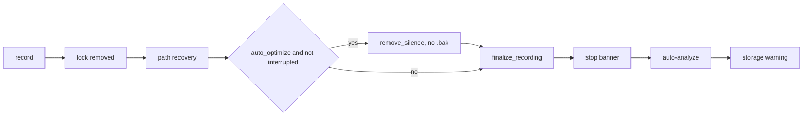

# ADR: Auto-Optimize After Recording

## Status
Accepted (approved by user 2026-11-06, implementation approved)

## Context

REQUIREMENTS.md (approved 2026-11-06, updated the same day for the default-yes prompt) fixes the what: silence-optimize the plain `.cast` right after a recording ends, before compression, without a `.bak` (only idle time is removed), one warning line on failure, `[recording] auto_optimize` with default answer yes, asked once after `agr config migrate` through a general post-migrate prompt registry.

This ADR decides the how: where the hook goes, how `apply_transforms` is reused, backup and compression interplay, interrupted and large recordings, the config version, and the shape of the prompt registry.

### Touch points (verified in code)

- `src/recording.rs` `finish` (line 174): capture inode, remove lock, `resolve_actual_path`, `finalize_recording`, `print_stop`. File is 370 lines.
- `src/recording/finalize.rs` (29 lines): `finalize_recording` gzips per `storage.compression`, prints its own warnings.
- `src/asciicast/transform_ops.rs` `apply_transforms`: parse (whole file in memory), `create_backup` (skips when a `.bak` exists), threshold `idle_time_limit` else 2.0, `SilenceRemoval::new`, atomic `cast.write`. Prints nothing. Callers: TUI optimize (`src/tui/list_app/session_actions.rs:111`) and tests.
- `src/asciicast/silence_removal.rs:88` `SilenceRemoval::new` **panics** on a threshold that is not positive and finite. A header with `idle_time_limit: 0` (or negative) panics `apply_transforms` today.
- `src/storage/compress/file.rs` `finalize` calls `compress_backup` before removing the plain file: `.x.cast.bak` becomes `.x.cast.gz.bak` (verified, gzip bytes, verified equal, then the plain backup is removed). An existing `.x.cast.gz.bak` is never overwritten, the plain backup stays and a warning is returned.
- `src/commands/config.rs` `handle_migrate`: migrate, diff preview, `should_proceed` (`[y/N]`, `--yes` returns true, no TTY returns false with a hint), `atomic_write`.
- `src/config/migrate/mod.rs` `fill_missing_defaults` records every key it inserts in `MigrateResult.added_fields` (`"recording.auto_optimize"`). `CURRENT_VERSION = 4`.
- `src/commands/compress_offer.rs` already injects `ask: impl FnOnce(&str) -> Result<bool>` for tests, same pattern is reused here.

**Correction (fixed in REQUIREMENTS 2026-11-06):** the CLI `agr optimize --remove-silence` (`src/commands/transform.rs` `handle_remove_silence`) does NOT use `apply_transforms` and does NOT create a `.bak`. Only the TUI optimize action does.

## Options Considered

### 1. Where the hook goes

**A. New `optimize_recording` in `src/recording/finalize.rs`, called from `Recorder::finish` between `resolve_actual_path` and `finalize_recording` (recommended).** `finalize.rs` already is "post-process a finished recording", it goes from 29 to about 70 lines, `finish` grows by about 3 lines, `recording.rs` stays around 380 lines. The function is in the library and testable without asciinema (like `finalize_recording` in `tests/integration/recording_test.rs`).

**B. Call optimize inside `finalize_recording`.** Fewer lines in `finish`, but `finalize_recording` then means two things, its existing tests start optimizing (default is now yes) and the interrupted flag has to be threaded in. Rejected.

**C. New `src/recording/optimize.rs`.** One more file for about 30 lines. Rejected, re-open if `finalize.rs` grows past ~200 lines.

### 2. Reuse `apply_transforms` without its backup

`apply_transforms` prints nothing, writes atomically and keeps the format, but always calls `create_backup`. Auto mode must not create a backup (user 2026-11-06), TUI optimize must keep it.

**A. Private `optimize_file(path, backup: bool)` in `transform_ops.rs`, two public wrappers (recommended).** The current body moves into `optimize_file`, the `create_backup` call sits behind `if backup`. `apply_transforms(path)` calls it with `true` (unchanged for TUI and all existing tests), new `remove_silence(path)` calls it with `false` and returns `TransformResult { backup_path: None, backup_created: false, .. }`. One transform path, parse still runs before any backup, atomic `cast.write` stays.

**B. Add a `bool` parameter to `apply_transforms`.** Smallest diff, but every caller and about 15 tests change and a bare `true` at the call site reads badly. Rejected.

**C. Call `AsciicastFile::parse`, `SilenceRemoval` and `write` directly from `recording/finalize.rs`.** Duplicates the threshold resolution and the panic fix below. Rejected.

Root-cause fix in `optimize_file`, so it covers both wrappers: `SilenceRemoval::new` **panics** on a threshold that is not positive and finite, a header with `idle_time_limit: 0` (or negative) crashes TUI optimize today. `optimize_file` returns an error instead (checked before any backup or write).

**Orphaned backup rule dropped.** The earlier "skip when `.x.cast.bak` or `.x.cast.gz.bak` exists" guard only protected against `create_backup` silently trusting a stale backup. Auto mode now neither creates nor reads a backup, so a stale one cannot be mistaken for this recording's original. Note: `compress_backup` would still adopt an orphaned `.x.cast.bak` as `.x.cast.gz.bak` of the new session, that is existing compression behaviour, independent of optimize and out of scope here (re-open in the orphan cleanup work if it shows up).

`check_file_integrity` must NOT be used, it is interactive (repair prompt). A corrupt file simply makes `parse` fail, which is the failure path.

### 3. Optimize and compression interplay

Order in `finish`: lock removed, path recovery, optimize (`remove_silence` rewrites `x.cast` atomically), `finalize_recording` (gzip `x.cast`, verify, remove `x.cast`). No backup is involved, so `compress_backup` finds nothing to convert.

| Failure point | Result on disk | Acceptable |
|---|---|---|
| parse fails (corrupt, truncated) | `x.cast` untouched, then compressed as usual | yes |
| bad header threshold | `x.cast` untouched, then compressed | yes |
| write fails | `x.cast` untouched (atomic temp and rename, temp removed) | yes |
| compression fails after optimize | optimized plain `x.cast` stays, `agr compress` handles it later | yes |

On optimize failure the unoptimized file stays as the session. On success the unoptimized version is gone by design (only idle time removed, user 2026-11-06).

### 4. Interrupted recording (SIGINT / SIGHUP)

Inside a recording the terminal is in raw mode, so Ctrl+C goes to the agent in the PTY, not to agr. `guard.is_interrupted()` is true only when agr itself got SIGINT/SIGHUP (terminal closed, kill).

**Decided (user 2026-11-06): skip optimize when interrupted, compression still runs.** The terminal may be gone, the last line may be truncated, and the less work after a hangup the better. The user can optimize later in the TUI.

### 5. Very large or corrupt recordings

`optimize_file` holds the whole parsed file in memory. The largest real session is 490MB plain, parsed that is roughly 1 to 1.5GB peak, once, at the end of the longest sessions. TUI optimize and analyze already do the same.

**Decided (user 2026-11-06): no size guard.** `remove_silence` gets a `// ponytail: whole file parsed in memory (~2-3x plain size), streaming optimize is the upgrade path, see follow-up issue` comment. A size guard would skip exactly the long sessions that gain the most. Streaming now is new transform code, against the "no new transform code" constraint.

Corrupt files: parse fails, warning, file untouched (table above).

**Follow-up issue text (user files it):**

> **Title:** Stream silence removal instead of parsing the whole recording
>
> **Problem**: `apply_transforms` / `remove_silence` (`src/asciicast/transform_ops.rs`) parse the whole recording into memory before clamping idle time. With auto-optimize on by default this runs after every recording, and for our largest sessions (490MB plain) the peak is around 1 to 1.5GB, right when the user ends a long session. TUI optimize has the same ceiling.
>
> **Approach:** silence removal is a per-event clamp with no state, as such it can stream: read the header line, then per line parse the event, clamp `time` to the threshold, write it out through `codec::atomic_write` (keeps plain and gzip, keeps the atomic temp and rename). Memory becomes one line at a time. Keep the threshold check and the backup flag of `optimize_file`.
>
> **Scope**:
> - **In:** `optimize_file` in `transform_ops.rs`, both `apply_transforms` and `remove_silence` benefit.
> - **Out:** other transforms (dedupe, analyze), they need the whole file.
>
> **Outcome:** peak memory of auto-optimize and TUI optimize independent of recording size, output byte-identical to today (pin with a test comparing old and new path on the fixtures).

### 6. Config version

Main is at v4, sync (#166, unmerged) adds v5 on its branch. This branch takes **v5** (`src/config/migrate/migrations/v5.rs`, empty `migrate` like v4, the default fill adds the key). **Sync must renumber to v6 after this merges** (its `vN.rs`, the `MIGRATIONS` entry, `CURRENT_VERSION`, the default-config snapshot). Whoever merges second renumbers.

Serde default for a missing `auto_optimize` is `true`, same as `Config::default()`, so one default everywhere. A user who upgrades without running migrate gets the default answer (yes), which matches the decision.

### 7. Post-migrate prompt registry

**Where:** `src/config/migrate/prompts.rs` in the library, next to the migrations, no IO. The binary side only supplies the "ask" function.

**Shape (minimal but real):**

```rust
pub struct PostMigratePrompt {
    pub key: &'static str,      // dotted path, "recording.auto_optimize"
    pub question: &'static str, // "Optimize recordings automatically after each session?"
    pub default: bool,
}
pub const PROMPTS: &[PostMigratePrompt] = &[/* auto_optimize */];

/// Ask every prompt whose key this migration newly added, write the answers into the
/// migrated TOML (format-preserving, toml_edit). Returns the new content.
pub fn apply_prompts(
    result: &MigrateResult,
    ask: impl FnMut(&PostMigratePrompt) -> Result<bool>,
) -> Result<String>
```

- **Condition:** fixed to "key is in `result.added_fields`". This is also the idempotency: the default fill only adds missing keys, so once the key exists in the file it is never asked again. A per-entry condition `fn` is added when a second kind of condition really shows up (the compression offer is version-based in `state.toml`, it would need to become a config key first, out of scope).
- **Answer type:** bool only. Same reasoning.
- **Write:** set the dotted key to the bool in the migrated document. Generic, no per-entry code.

**Runner placement in `handle_migrate`:** after the user confirms the migration (or `--yes`), before `atomic_write`, so the file is written once with the answer. If the user declines the migration nothing is written and the question comes back next time (key still missing). Covers both "config exists" and "config created" paths (fresh install also asks, through `install.sh`).

**Ask function (binary, `src/commands/prompt.rs`):** `should_proceed` is `[y/N]` and returns false without a TTY, so it cannot be reused as is. Add `ask_with_default(message, default, auto_confirm) -> Result<bool>`: `auto_confirm` or no TTY returns `default` without asking, otherwise prints `message [Y/n]` (or `[y/N]`) and parses with a pure `parse_answer(input, default)` (empty keeps the default, `y`/`yes`/`n`/`no`, anything else keeps the default). `should_proceed` stays untouched.

**`config migrate --yes`:** applies the migration and writes every prompt's default without asking. Without a TTY and without `--yes`, `should_proceed` already declines the whole migration, so the prompt is never reached (unchanged behaviour).

**Tests without a TTY:** `apply_prompts` takes the `ask` closure (same pattern as `compress_offer::offer_flow`), `parse_answer` is pure. Only the 10-line terminal glue is untested (`tarpaulin_include` off, like `should_proceed`).

### 8. What is dropped (over-engineering check)

- No success line after optimize. Silent on success, one warning on failure. Add a "saved Xs" line if users ask.
- No size guard, no streaming (see 5).
- No per-entry condition or typed answers in the registry (see 7).
- No `check_not_locked` call: our own lock was just removed and nobody else can lock this file.
- No backup in auto mode, no orphaned-backup guard (see 2).

## Decision

1. `transform_ops.rs`: body of `apply_transforms` moves into private `optimize_file(path, backup: bool)`, `apply_transforms` (backup, unchanged behaviour) and new `remove_silence` (no backup) wrap it. `optimize_file` rejects a non-positive or non-finite `idle_time_limit` with an error instead of panicking.
2. `optimize_recording(path, config) -> Option<String>` in `src/recording/finalize.rs`, returns the warning line, prints nothing. `None` when `auto_optimize` is off or the file is missing (path recovery already warned), otherwise `remove_silence`, an error becomes `Auto-optimize failed, kept original: <err>`.
3. `Recorder::finish` calls it after `resolve_actual_path` and before `finalize_recording`, only when `!self.guard.is_interrupted()`, and prints the warning with the same `  \u{26a0} ` prefix as compression.
4. Config v5, `recording.auto_optimize: bool`, default and serde default `true`.
5. Post-migrate prompt registry in `src/config/migrate/prompts.rs`, runner wired into `handle_migrate`, `ask_with_default` in `src/commands/prompt.rs`.

### Flow


Legend: everything up to `finalize_recording` runs inside `Recorder::finish`, sync push hooks in after the storage warning later.

## Consequences

- Auto-optimized recordings have no backup, the original idle time cannot be restored. Accepted by the user, only idle time is removed.
- Recordings without a gap above the threshold are still rewritten (same content, atomic), no visible effect.
- TUI optimize no longer panics on a header with `idle_time_limit <= 0`, and keeps its `.bak` as before.
- Sync (#166) renumbers its migration to v6 and hooks its push after this flow.
- e2e recordings are optimized by default (CI config has no `auto_optimize` key, serde default yes), e2e must still pass.

## To verify during implementation

- Stage 3: no `.x.cast.bak` or `.x.cast.gz.bak` after `optimize_recording` plus `finalize_recording`, under gzip and `"none"`.
- Stage 1: TUI path (`apply_transforms`) still creates the `.bak`, `remove_silence` does not.
- Stage 4: e2e recording with `sh -c 'echo a; sleep 3; echo b'` yields a duration under 3s and no hidden backup.
- Stage 6: running `config migrate --yes` twice asks nothing and changes nothing the second time.

## Decision History

1. 2026-11-06: User replaced the opt-in default (`auto_optimize = false`) with a default answer of yes plus a post-migrate question after `agr config migrate`, Enter keeps yes, no TTY or `--yes` writes the default. The question must be a general registry other features can hook into (sync auto push, compression offer). This replaces REQUIREMENTS fixed decision 1.
2. 2026-11-06: Architect chose `finalize.rs` over a new module, root-cause fix of the threshold panic in `apply_transforms`, stale-backup guard in the auto path only, v5 for this branch with sync renumbering to v6.
3. 2026-11-06: User decisions. Interrupted recordings skip auto-optimize, compression still runs. Auto-optimize keeps NO `.bak` (replaces REQUIREMENTS fixed decision 3), TUI optimize keeps its `.bak`, as such the orphaned-backup guard and the "delete identical .bak" idea are dropped. No size guard, `ponytail:` comment plus follow-up issue for streaming optimize (text in section 5). ADR accepted, implementation approved.
