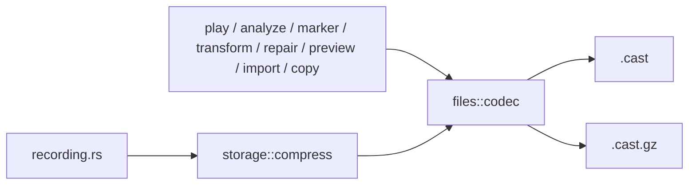
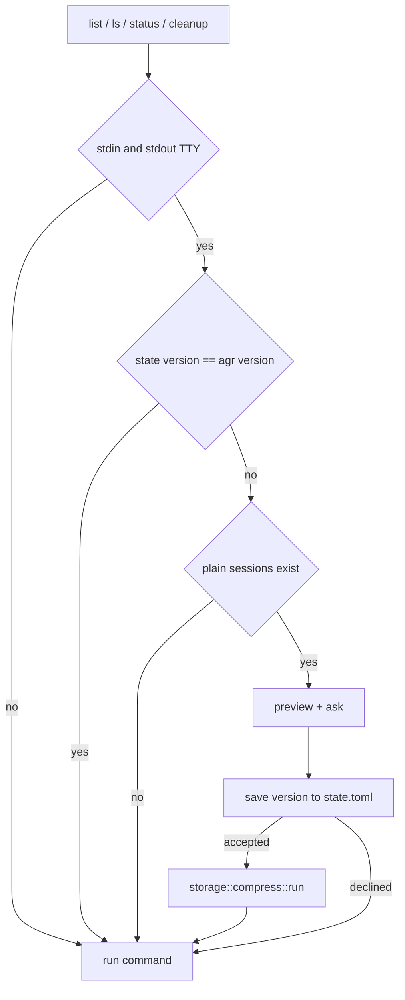

# ADR: Gzip-Compressed Session Storage

## Status
Accepted (approved by user 2026-11-05)

## Context

Sessions are stored as plain asciicast text. On real data this is 6.8G for 721 sessions, the
largest 490MB, which gzip -6 brings down to 52MB. REQUIREMENTS.md (approved) fixes the what:
`.cast.gz` by default, `[storage] compression`, `agr compress` plus a once-per-version offer,
transparent read and write for every command, on-disk size as the primary number.

This ADR decides the how: crate, the shared abstraction and where it lives, naming, offer state,
migration flow, streaming and the clipboard temp file.

Base: branch `feature/gzip-storage` is cut after PR #162 (config v3) merges, as such v4 is the
next config version.

### Touch points (verified in code)

Every one of these assumes a plain `.cast` today. Note that `Path::extension()` on
`x.cast.gz` returns `gz` and `with_extension("cast.tmp")` turns `x.cast.gz` into
`x.cast.cast.tmp`, so every extension check below breaks on gzip, not only the readers.

**Readers (open the file directly)**
- `src/asciicast/reader.rs` `AsciicastFile::parse` (used by player, analyzer service, marker,
  transform command, analyzer result, transform_ops, integrity)
- `src/asciicast/integrity.rs` `diagnose` (File::open) and `repair` (read_to_string)
- `src/storage/mod.rs` `validate_cast_header`
- `src/tui/widgets/file_explorer.rs` `SessionPreview::load_streaming`
- `src/clipboard/copy.rs` `Copy::file` (metadata size check and read_to_string)
- `src/recording.rs` `read_header_line` and `src/files/lock.rs` `find_by_header`,
  `find_by_inode` (live recording only, stays plain, no change)

**Writers and temp files**
- `src/asciicast/writer.rs` `AsciicastFile::write` (`cast.tmp` temp)
- `src/asciicast/integrity.rs` `repair` (`cast.tmp` temp)
- `src/files/backup.rs` `restore_from_backup` (`cast.tmp` temp), `create_backup` (fs::copy)
- `src/asciicast/transform_ops.rs` `apply_transforms` (own fs::copy backup, duplicates
  `create_backup`)
- `src/storage/mod.rs` `import_cast_file` (fs::copy)

**Extension and suffix checks**
- `src/storage/mod.rs` `list_sessions`, `validate_cast_header`, `resolve_filename_conflict`
- `src/files/filename.rs` `rename_file` (keeps only the last extension, would produce `new.gz`)
- `src/commands/{play,analyze,transform,copy}.rs` "not a .cast" warnings
- `src/commands/analyze.rs` rename suggestion `format!("{}.cast")`
- `src/tui/list_app.rs` newest-`.cast` lookup after analyze, rename stem length
- `src/tui/widgets/file_explorer.rs` rename input spans hardcode `.cast`
- `src/tui/cleanup_app.rs` glob select (`*.cast` hint and matching)

**Size and stats**
- `src/storage/mod.rs` `SessionInfo.size`, `StorageStats`, `summary()`, `exceeds_threshold`
- `src/tui/widgets/file_explorer.rs` detail pane `Size:`
- `src/tui/cleanup_app.rs` and `StorageManager::delete_sessions` freed size (already on-disk)

**Not touched**: completions (go through `list_cast_files_short`, so they pick up whatever
`list_sessions` returns), marker command (goes through `MarkerManager`, which goes through
parse/write), lock files (live plain only).

### File size constraint

`src/storage/mod.rs` is 1012 lines, `file_explorer.rs` 2109, `list_app.rs` 2134,
`cleanup_app.rs` 981, `main.rs` 1034. New code must not land in any of these. The storage
module gets split first (Stage 3) because most new storage logic belongs next to it.
(Revised 2026-11-05 by user: no deferral.) Every file this branch touches is brought within
~400 lines in this MR. The TUI files and `main.rs` get their own pure-move split stage
(Stage 21) before the stages that change them (11, 13), so the gzip edits land in small files.

## Options Considered

### 1. Crate

**Option A: `flate2` with `rust_backend` (miniz_oxide)**
- Pros: de facto standard, pure Rust with the backend, no C toolchain, MSRV 1.67 (we declare
  1.70). `GzBuilder` writes mtime 0, no filename and OS 255 unless told otherwise, as such the
  header is deterministic by default. Stream types (`GzEncoder<W: Write>`, `GzDecoder<R: Read>`)
  plug straight into `BufReader` and the existing `parse_reader`.
- Cons: miniz_oxide is a bit slower than zlib-ng (irrelevant at our sizes, compress runs once
  per session).

**Option B: `flate2` with `zlib-ng`**
- Pros: faster.
- Cons: C build dependency, cross builds get harder. Requirements prefer pure Rust.

**Option C: `miniz_oxide` directly or `libdeflater`**
- Pros: one less layer.
- Cons: no gzip framing (we would write header, CRC and trailer ourselves) or C dependency.
  Writing gzip framing by hand is exactly the code we do not want to own.

**Decision: Option A.** `flate2 = { version = "1.1", default-features = false, features =
["rust_backend"] }`. Encoder built with `GzBuilder::new()` (no name, no mtime, no comment) and
`Compression::new(6)`. Decoder is `GzDecoder` (single member, matches what we write).

Determinism note for #164: same content and same miniz_oxide version gives the same bytes. A
future miniz_oxide upgrade could change the deflate output. If sync hashes must survive that,
#164 should hash the decoded content (CRC32 is in the trailer already). Re-open only if #164
needs byte-stable output across crate upgrades.

### 2. Shared abstraction shape

**Option A: per-call-site `if is_gzip { GzDecoder } else { File }`**
- Cons: the exact per-command special casing the requirements forbid. Rejected.

**Option B: `SessionFile` struct wrapping path plus format, with methods**
- Pros: one type to pass around.
- Cons: every API that takes `&Path` today would change signature (parse, write, backup,
  marker, clipboard, analyzer). Large blast radius for no behavior gain, the format is fully
  derivable from the path.

**Option C: a small free-function module keyed on the path suffix**
- Pros: callers keep passing `&Path`. The format is decided once, from the suffix, in one
  place. Fits the existing `files/` helpers style (`backup_path_for`, `lock_path_for`,
  `hidden_auxiliary_path`).
- Cons: format detection is by name, not by magic bytes. A misnamed file fails with a decode
  error naming the file, which is acceptable.

**Decision: Option C, module `src/files/codec.rs`.**

It lives in `src/files/` and not `src/storage/` because `asciicast` already depends on
`files` (`transform_ops` uses `files::backup`), and `asciicast` depending on `storage` would
invert the layering. When the deferred `files` to `storage` restructure
(`.state/refactor-files-to-storage-module/ADR.md`) happens, `codec.rs` moves with the rest.

Public surface (names are a first vision, implementer may adjust):

- `SESSION_SUFFIX = ".cast"`, `GZIP_SUFFIX = ".cast.gz"`
- `is_gzip_path(path) -> bool`, `is_session_path(path) -> bool` (visible `.cast` or `.cast.gz`,
  hidden dot files excluded)
- `session_suffix(path) -> &str` and `session_stem(name) -> &str` (strip `.cast.gz` or `.cast`)
- `temp_path_for(path) -> PathBuf` (hidden, `.x.cast.gz.tmp`, via `hidden_auxiliary_path`)
- `open_reader(path) -> Result<Box<dyn BufRead>>` (gunzip when the suffix is `.cast.gz`, errors
  carry the file path)
- `atomic_write(path, write_fn) -> Result<()>` (hidden temp, gzip encoder when the target
  suffix is `.cast.gz`, `finish`, `sync_all`, rename, temp removed on failure)
- `transcode(src, dst) -> Result<()>` (`open_reader(src)` into `atomic_write(dst)` via
  `io::copy`, the one primitive behind compress and import)
- `same_content(a, b) -> Result<bool>` (decoded byte streams compared chunk by chunk, used for
  verify)
- `uncompressed_size(path) -> Result<UncompressedSize>` (gzip trailer ISIZE, plain file length)

`UncompressedSize` is `Exact(u64)` or `Over4GiB`. (Revised 2026-11-05 after pair review, see
Decision History: the earlier 64x-ratio rule flagged every session over ~67MB on disk as
"4GiB+".)

Our writer stores the exact uncompressed size in the gzip header as an FEXTRA subfield
(RFC 1952 2.3.1.1): subfield id `AG`, length 8, little-endian u64. Standard tools (`zcat`,
`gzip -t`) ignore it, output stays deterministic (same content gives the same bytes).
The size is only known after compressing, so `atomic_write` writes the subfield with a zero
placeholder into the temp file, finishes the encoder, then seeks back and patches the 8 bytes
at their fixed offset (no FHCRC, so nothing else depends on header bytes) before `sync_all`
and rename. `uncompressed_size` reads the header via `GzDecoder::header().extra()`, which
needs only the first bytes of the file.

Fallback for `.cast.gz` files without the subfield (compressed by other tools): trust the
4-byte trailer ISIZE as `Exact`, except `Over4GiB` when ISIZE is smaller than the on-disk
size, which can only happen after a wrap for real recordings.
`// ponytail:` ceiling is foreign gzip files over 4GiB uncompressed whose wrapped ISIZE is
still larger than the on-disk size, they show a wrong number. `agr compress` never produces
those, rewriting such a file through our writer fixes it.

Writers do not need a "remember the source format" flag. `AsciicastFile::write(path)` writes
gzip when `path` ends in `.cast.gz`, so rewriting a session in place keeps its format by
construction, and `agr optimize --output foo.cast` writes plain.

Legend: every reader and writer goes through `files::codec`, only `storage::compress` and import
change a session's format.

### 3. File naming

**Decision:** `<name>.cast.gz`, the `.cast` stays. Auxiliary files derive from the full on-disk
filename through `hidden_auxiliary_path`: `.x.cast.gz.bak`, `.x.cast.gz.tmp`. Lock files stay
`.x.cast.lock` because only live (plain) recordings are locked.

- **Identity:** a session is its stem. `list_sessions` collects `.cast` and `.cast.gz`, skips
  hidden files, and when both `x.cast` and `x.cast.gz` exist (crash between rename and source
  removal) lists only `x.cast.gz`. The leftover `x.cast` is picked up by `agr compress`, which
  verifies it against the existing `.cast.gz` and removes it, or skips it with a warning when
  they differ.
- **Resolve:** `resolve_cast_path` and `find_cast_file_by_name` try the name as given, then the
  other variant (`x.cast` to `x.cast.gz` and back), then match by stem.
- **Rename:** `rename_file` keeps the full session suffix and moves the backup (already does,
  through `backup_path_for`).
- **Backups across compression:** when a plain session with a backup is compressed, its
  `.x.cast.bak` is transcoded to `.x.cast.gz.bak` by the same primitive, so restore stays a
  byte copy and keeps the format.

### 4. Where the per-version offer state lives

**Option A: key in `config.toml`** (e.g. `[storage] compress_offer_version`)
- Pros: no new file.
- Cons: mixes runtime state into a user-edited file, `config migrate` and `config show` would
  show it, writing it from a normal command means rewriting the user's config.

**Option B: hidden file in the storage directory** (`<storage>/.agr-state.toml`)
- Pros: travels with the data.
- Cons: the storage dir is what #164 syncs, two machines would fight over it. Also exactly the
  filesystem pollution the user rejected in the hidden-files ADR (decision history item 2).

**Option C: `~/.config/agr/state.toml`** next to the config, machine-local
- Pros: clean split of config (user intent) and state (what agr remembers), never synced,
  trivial TOML `compress_offer_version = "0.3.0"`. Room for later state without touching
  config.
- Cons: one new file under `~/.config/agr/`.

**Decision: Option C**, module `src/config/state.rs` (load returns default on missing or
broken file, save writes atomically). Flagged for the user given the earlier "no metadata
file" preference.

### 5. Migration flow

**Config:** `src/config/migrate/migrations/v4.rs` inserts `storage.compression = "gzip"` when
the key is missing (explicit, same pattern as v2/v3, records it in `added_fields`).
`CURRENT_VERSION = 4`. The type is a serde enum `Compression { Gzip, None }` with
`rename_all = "lowercase"`. Invalid values are rejected by serde at load time with
"unknown variant `zstd`, expected `gzip` or `none`" plus the config path from `Config::load`,
which is clear enough, no custom validation code.

**Sessions** (never in `StorageManager::new()` and never in `storage/migrate.rs`, those run
silently):

Legend: the offer is made at most once per agr version and only on storage-management commands.

The offer runs only before `list`/`ls`, `status` and `cleanup`. Not on `record` (the shell
wrapper runs `agr record` every time an agent starts, a prompt there blocks the agent), not on
`play`/`analyze`/`copy`/`marker` (single-file commands where a bulk prompt is surprising), not
on `completions` (machine output). Flagged for the user.

`agr compress [--agent X] [--yes]` and the offer share one code path in
`src/storage/compress.rs`:

1. `plan(storage, agent) -> CompressPlan` lists plain sessions, splits off live-locked ones
   (`lock::check_not_locked`, which already cleans stale locks), and estimates the projected
   size.
2. Preview prints count, current size, projected size, savings, and skipped live sessions.
3. `run(plan) -> CompressReport` compresses one file at a time, per-file errors are collected,
   never abort. Report: compressed, skipped, failed (with reason), bytes saved.

`compress_file(path)`: `transcode` to `x.cast.gz` (hidden temp, atomic rename), `same_content`
verify, then remove `x.cast`, then transcode the backup if one exists. Any failure before the
plain file is removed leaves the plain file untouched and removes the temp or the unverified
`.cast.gz`.

**Projected size estimate:** compress the first 64KiB of each plain file in memory and scale
by its file size. Cheap (721 files read ~45MB), shown with a "~".
`// ponytail:` sample-based, a session whose head compresses very differently from its tail
gets a rough number. Upgrade path is a larger sample. The same estimator feeds the `agr status`
"would save" line.

**Recording:** in `Recorder::record`, after `remove_lock` and `resolve_actual_path`, when
`compression = "gzip"` call `compress::compress_file(&actual_path)`. On error print a warning
and keep the plain path. The final box line and auto-analyze use the resulting path. Sequential
and blocking, a 490MB session takes a few seconds, which is acceptable right after a session
ends.

### 6. Streaming vs temp decompress

**Decision: stream** (resolved in REQUIREMENTS). `open_reader` returns a `BufRead` over
`GzDecoder`, `parse_reader`, `diagnose` and the preview loader consume it line by line.
`repair` changes from `read_to_string` to streaming through `open_reader` into `atomic_write`,
which also lowers its memory today. A truncated or corrupt `.cast.gz` surfaces as an io error
from the decoder (`GzDecoder` errors on a missing or wrong CRC/ISIZE trailer at EOF), wrapped
with the file path, never a silent partial parse. A decoder error is terminal: `diagnose`
records it once and stops (a gzip stream cannot resume after a decode error, retrying loops
forever, found in Batch 4 review), `repair` aborts with the error.

### 7. Clipboard temp file

The file reference path (osascript `POSIX file`, xclip `text/uri-list`) puts a path on the
clipboard, the receiving app reads the file at paste time, which is after `agr copy` has
exited. Deleting the temp right after copy (as written in REQUIREMENTS) makes the paste fail.

**Option A: delete immediately** (as written). Paste of a `.cast.gz` session is broken on macOS.

**Option B: fixed per-user location, replaced on the next copy.** Decompress to
`<tmp>/agr-clipboard/<stem>.cast`, the directory is cleared before each copy (so at most one
leftover), and removed on any failure. The OS cleans `<tmp>` on reboot.

**Option C: text copy only for gzip sessions.** Breaks paste-as-attachment, which is the main
reason `agr copy` exists.

**Decision: Option B**, pending user confirmation since it changes an acceptance criterion
("temporary decompressed file is removed after copy"). The text fallback reads through
`open_reader` and checks `MAX_CONTENT_SIZE` against `uncompressed_size`. Plain sessions keep the
exact current path. Lives in a new `src/clipboard/plain_copy.rs` so `copy.rs` stays small.

## Decision

1. `flate2` with `rust_backend`, deterministic `GzBuilder` header, level 6.
2. Free-function codec module `src/files/codec.rs`, format decided by suffix, every reader and
   writer routes through it, `transcode` is the single format-changing primitive.
3. `<name>.cast.gz`, stem identity, aux files from the full filename, `.cast.gz` wins on
   duplicates.
4. Offer state in `~/.config/agr/state.toml` (`src/config/state.rs`).
5. Config v4 adds the key, session compression only through `storage::compress` (command,
   offer, post-recording), offer only on list/status/cleanup with a TTY.
6. Streaming everywhere, no temp decompress for reading.
7. Clipboard file reference uses a fixed replace-on-next-copy temp location.

### Module layout

- `src/files/codec.rs` (new): format helpers and streams.
- `src/storage/mod.rs`: split into `sessions.rs` (SessionInfo, listing, resolve),
  `stats.rs` (StorageStats, disk percentage), `import.rs` (ImportError, validation, import),
  `mod.rs` keeps `StorageManager` struct, `new`, dirs, delete, threshold. Inline tests move to
  `tests/integration/storage_test.rs`.
- `src/storage/compress.rs` (new): plan, estimate, compress_file, run, report.
- `src/config/state.rs` (new): offer state.
- `src/config/migrate/migrations/v4.rs` (new).
- `src/commands/compress.rs` (new): `agr compress` handler and preview/report printing.
- `src/commands/compress_offer.rs` (new): TTY and version gate, calls the same preview and run.
- `src/commands/prompt.rs` (new): `should_proceed` moved out of `commands/config.rs` so config
  migrate, config reset and compress share one confirm prompt.
- `src/clipboard/plain_copy.rs` (new): decompress-to-temp for file references.

### Quality guards for implementers

- `cargo clippy -- -D warnings` and SonarCloud zero new issues on touched files. Pass method
  references instead of trivial closures (rust:S1612), e.g. `.map(PathBuf::from)` not
  `.map(|p| PathBuf::from(p))`, `.filter_map(Result::ok)`.
- ~400 lines per new file, ~20 lines per function, max 3 nesting levels.
- New tests in `tests/integration/`, existing inline test modules may get the minimal update
  their file already needs.

## Consequences

- **Easier:** one place decides format, every command works on both, new codecs later are one
  enum variant plus a branch in `open_reader` and `atomic_write`. #164 gets stable names and
  deterministic bytes.
- **Harder:** `Path::extension()` is no longer safe for sessions, contributors must use
  `codec::is_session_path` and `session_stem`. Writing a `.cast.gz` costs CPU on every marker
  add and transform (fine at our sizes).
- **Follow-ups:** `agr decompress` (out of scope). Oversized files this branch touches are
  split in this MR (Stages 19, 21), not deferred.
  FEXTRA size field if the 64x wrap heuristic ever bites.

## To verify during implementation

- Stage 1: `GzDecoder` returns an error (not `Ok(0)`) on a truncated stream with the flate2
  version we pin. Add a test with a file cut in half and one with a flipped trailer byte.
- Stage 1: two `atomic_write` runs of identical content produce identical bytes.
- Stage 2: the config migrate snapshot (`complete_default_config_snapshot`) changes by exactly
  the new `compression` line.
- Stage 12: whether `SessionPreview` is the right carrier for the uncompressed size in the
  detail pane (it is loaded lazily and cached, so the 4-byte trailer read happens once per
  selection, not per frame).
- Stage 13: memory of play/analyze on a generated 100MB `.cast.gz` stays near the plain case
  (parsed file is held in memory in both cases, the decoder adds a fixed 32KiB window).

## Decision History

1. Chose path-suffix free functions over a `SessionFile` type to keep every `&Path` API stable.
2. Put the codec in `files/` to keep `asciicast` from depending on `storage`.
3. Moved offer state out of config and storage dir into `~/.config/agr/state.toml`.
4. Found that deleting the clipboard temp breaks file-reference paste, proposed replace on next
   copy instead (needs user sign-off).
- 2026-11-05: Accepted by user. Clipboard: decompress to `<tmp>/agr-clipboard/<stem>.cast`, folder cleared before each copy (at most one leftover), removed on failure. Offer state in `~/.config/agr/state.toml`. Offer only on list/ls, status, cleanup with a TTY, never on record.
- 2026-11-05: Uncompressed size rule revised (pair review found the 64x rule flagged sessions over ~67MB on disk as "4GiB+"). User chose: exact size stored in a gzip FEXTRA subfield by our writer, trailer fallback for foreign files.
- 2026-11-05: Batch 4 review decisions by user. Clipboard: a `.cast.gz` is handed over as a file reference at any size like a plain `.cast`, the 10MB limit only applies to the text fallback. Temp dir is `<tmp>/agr-clipboard-<uid>`, refused if it is a symlink or not owned by the current user, created 0700. Oversized files touched by this branch are split in this MR.
- 2026-11-05: Long functions: user chose to split only functions that gzip stages change, moved-but-untouched TUI functions stay as they are. Windows: compile check in CI (`cargo check` for x86_64-pc-windows-msvc), Windows stays unsupported at runtime. `repair` removes invalid-UTF-8 lines (confirmed by the user's prompt, matches `diagnose`). Pre-uid `<tmp>/agr-clipboard` dirs are left alone (one stale copy at most).
- 2026-11-05: Stage 23. `repair` dropping invalid-UTF-8 lines is pinned by a test. Dir fsync warnings go through a process-wide sink in `files::codec` (`set_warning_sink`), `tui::app::warnings::WarningGuard` (held by `App`) queues them for the status line and restores stderr on drop. `uncompressed_size` on foreign multi-member gzip reports the last member only. Trailing non-gzip bytes after the last member make `open_reader` error with the path, no silent truncation (pinned by a test, a single-member `GzDecoder` would swallow them).
- 2026-11-05: MSRV: declared 1.70 was never enforced and the code already needs newer APIs. User chose: bump `rust-version` to the real minimum and enforce it with a CI job on that toolchain.
