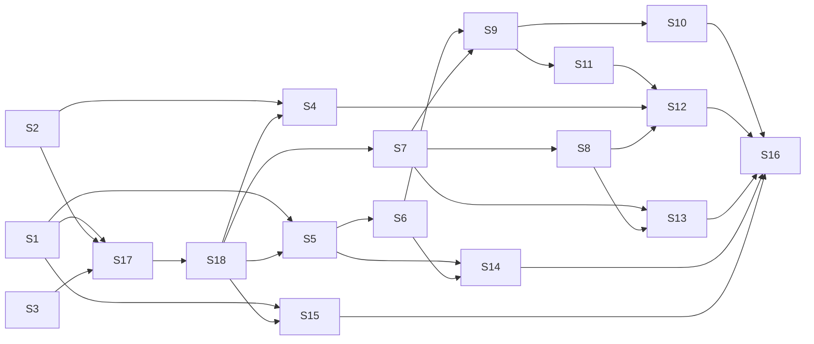

# Plan: Gzip-Compressed Session Storage

References: ADR.md, REQUIREMENTS.md

Every stage is TDD (RED test first, GREEN minimal code, REFACTOR), ends with `cargo fmt`,
`cargo clippy -- -D warnings` and `cargo test`. No trivial closures where a method reference
works (SonarCloud rust:S1612). New files stay under ~400 lines, functions ~20 lines, nesting
max 3. New tests go in `tests/integration/`.

## Open Questions

1. Exact projected-size sample length (ADR says 64KiB), tune in Stage 9 if the estimate is
   more than ~20% off on the fixture set.
2. Whether `SessionPreview` or `FileItem` carries the uncompressed size for the detail pane
   (Stage 13, see ADR "To verify").

## Stages

### Stage 1: Codec module and flate2 dependency

Goal: `src/files/codec.rs` with suffix helpers, `open_reader`, `atomic_write`, `transcode`,
`same_content`, `uncompressed_size`. No callers yet.
Owner: implementer

- [x] Add `flate2 = { version = "1.1", default-features = false, features = ["rust_backend"] }`.
- [x] RED/GREEN: `is_gzip_path`, `is_session_path` (accepts `x.cast`, `x.cast.gz`, rejects
      `.x.cast.gz.bak`, `.x.cast.gz.tmp`, `.x.cast.lock`, `x.gz`, `x.txt`).
- [x] RED/GREEN: `session_stem` strips `.cast.gz` then `.cast`, `session_suffix` returns the
      matching suffix.
- [x] RED/GREEN: `temp_path_for(dir/x.cast.gz)` is `dir/.x.cast.gz.tmp` (via
      `hidden_auxiliary_path`).
- [x] RED/GREEN: `atomic_write` to `.cast.gz` yields a file `GzDecoder` decodes to the input,
      to `.cast` yields plain bytes, temp removed on write error.
- [x] RED/GREEN: determinism, two writes of the same content are byte-identical, header has
      mtime 0, no FNAME.
- [x] RED/GREEN: `open_reader` on plain and gzip yields the same lines.
- [x] RED/GREEN: truncated `.cast.gz` and flipped trailer byte give an error whose message
      contains the file path.
- [x] RED/GREEN: `transcode` plain to gzip and back is lossless, `same_content` true for a
      plain/gzip pair and false after one byte changes.
- [x] RED/GREEN: `uncompressed_size` returns trailer ISIZE for gzip, file length for plain,
      `Over4GiB` when the 64x wrap rule triggers (unit test on the pure decision function with
      synthetic numbers, no 4GiB file).

Files: `Cargo.toml`, `Cargo.lock`, `src/files/codec.rs`, `src/files/mod.rs`,
       `tests/integration/codec_test.rs`, `tests/integration.rs`
Depends on: none

Considerations:
- `atomic_write` takes `FnOnce(&mut dyn Write) -> Result<()>` so `AsciicastFile::write_to` and
  `io::copy` both fit. Call `GzEncoder::finish()` before `sync_all`.
- Gzip output must be single-member and readable by `zcat` (e2e check in Stage 16).

### Stage 2: Config v4 and Compression enum

Goal: `[storage] compression = "gzip" | "none"`, default gzip, versioned migration v4.
Owner: implementer

- [x] RED: `migrate_config("config_version = 3\n[storage]\n")` yields `compression = "gzip"` and
      `config_version = 4`, field listed in `added_fields`.
- [x] RED: an existing `compression = "none"` is kept by v4.
- [x] RED: loading `compression = "zstd"` fails with a message naming the allowed values.
- [x] GREEN: `Compression` enum (`serde(rename_all = "lowercase")`, `Default = Gzip`) on
      `StorageConfig`, `migrations/v4.rs`, register in `MIGRATIONS`, `CURRENT_VERSION = 4`.
- [x] Add the key to `src/config/docs.rs` field docs, accept the updated default-config
      snapshot (only the new line may change).

Files: `src/config/types.rs`, `src/config/migrate/mod.rs`,
       `src/config/migrate/migrations/mod.rs`, `src/config/migrate/migrations/v4.rs`,
       `src/config/docs.rs`, `src/config/migrate/snapshots/agr__config__migrate__tests__complete_default_config_snapshot.snap`,
       `tests/integration/config_test.rs`
Depends on: none

Considerations:
- Rebase onto main after #162 merges, v3 must exist.
- `src/config/migrate/mod.rs` is over 400 lines already, only the constant changes here.

### Stage 3: Split src/storage/mod.rs (no behavior change)

Goal: bring `src/storage/mod.rs` (1012 lines) under the limit before adding logic.
Owner: implementer

- [x] Move `SessionInfo`, `format_smart_time`, `list_sessions`, `resolve_cast_path`,
      `find_cast_file_by_name`, `list_cast_files_short` to `src/storage/sessions.rs`
      (as `impl StorageManager` blocks where they are methods).
- [x] Move `StorageStats`, `get_stats`, `calculate_disk_percentage`, `query_disk_total_bytes`
      to `src/storage/stats.rs`.
- [x] Move `ImportError`, `validate_agent_name`, `validate_cast_header`,
      `resolve_filename_conflict`, `import_cast_file` to `src/storage/import.rs`.
- [x] Re-export from `mod.rs` so every existing `crate::storage::X` / `agr::storage::X` import
      still resolves.
- [x] Move the inline `#[cfg(test)]` tests to `tests/integration/storage_test.rs` (private
      helpers they need become `pub(crate)` or are tested through the public API).
- [x] `cargo test` passes with zero changes outside `src/storage/` and the test file.

Files: `src/storage/mod.rs`, `src/storage/sessions.rs`, `src/storage/stats.rs`,
       `src/storage/import.rs`, `tests/integration/storage_test.rs`
Depends on: none

Considerations:
- Pure move, review with `git diff --color-moved`.

### Stage 4: Offer state file

Goal: `~/.config/agr/state.toml` with `compress_offer_version`.
Owner: implementer

- [ ] RED: load from a missing file returns default (`None`).
- [ ] RED: load from a malformed file returns default, does not error.
- [ ] RED: save then load round-trips `"0.3.0"`, save is atomic (temp + rename).
- [ ] GREEN: `src/config/state.rs` with `State { compress_offer_version: Option<String> }`,
      `load_from(path)`, `save_to(path)`, plus `load()` / `save()` using `config_dir()`.

Files: `src/config/state.rs`, `src/config/mod.rs`, `tests/integration/config_test.rs`
Depends on: Stage 2, Stage 18

Considerations:
- Path-taking variants keep tests off the real home directory.

### Stage 5: Asciicast read, write and repair through the codec

Goal: parse, write, diagnose and repair work on `.cast.gz`, and writes keep the format.
Owner: implementer

- [ ] RED: `AsciicastFile::parse(x.cast.gz)` equals parse of the plain twin.
- [ ] RED: `write(x.cast.gz)` produces gzip, `write(x.cast)` plain, no `x.cast.cast.tmp` left.
- [ ] RED: `diagnose` and `repair` on a gzip file with a corrupt line, the repaired file is
      still gzip and the bad line is gone.
- [ ] RED: `MarkerManager::add_marker` on `.cast.gz` keeps the file gzip.
- [ ] GREEN: `parse` uses `codec::open_reader`, `write` uses `codec::atomic_write`, `diagnose`
      uses `open_reader`, `repair` streams `open_reader` into `atomic_write` (drops
      `read_to_string`).

Files: `src/asciicast/reader.rs`, `src/asciicast/writer.rs`, `src/asciicast/integrity.rs`,
       `tests/integration/asciicast_test.rs`, `tests/integration/markers_test.rs`
Depends on: Stage 1, Stage 18

Considerations:
- Inline tests in `integrity.rs` and `transform_ops.rs` assert `with_extension("cast.tmp")`
  is absent, update those to `codec::temp_path_for`.

### Stage 6: Backup, restore and rename keep the full suffix

Goal: `.x.cast.gz.bak` byte copies, restore via hidden temp, rename keeps `.cast.gz`.
Owner: implementer

- [ ] RED: `create_backup(x.cast.gz)` creates `.x.cast.gz.bak` byte-identical to the source.
- [ ] RED: `restore_from_backup(x.cast.gz)` restores bytes exactly, no `x.cast.cast.tmp`.
- [ ] RED: `rename_file(dir/x.cast.gz, "y")` gives `dir/y.cast.gz` and moves the backup to
      `.y.cast.gz.bak`.
- [ ] RED: rename length check counts the full `.cast.gz` suffix.
- [ ] GREEN: `restore_from_backup` temp via `codec::temp_path_for`, `rename_file` uses
      `codec::session_stem`/`session_suffix` instead of `extension()`.
- [ ] REFACTOR: `transform_ops::apply_transforms` calls `backup::create_backup` instead of its
      own `fs::copy` (one backup code path).

Files: `src/files/backup.rs`, `src/files/filename.rs`, `src/asciicast/transform_ops.rs`,
       `tests/integration/filename_test.rs`
Depends on: Stage 1, Stage 5

Considerations:
- `transform_ops` writes through `AsciicastFile::write`, as such its gzip test needs Stage 5.

### Stage 7: Session listing, resolve and import handle both formats

Goal: sessions listed once by stem, lookup accepts either name, import compresses per config.
Owner: implementer

- [ ] RED: `list_sessions` returns `x.cast` and `y.cast.gz`, never hidden `.y.cast.gz.bak`
      or `.y.cast.gz.tmp`.
- [ ] RED: with both `x.cast` and `x.cast.gz` present only `x.cast.gz` is listed.
- [ ] RED: `resolve_cast_path("agent/x.cast")` finds `x.cast.gz` when only that exists, and
      the other way round, same for `find_cast_file_by_name` and absolute paths.
- [ ] RED: completions (`list_cast_files_short`) include `.cast.gz` sessions.
- [ ] RED: import of `.cast.gz` with valid content succeeds, with non-asciicast content fails
      `InvalidFormat`, a plain `.cast` under gzip config lands as `<name>.cast.gz`, a
      `.cast.gz` under `none` lands as plain `<name>.cast`.
- [ ] RED: conflict suffixing works on `.cast.gz` (`x-1.cast.gz`) and checks both variants.
- [ ] GREEN: `is_session_path` in listing, dedupe by stem, resolve fallbacks, header check via
      `open_reader`, import via `codec::transcode` (or `fs::copy` when formats match).

Files: `src/storage/sessions.rs`, `src/storage/import.rs`, `tests/integration/storage_test.rs`,
       `tests/integration/import_test.rs`
Depends on: Stage 1, Stage 2, Stage 3, Stage 17, Stage 18

Considerations:
- `ImportError::WrongExtension` message becomes "Expected .cast or .cast.gz".
- TUI import (`list_app.rs`) calls `import_cast_file`, no change needed there.

### Stage 8: Storage tracking with uncompressed size

Goal: on-disk size stays primary, uncompressed size shown in status and list.
Owner: implementer

- [ ] RED: `SessionInfo` exposes `uncompressed_size()` via `codec::uncompressed_size` (trailer
      read, test asserts it works on a file whose body is garbage after a valid trailer, as
      proof there is no decompress).
- [ ] RED: `StorageStats.total_size` equals the sum of on-disk sizes, a new
      `uncompressed_total` is the sum of uncompressed sizes (or flags "4GiB+" when any part
      overflowed).
- [ ] RED: `summary()` shows both numbers, plus plain session count.
- [ ] RED: `exceeds_threshold` compares on-disk size.
- [ ] GREEN: implement in `stats.rs`, `agr list` table gets an uncompressed column.

Files: `src/storage/stats.rs`, `src/commands/status.rs`, `src/commands/list.rs`,
       `src/commands/cleanup.rs`, `tests/integration/storage_test.rs`
Depends on: Stage 7

Considerations:
- `commands/cleanup.rs` builds a mock `StorageStats`, add the new field there in the same
  stage if it breaks compilation (it is only a test helper).

### Stage 9: Compress core (shared by command, offer and recording)

Goal: `src/storage/compress.rs` with `plan`, `estimate`, `compress_file`, `run`, report.
Owner: implementer

- [ ] RED: `compress_file(x.cast)` leaves only `x.cast.gz`, content equal, no temp left.
- [ ] RED: failure injection (read-only dir, verify mismatch) leaves `x.cast` untouched and
      no `x.cast.gz` or temp behind.
- [ ] RED: an existing `.x.cast.bak` becomes `.x.cast.gz.bak` with equal decoded content.
- [ ] RED: `plan` skips sessions with a live lock (current PID) and reports them, a stale lock
      is cleaned and the file is eligible.
- [ ] RED: `plan` with an agent filter only includes that agent.
- [ ] RED: `run` continues after a per-file failure, report counts compressed, skipped,
      failed, bytes saved.
- [ ] RED: idempotent, a second `run` finds nothing to do.
- [ ] RED: leftover `x.cast` next to an equal `x.cast.gz` is removed, a differing one is
      skipped with a warning.
- [ ] RED: `estimate` is within 2x of the real size on the fixture files.
- [ ] GREEN: implement, `pub mod compress;` in `storage/mod.rs`.

Files: `src/storage/compress.rs`, `src/storage/mod.rs`, `tests/integration/compress_test.rs`,
       `tests/integration.rs`
Depends on: Stage 1, Stage 3, Stage 6, Stage 7

Considerations:
- No printing in this module, it returns data, commands do the output.

### Stage 10: Compress after recording

Goal: finished recordings become `.cast.gz` when `compression = "gzip"`.
Owner: implementer

- [ ] RED: helper `finalize_recording(path, &config)` returns `x.cast.gz` with gzip config and
      `x.cast` with `none`.
- [ ] RED: on compress failure it returns the plain path and the plain file still exists.
- [ ] GREEN: call it in `Recorder::record` after `remove_lock` and `resolve_actual_path`, use
      its result for the final box line and `maybe_auto_analyze`, print a warning on failure.

Files: `src/recording.rs`, `tests/integration/recording_test.rs`
Depends on: Stage 2, Stage 9

Considerations:
- Live recording code (lock, inode, header recovery) stays untouched and plain.
- Keep `recording.rs` under 400 lines, the helper is a few lines delegating to
  `compress::compress_file`.

### Stage 11: agr compress command

Goal: `agr compress [--agent X] [--yes]` with dry-run preview and confirm prompt.
Owner: implementer

- [ ] Move `should_proceed` from `commands/config.rs` to `commands/prompt.rs`, config migrate
      and reset use it (no behavior change, existing tests pass).
- [ ] RED: CLI parse tests for `compress`, `--agent`, `--yes` (in `tests/integration`).
- [ ] RED: help snapshot for `agr compress --help`, main help snapshot lists it.
- [ ] RED: `agr compress --yes` (assert_cmd, temp storage via config env or HOME) compresses
      and prints the report, without `--yes` and no TTY it prints the preview and changes
      nothing.
- [ ] GREEN: `Commands::Compress` in `cli.rs`, dispatch in `main.rs`, handler in
      `commands/compress.rs` (preview print, prompt, `compress::run`, report print).

Files: `src/cli.rs`, `src/main.rs`, `src/commands/mod.rs`, `src/commands/compress.rs`,
       `src/commands/prompt.rs`, `src/commands/config.rs`,
       `tests/integration/snapshot_cli_test.rs`, `tests/integration/snapshots/`,
       `tests/integration/compress_test.rs`
Depends on: Stage 9

Considerations:
- `main.rs` is over the limit, only add the dispatch arm.

### Stage 12: Auto-migrate offer and status savings line

Goal: once-per-version offer on list/status/cleanup, `agr status` shows plain count and
projected savings.
Owner: implementer

- [ ] RED: gate function `should_offer(is_tty, state_version, current_version, plain_count)`
      truth table (no TTY never, same version never, zero plain never).
- [ ] RED: accepting and declining both save the current version, a second call does not offer.
- [ ] RED: non-TTY run of `agr status` never prompts and never rewrites (assert_cmd).
- [ ] RED: `agr status` with plain sessions shows "N plain, ~X saved by agr compress".
- [ ] GREEN: `commands/compress_offer.rs` (gate, reuses preview and run from
      `commands/compress.rs`), called at the start of `list`, `status`, `cleanup` handlers.

Files: `src/commands/compress_offer.rs`, `src/commands/mod.rs`, `src/commands/list.rs`,
       `src/commands/status.rs`, `src/commands/cleanup.rs`, `tests/integration/compress_test.rs`
Depends on: Stage 4, Stage 8, Stage 11

Considerations:
- Version is `env!("CARGO_PKG_VERSION")`.
- TTY check uses `atty` (already a dependency) on stdin and stdout.

### Stage 13: TUI on compressed sessions

Goal: ls/cleanup TUI preview, rename, analyze follow-up and detail pane work on `.cast.gz`.
Owner: implementer

- [ ] RED: `SessionPreview::load` on `.cast.gz` equals the plain twin (duration, markers,
      preview lines).
- [ ] RED: rename spans show the real suffix (`.cast.gz`) instead of a hardcoded `.cast`.
- [ ] RED: rename stem length limit uses the full suffix.
- [ ] RED: detail pane shows on-disk size and uncompressed size (snapshot).
- [ ] RED: cleanup TUI deletes a `.cast.gz` with its hidden backup and reports on-disk size
      freed.
- [ ] GREEN: `load_streaming` via `codec::open_reader`, suffix via `codec::session_suffix`,
      newest-session lookup after analyze via `codec::is_session_path`, rename stem via
      `codec::session_stem`, cleanup glob hint mentions `*.cast*`.

Files: `src/tui/widgets/file_explorer.rs`, `src/tui/list_app.rs`, `src/tui/cleanup_app.rs`,
       `tests/integration/preview_test.rs`, `tests/integration/file_explorer_test.rs`,
       `tests/integration/snapshot_tui_test.rs`
Depends on: Stage 1, Stage 7, Stage 8

Considerations:
- These three files are far over 400 lines. Keep edits to call-site swaps, no new functions
  over a few lines. Splitting them is a follow-up, not this branch.

### Stage 14: CLI single-file commands

Goal: play, analyze, optimize, marker, copy accept `.cast.gz` without warnings, analyze
rename keeps the suffix.
Owner: implementer

- [ ] RED: `agr play`/`optimize`/`marker list` on `.cast.gz` give no extension warning
      (assert_cmd stderr).
- [ ] RED: analyze rename suggestion on `x.cast.gz` produces `<suggested>.cast.gz` and moves
      the backup (use `filename::rename_file`).
- [ ] RED: `agr optimize --remove-silence x.cast.gz` keeps gzip, `--output y.cast` writes
      plain.
- [ ] GREEN: replace `extension() != Some("cast")` with `!codec::is_session_path`, analyze
      rename through `rename_file`.

Files: `src/commands/play.rs`, `src/commands/analyze.rs`, `src/commands/transform.rs`,
       `src/commands/copy.rs`, `src/commands/marker.rs`, `tests/integration/play_test.rs`,
       `tests/integration/transform_test.rs`
Depends on: Stage 1, Stage 5, Stage 6

Considerations:
- `analyze.rs` is over the limit, edits stay at call sites.

### Stage 15: Clipboard always plain

Goal: `.cast.gz` copies as a plain `.cast` file reference or decompressed text.
Owner: implementer

- [ ] RED: with a fake file-capable tool, copying `x.cast.gz` hands the tool a path ending in
      `x.cast` whose content equals the decompressed session.
- [ ] RED: the temp dir is cleared before the next copy (at most one leftover) and removed
      when every tool fails.
- [ ] RED: text fallback for `.cast.gz` copies decompressed text, size limit checked against
      the uncompressed size (a small gzip with a big ISIZE is rejected `FileTooLarge`).
- [ ] RED: plain `.cast` path unchanged (existing tests pass untouched).
- [ ] GREEN: `clipboard/plain_copy.rs` (`prepare(path) -> PlainSource`), `Copy::file` asks it
      for the path and size before trying tools.

Files: `src/clipboard/copy.rs`, `src/clipboard/plain_copy.rs`, `src/clipboard/mod.rs`,
       `tests/integration/clipboard_test.rs`
Depends on: Stage 1, Stage 18

Considerations:
- Pending user decision on temp lifetime (ADR section 7). If the user insists on immediate
  removal, the file-reference path is skipped for gzip and text fallback is used.

### Stage 16: Docs, e2e and memory check

Goal: README and config docs describe the feature, e2e covers zcat and recording, memory
check on a large file.
Owner: implementer

- [ ] README: `compression` key, `.cast.gz` naming, `agr compress`, offer behavior, state file.
- [ ] `src/config/docs.rs` example block includes `compression = "gzip"`.
- [ ] e2e: a finished recording is `.cast.gz` and `zcat` output is valid asciicast, with
      `none` it stays `.cast`.
- [ ] Performance test: generated 100MB-decompressed `.cast.gz`, parse peak RSS within ~10%
      of the plain file (ignored by default like the other performance tests).
- [ ] Full `cargo test`, `cargo clippy -- -D warnings`, `cargo fmt --check`,
      `./tests/e2e_test.sh`.

Files: `README.md`, `src/config/docs.rs`, `tests/e2e/recording.sh`,
       `tests/performance/gzip_memory_test.rs`, `tests/performance.rs`
Depends on: Stage 10, Stage 12, Stage 13, Stage 14, Stage 15

Considerations:
- Run SonarCloud locally if available, otherwise check the PR analysis for zero new issues.

### Stage 17: Batch 1 hardening (user request, in this MR)

Goal: no deferred cleanup. Prove Batch 1 tests catch regressions, bring the storage test
file under the size limit, make clippy clean for all targets.
Owner: implementer

- [x] Split `tests/integration/storage_test.rs` (~1300 lines) by topic so every file is
      within ~400 lines, no test removed or renamed, identical test count.
- [x] Fix every `cargo clippy --all-targets -- -D warnings` error (lib test modules,
      `src/commands/analyze.rs`, `src/config/migrate/mod.rs`,
      `src/analyzer/transforms/cleaner.rs`, integration tests incl. `codec_test.rs`).
- [x] Add `--all-targets` to the CI lint job so this stays clean.

Files: `tests/integration/storage_test.rs`, `tests/integration/storage_*_test.rs`,
       `tests/integration.rs`, `tests/integration/codec_test.rs`,
       `tests/integration/aggressive_transform_test.rs`,
       `tests/integration/snapshot_tui_test.rs`,
       `tests/integration/terminal_transform_test.rs`, `src/commands/analyze.rs`,
       `src/config/migrate/mod.rs`, `src/analyzer/transforms/cleaner.rs`,
       `.github/workflows/ci.yml`
Depends on: Stage 1, Stage 2, Stage 3

### Stage 18: Batch 1 pair review fixes (user request, in this MR)

Goal: fix every Batch 1 pair review finding. Exact uncompressed size per revised ADR.
Owner: implementer

- [ ] RED/GREEN: `atomic_write` to `.cast.gz` stores the exact uncompressed size in a gzip
      FEXTRA subfield `AG` (len 8, u64 LE), placeholder then seek-and-patch before sync.
      `zcat`/`GzDecoder` still decode, two writes stay byte-identical.
- [ ] RED/GREEN: `uncompressed_size` reads the subfield (1GB/100MB-sized synthetic header
      returns `Exact`), falls back to trailer for files without it, `Over4GiB` only when
      ISIZE < on-disk size. Replace `size_from_trailer` rule and its tests, regression test
      for 1GB at 10x returning `Exact`.
- [ ] RED/GREEN: write-side errors (`File::create`, closure, `finish`, `sync_all`) carry the
      path via `with_context`.
- [ ] Replace the `Option::take` wrapper in `atomic_write` with a direct `FnOnce` pass.
- [ ] fsync the parent directory after rename (unix), error carries the dir path.
- [ ] `// ponytail:` comment on the fixed temp path (concurrent writers to the same target).
- [ ] Remove unused `Write` import and `read_all` helper in `codec_test.rs`.
- [ ] RED/GREEN: invalid `compression` value error names the config file path (ADR).
- [ ] Verify Stage 3 moved tests: compare old inline `create_test_config` fixture
      (threshold `Some(5.0)`, agents claude/codex, no_wrap) with the new one, restore the
      original fixture values if any moved test depended on them.
- [ ] Mutation check for Stage 1, 2 and 18 tests (after the fixes above): for each codec/v4 behavior, break the code
      on purpose (e.g. set mtime, skip temp cleanup, drop path from error, wrong wrap rule,
      v4 overwriting an existing value), confirm a test fails, revert. Record the
      break/test pairs in this stage's notes. Add tests where nothing fails.

Files: `src/files/codec.rs`, `tests/integration/codec_test.rs`, `src/config/io.rs`,
       `tests/integration/config_test.rs`, `tests/integration/storage_test.rs`
Depends on: Stage 17

## Dependencies

- Stage 1, Stage 2, Stage 3 are independent foundations.
- Stage 4 depends on Stage 2 (shares `config_test.rs`).
- Stage 5 depends on Stage 1, Stage 6 on Stage 1 and Stage 5.
- Stage 17 depends on Stage 1, Stage 2, Stage 3 (Batch 1 hardening, user request).
- Stage 18 depends on Stage 17 (Batch 1 pair review fixes, shares codec and storage tests).
- Stage 7 depends on Stage 1, Stage 2, Stage 3, Stage 17 (17 splits `storage_test.rs`). Stage 8 on Stage 7.
- Stage 9 depends on Stage 1, Stage 3, Stage 6, Stage 7.
- Stage 10 depends on Stage 2, Stage 9. Stage 11 on Stage 9. Stage 12 on Stage 4, 8, 11.
- Stage 13 depends on Stage 1, 7, 8. Stage 14 on Stage 1, 5, 6. Stage 15 on Stage 1.
- Stage 16 depends on everything user-facing.

Legend: arrows point from prerequisite to dependent stage.

## Progress

| Stage | Status | Notes |
|-------|--------|-------|
| 1 | pending | |
| 2 | pending | |
| 3 | pending | |
| 4 | pending | |
| 5 | pending | |
| 6 | pending | |
| 7 | pending | |
| 8 | pending | |
| 9 | pending | |
| 10 | pending | |
| 11 | pending | |
| 12 | pending | |
| 13 | pending | |
| 14 | pending | |
| 15 | pending | |
| 16 | pending | |
