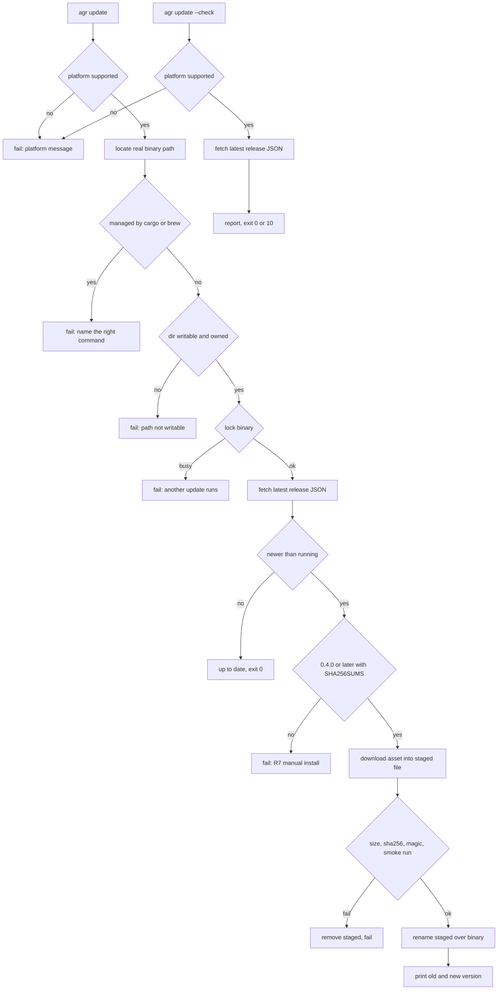

# ADR: agr update, self-update from GitHub releases

**Status**: proposed, waiting for approval. Ships in 0.4.0, the first release with checksums. Execution in PLAN.md, open points in 11.

**Links**:

| What | Pinned to |
|------|-----------|
| Existing code ("before") | `81d5bc4` on `main` (base of `feature/self-update`) |
| Requirements | [REQUIREMENTS.md](REQUIREMENTS.md), R1 to R19 and decisions 1 to 8, signed off 2026-11-13 |
| New code | not written yet, paths in 9 |

Base for code links: `https://github.com/thiscantbeserious/agent-session-recorder/blob/81d5bc4/`.

## 1. Problem and outcome

Users of a release binary can only upgrade by downloading and replacing `agr` by hand.

| Area | Before | Now | Section |
|------|--------|-----|---------|
| Command | none | `agr update` and `agr update --check` | 3 |
| Release source | `repository` in [Cargo.toml#L12](https://github.com/thiscantbeserious/agent-session-recorder/blob/81d5bc4/Cargo.toml#L12) points at `simon/agent-session-recorder` | fixed to `thiscantbeserious/agent-session-recorder`, hidden test override only | 4.1 |
| Network | only `gh` and `git` in sync | `curl` in the update module, nowhere else | 4 |
| Release assets | bare binaries, no checksum ([release.yml#L123-L131](https://github.com/thiscantbeserious/agent-session-recorder/blob/81d5bc4/.github/workflows/release.yml#L123-L131)) | plus `SHA256SUMS` | 5.1 |
| Verification | none | size, SHA-256, magic bytes, smoke run with `--version` | 5 |
| Replacement | by hand | staged file in the same directory, one `rename` | 7 |

What mattered most: the running binary is never touched until everything is verified, and then it changes in one atomic step.

**Out of scope**: auto-update, background checks, package-manager integration, Windows asset, channels, pinning, downgrade, signatures.

## 2. Overview



**Legend**: the update path runs in `src/update/mod.rs` (see 9). Each failure box exits 1 and leaves the binary untouched (see 7.2). `--check` never locks, stages or downloads an asset (see 3.1).

## 3. Commands and exit codes

### 3.1 Surface

| Command | Does | Writes to disk |
|---------|------|----------------|
| `agr update` | full flow in 2 | staged file next to the binary, then one rename |
| `agr update --check` | platform check, latest release JSON, compare, print | nothing, the JSON is read from curl stdout |

- `--check` skips path discovery, lock and staging, so R2 holds by construction.
- There is no flag to skip verification (R5) and no flag for another repo (R3).

### 3.2 Exit codes

| Case | `agr update` | `agr update --check` |
|------|--------------|----------------------|
| Up to date | 0 | 0 |
| Running build newer than latest (dev build) | 0 | 0 |
| Update available | updates, 0 | 10 |
| Update available but release has no checksums (R7) | 1 | 10, plus the R7 note |
| Any failure (platform, network, verification, permission, lock) | 1 | 1 |

- Code 10 is fixed by decision 1. The handler calls `std::process::exit(10)`, the same pattern as [src/commands/sync/run.rs#L66](https://github.com/thiscantbeserious/agent-session-recorder/blob/81d5bc4/src/commands/sync/run.rs#L66).
- Failures return `anyhow::Error` from `main`, which exits 1.

### 3.3 Messages

- Success: `Updated agr 0.4.0 to 0.5.0.`
- Every failure: one line with the cause and the fix, detail on the next lines.
- Output is plain text with no colour codes, so `NO_COLOR` holds trivially (R16).
- The release page `https://github.com/thiscantbeserious/agent-session-recorder/releases` is the manual fallback named in every refusal.

## 4. Release source and network

### 4.1 Fixed source

| Setting | Value |
|---------|-------|
| API URL | `https://api.github.com/repos/thiscantbeserious/agent-session-recorder/releases/latest` |
| Asset URL prefix | `https://github.com/thiscantbeserious/agent-session-recorder/releases/download/` |
| Test override | `AGR_UPDATE_RELEASE_BASE`, hidden, undocumented (decision 2) |

- "Get the latest release" returns the most recent non-prerelease, non-draft release ([GitHub REST docs](https://docs.github.com/en/rest/releases/releases#get-the-latest-release)). This covers R1 "prereleases and drafts are never offered". The parser still rejects `draft` or `prerelease` set to true.
- Each asset in the JSON carries `name`, `size` and `browser_download_url` ([same page, response schema](https://docs.github.com/en/rest/releases/releases#get-the-latest-release)).
- `browser_download_url` is only used if it starts with the asset URL prefix. Anything else fails as a malformed response.
- With the override set, both URLs are built from the override base and the URL prefix check uses that base. The override must start with `https://` or `file://`. Plain `http` is refused.
- Why `file://` for tests: the fake release is a plain directory, no server thread, no port, no TLS setup.
- Rejected: a user-facing `--repo` flag (decision 2).

### 4.2 curl invocation

Every request is one `curl` process, never through a shell, built in `src/update/fetch.rs`.

| Flag | Value | Why | Source |
|------|-------|-----|--------|
| `--silent --show-error` | | no progress meter, errors still on stderr | [curl -s](https://curl.se/docs/manpage.html#--silent), [curl -S](https://curl.se/docs/manpage.html#--show-error) |
| `--proto` | `=https` (or `=file` under a `file://` override) | only HTTPS, R15 | [curl --proto](https://curl.se/docs/manpage.html#--proto) |
| no `--location` | | redirects are followed by agr, each hop checked (4.3) | [curl -L](https://curl.se/docs/manpage.html#--location) |
| `--connect-timeout` | 10 | bounded connect | [curl --connect-timeout](https://curl.se/docs/manpage.html#--connect-timeout) |
| `--max-time` | 30 for JSON and SHA256SUMS, 300 for the binary | bounded total time | [curl --max-time](https://curl.se/docs/manpage.html#--max-time) |
| `--max-filesize` | 1M for JSON and SHA256SUMS, 64M for the binary | bounded size, curl exits 63 when exceeded | [curl --max-filesize](https://curl.se/docs/manpage.html#--max-filesize) |
| `--output` | staged file, binary only | bytes go straight to disk | [curl -o](https://curl.se/docs/manpage.html#--output) |
| `--write-out` | `%{stderr}%{http_code} %{redirect_url}` | status and redirect target on the last stderr line, body stays clean on stdout | [curl -w](https://curl.se/docs/manpage.html#--write-out) |
| `-H` | `Accept: application/vnd.github+json` on the API call | documented media type | [GitHub REST docs](https://docs.github.com/en/rest/releases/releases#get-the-latest-release) |

- `--max-filesize` is not enforced before curl 8.4.0 when the size is unknown upfront ([curl --max-filesize](https://curl.se/docs/manpage.html#--max-filesize)). As such the binary is also checked against the advertised `size` (5.4).
- No token is sent. 60 unauthenticated requests per hour ([GitHub rate limits](https://docs.github.com/en/rest/using-the-rest-api/rate-limits-for-the-rest-api)) is enough for a manual command, so R15 "never prints tokens" holds because there is none.
- curl sends its own `User-Agent`, which the GitHub API accepts. UNVERIFIED.
- Rejected: `ureq` or `reqwest` (decision 7). Rejected: reuse of the sync `Runner` ([runner.rs#L28](https://github.com/thiscantbeserious/agent-session-recorder/blob/81d5bc4/src/sync/store/gist/runner.rs#L28)), it is `pub(super)` inside sync and its stall watchdog is not needed when curl bounds itself with `--max-time`.

### 4.3 Redirects

- Without `--location`, curl reports the target in `%{redirect_url}` ([curl -w redirect_url](https://curl.se/docs/manpage.html#--write-out)).
- On a 3xx, agr checks the target and requests it again. At most 3 hops.
- Allowed hosts: `api.github.com`, `github.com`, `release-assets.githubusercontent.com`, `objects.githubusercontent.com`.
- A real 0.3.0 asset URL answered `302` to `release-assets.githubusercontent.com` (observed with `curl -I` on 2026-11-13). `objects.githubusercontent.com` is the older asset host, kept as allowed. UNVERIFIED that GitHub still uses it.
- Host parsing is a pure function: `https://` prefix, host up to the first `/`, reject `@`, `:` and empty host.

### 4.4 Failure mapping (R15)

| Signal | Message cause | Source |
|--------|---------------|--------|
| spawn fails with `NotFound` | `agr update needs curl, install it and retry` | |
| curl exit 6 | DNS failure | [curl exit codes](https://curl.se/docs/manpage.html#EXIT) |
| curl exit 7 | cannot connect (offline) | same |
| curl exit 28 | timeout | same |
| curl exit 63 | download larger than allowed | same |
| HTTP 403 or 429 on the API | GitHub rate limit, try again later | [GitHub rate limits](https://docs.github.com/en/rest/using-the-rest-api/rate-limits-for-the-rest-api) |
| other HTTP status 400 or more | HTTP error with the code | |
| JSON does not parse, field missing, bad URL | malformed release response | |
| redirect to a host not in 4.3, or more than 3 hops | redirect refused, host named | |

The classifier is a pure function of curl exit code, HTTP code and stderr, unit tested without network. The `#EXIT` anchor is UNVERIFIED, the exit code texts are from the fetched page.

### 4.5 No network elsewhere (R14)

- `curl` and `AGR_UPDATE_RELEASE_BASE` appear only under `src/update/`.
- An integration test scans `src/` and fails on any other occurrence.
- No cache file, no timer, no hint in other commands.

## 5. Publishing and verification

### 5.1 release.yml change

One line in "Prepare release assets" ([release.yml#L123-L131](https://github.com/thiscantbeserious/agent-session-recorder/blob/81d5bc4/.github/workflows/release.yml#L123-L131)), after the rename loop:

```bash
(cd release-assets && sha256sum agr-* > SHA256SUMS && cat SHA256SUMS)
```

- The existing upload `files: release-assets/*` ([release.yml#L173-L178](https://github.com/thiscantbeserious/agent-session-recorder/blob/81d5bc4/.github/workflows/release.yml#L173-L178)) picks up `SHA256SUMS` with no further change.
- The release job runs on `ubuntu-latest`, which ships GNU coreutils `sha256sum`.
- The same workflow already verifies git-cliff with `sha512sum -c`, so the pattern is known here.
- Rejected: one `.sha256` file per asset. Three extra assets for no gain, and one file is what `sha256sum -c` reads.

### 5.2 SHA256SUMS format

- One line per file: hex digest, a space, a mode flag (`*` binary or space for text), file name ([GNU cksum output modes](https://www.gnu.org/software/coreutils/manual/html_node/cksum-output-modes.html)).
- Text mode is the default on Linux, so the lines read `<64 hex>  agr-linux-x86_64` with two spaces ([same page](https://www.gnu.org/software/coreutils/manual/html_node/cksum-output-modes.html)).
- The parser accepts both flags, lowercase hex only, exact name match, and fails on a duplicate or missing entry.
- Hashing uses `sha2`, already a dependency ([Cargo.toml](https://github.com/thiscantbeserious/agent-session-recorder/blob/81d5bc4/Cargo.toml#L1)).

### 5.3 Minimum updatable release (R7, decision 8)

| Latest release | Has `SHA256SUMS` | `agr update` | `--check` |
|----------------|------------------|--------------|-----------|
| below 0.4.0 | any | refuse, R7 message | report, plus "cannot be applied automatically, no checksums" |
| 0.4.0 or later | no | refuse, R7 message | same note |
| 0.4.0 or later | yes | proceed | report |

- R7 message: `Release v0.3.0 has no checksums, so agr update cannot verify it. Install it manually from <releases page>.`
- Both rows are checked, so a 0.4.0+ release that lost its checksum file still fails safe.
- GitHub now also returns a `digest` (`sha256:...`) per asset in the API ([GitHub REST docs example](https://docs.github.com/en/rest/releases/releases#get-the-latest-release)), and the live 0.3.0 assets carry one. Not used, decision 3 fixed the checksum file. Same trust level anyway (see 5.5).

### 5.4 Checks on the downloaded file, in order

| # | Check | Fails when |
|---|-------|-----------|
| 1 | size equals the asset `size` from the JSON | truncated or oversized |
| 2 | SHA-256 equals the `SHA256SUMS` entry | corrupt or tampered |
| 3 | non-empty, magic bytes of the platform: ELF `7f 45 4c 46` on Linux, Mach-O 64-bit `cf fa ed fe` on macOS | wrong file type |
| 4 | set mode bits of the original binary on the staged file | |
| 5 | run staged file with `--version`, stdin null, 10 s timeout, killed on timeout | non-zero exit, timeout |
| 6 | reported version core equals the release tag without `v` | version mismatch |

- Magic byte values are UNVERIFIED (no page fetched).
- Smoke run happens only after check 2 (R8). The staged file is executable only from step 4, and it is never at the final path before step 7 in 7.1 (R5).
- Version parsing: `agr 0.4.0-dev+abc1234 (...)` and `agr 0.4.0 (...)` both give `0.4.0`. Release builds run without `--features release` ([release.yml#L97-L98](https://github.com/thiscantbeserious/agent-session-recorder/blob/81d5bc4/.github/workflows/release.yml#L97-L98)), so they print the `-dev` form of [help.rs#L28](https://github.com/thiscantbeserious/agent-session-recorder/blob/81d5bc4/src/help.rs#L28).
- Versions are `MAJOR.MINOR.PATCH` compared as three `u64`. No `semver` crate. The running version is `CARGO_PKG_VERSION`.

### 5.5 Limit of the checksum

- The checksum catches corruption and partial downloads. It does not catch a compromised release, an attacker who can replace the asset can replace `SHA256SUMS` too.
- Signatures or build attestation are possible later and are out of scope.
- Up to and including 0.3.0 no release has checksums, so an end-to-end update against the real GitHub is not possible until 0.4.0 ships. The success path is proven against the `file://` fixture (10).

## 6. Install location

### 6.1 Path discovery

- `std::env::current_exe()`, then `std::fs::canonicalize`.
- `current_exe` may return the symlink or its target depending on the platform ([Rust std docs](https://doc.rust-lang.org/std/env/fn.current_exe.html)), canonicalize makes it the real path on both.
- The real path is what gets checked, locked, replaced and named in messages (R12).
- Rejected: `argv[0]` lookup in `PATH`, it breaks for relative calls.

### 6.2 Managed installs (R12)

| Real path | Detected as | Message names |
|-----------|-------------|---------------|
| under `$CARGO_HOME/bin`, or `~/.cargo/bin` when unset | cargo | `cargo install agr` |
| contains a `/Cellar/` component, or under `$HOMEBREW_PREFIX` | Homebrew | `brew upgrade` |
| anything else | self-managed | proceed |

- A pure function `managed_install(path, home, cargo_home, brew_prefix)`, unit tested.
- Homebrew links `bin/agr` into `Cellar`, so the canonical path from 6.1 hits the `/Cellar/` rule. UNVERIFIED for an `agr` formula, none exists today.

### 6.3 Writable check (R11)

- Before any network call: `libc::access(dir, W_OK)` on the binary directory, and the binary owner uid equals `libc::geteuid()`.
- Fail message names the path and says to re-run with the right permissions or install elsewhere. No sudo.
- `libc` is already a dependency.

## 7. Replacement

### 7.1 Steps

| # | Step | Target binary state |
|---|------|---------------------|
| 1 | lock (7.3) | untouched |
| 2 | create `<dir>/.agr.update-<pid>` with `create_new`, mode 0600 | untouched |
| 3 | curl writes the asset into it | untouched |
| 4 | checks 1 to 6 of 5.4 | untouched |
| 5 | `sync_all` on the staged file | untouched |
| 6 | `rename(staged, binary)` | old or new, never missing |
| 7 | `sync_all` on the directory, best effort | new |

- Staging in the same directory keeps it on the same filesystem (R9).
- POSIX `rename` replaces `new` so that the name stays visible throughout and refers to either the old or the new file ([POSIX rename](https://pubs.opengroup.org/onlinepubs/9799919799/functions/rename.html)). This is R9.
- A running `agr` keeps its old inode, so an active recording continues and the next start runs the new version (R13).
- Rejected: copy over the binary in place. It leaves a half-written file on failure and changes the inode a running process maps.
- Rejected: backup copy plus restore. With one rename as the only mutation, there is nothing to restore.

### 7.2 Rollback

The only write to the target is step 6. Every failure before it is handled the same way.

| Fails at | Effect |
|----------|--------|
| steps 1 to 5 (network, disk full, verification, smoke run) | staged file removed by a drop guard, exit 1, binary untouched |
| step 6 (`rename` error) | same, POSIX `rename` leaves `new` unchanged on failure ([POSIX rename](https://pubs.opengroup.org/onlinepubs/9799919799/functions/rename.html)) |
| step 7 | update already done, warning only |

### 7.3 Concurrency (R13)

- `flock(LOCK_EX | LOCK_NB)` on the binary itself, opened read-only.
- Busy: fail with `another agr update is running for <path>`.
- Why the binary and not a lock file: no stray `.agr.lock` left in `/usr/local/bin`. [files/lock.rs#L68](https://github.com/thiscantbeserious/agent-session-recorder/blob/81d5bc4/src/files/lock.rs#L68) keeps its lock file on disk, so it is not reused.
- Edge: a second run that opened the old inode just before the rename gets its lock after the first finishes and re-installs the same version. Harmless.
- flock on a read-only descriptor is UNVERIFIED on macOS.

### 7.4 Ctrl-C (R10)

- [ProcessGuard::register_signal_handlers](https://github.com/thiscantbeserious/agent-session-recorder/blob/81d5bc4/src/utils/process_guard.rs#L51) turns SIGINT into a flag, so agr is not killed mid-step.
- curl in the same process group gets the SIGINT from the terminal and exits. UNVERIFIED for every terminal setup.
- agr checks [is_interrupted](https://github.com/thiscantbeserious/agent-session-recorder/blob/81d5bc4/src/utils/process_guard.rs#L61) between steps, drops the staged file, exits 1 with `interrupted`.

## 8. Platforms (R4)

| `std::env::consts` OS and ARCH | Asset | Result |
|--------------------------------|-------|--------|
| macos, aarch64 | `agr-macos-arm64` | supported |
| macos, x86_64 | `agr-macos-x86_64` | supported |
| linux, x86_64 | `agr-linux-x86_64` | supported |
| windows, any | none | fail: `agr update is not supported on Windows because no Windows release exists. Install manually from <releases page>.` |
| anything else | none | fail: `agr update does not support <os>-<arch>, supported: macos-arm64, macos-x86_64, linux-x86_64.` |

- Mapping runs first, before any network call, for `update` and `--check`.
- The Windows message does not suggest a retry.
- Release has no asset for the platform: `Release v0.5.0 has no asset agr-linux-x86_64`, nothing changed.
- Asset names come from the build matrix ([release.yml#L61-L98](https://github.com/thiscantbeserious/agent-session-recorder/blob/81d5bc4/.github/workflows/release.yml#L61-L98)).

## 9. Module layout

| File | Holds |
|------|-------|
| `src/update/mod.rs` | `check()` and `run()`, the flow of 2, constants (API URL, prefix, `SHA256SUMS`, minimum 0.4.0) |
| `src/update/version.rs` | parse, compare, parse `--version` output |
| `src/update/platform.rs` | asset name per OS and arch (8) |
| `src/update/release.rs` | release JSON via `serde_json`, `SHA256SUMS` parser, R7 gate |
| `src/update/fetch.rs` | curl call, redirect loop, host allowlist, failure mapping, override base |
| `src/update/install.rs` | path discovery, managed check, writable check, lock, staging, checks, rename |
| `src/commands/update.rs` | handler, printing, exit codes |
| `src/cli.rs`, `src/dispatch.rs`, `src/lib.rs`, `src/commands/mod.rs` | wiring, next to [Commands](https://github.com/thiscantbeserious/agent-session-recorder/blob/81d5bc4/src/cli.rs#L48) and [dispatch](https://github.com/thiscantbeserious/agent-session-recorder/blob/81d5bc4/src/dispatch.rs#L91) |

- The library module is `pub` so the integration tests can reach the pure functions (tests only live in `tests/integration`).
- `install.rs` is `#[cfg(unix)]`. On other targets the platform check fails first.
- No new dependency.

## 10. Tests

- No test touches the real network. Downloads go through `AGR_UPDATE_RELEASE_BASE=file://<tempdir>`.
- All tests under `tests/integration/`, registered in `tests/integration.rs`.
- Fake release helper `tests/integration/helpers/update_fake.rs`: compiles a one-line Rust stub that prints `agr <version>` with `rustc` once per test run, writes it as the platform asset, writes `SHA256SUMS` and the latest JSON with `file://` URLs.
- Why `rustc`: the stub must pass the magic byte check and report a newer version, and `rustc` is always present where `cargo test` runs.
- CLI tests copy `CARGO_BIN_EXE_agr` into a temp dir and update that copy, never the build output.

| Section | File | Proves |
|---------|------|--------|
| 5.1 | `release_workflow_test.rs` | workflow writes and uploads `SHA256SUMS` |
| 5.4 | `update_version_test.rs` | parse, compare, `--version` parsing |
| 8 | `update_platform_test.rs` | mapping, Windows and unsupported messages |
| 5.2, 5.3 | `update_release_test.rs` | JSON, `SHA256SUMS`, R7 gate |
| 4.2 to 4.4 | `update_fetch_test.rs` | host allowlist, failure mapping, missing curl |
| 6, 7 | `update_install_test.rs` | managed, read-only, symlink, mode, lock, rollback |
| 3, 5, 7 | `update_cli_test.rs` | end to end against the fixture |
| 4.5, 4.1 | `update_boundary_test.rs` | no curl outside `src/update`, override undocumented, repository field |

**Manual check** (after 0.4.0 ships, not part of this PR):

| Check | Result |
|-------|--------|
| `agr update --check` on 0.4.0 against the real release | pending |
| `agr update` from 0.4.0 to the next release | pending |

## 11. Open questions

| Question | Answer in |
|----------|-----------|
| Which checksum file | 5.1, 5.2 |
| How to test without GitHub | 4.1, 10 |
| Rollback technique | 7.1, 7.2 |

1. Optional `GITHUB_TOKEN` against rate limits. Skipped, 60 per hour is enough for a manual command. Add if users hit it.
2. Use the API `digest` as a second check next to `SHA256SUMS`. Cheap, but same trust level, so no real gain. Not planned.

## 12. Appendix

| Item | Change |
|------|--------|
| `README.md` | new "Updating" section: commands, exit codes, platforms, curl prerequisite, Windows limit, manual fallback, release checksum note |
| `docs/man/agr-update.1`, `docs/wiki/Command-update.md`, `docs/COMMANDS.md` | regenerated with `cargo xtask gen-docs` |
| `.github/workflows/release.yml` | 5.1 |
| `Cargo.toml` `repository` | `https://github.com/thiscantbeserious/agent-session-recorder` (R19) |
| `Cargo.toml`, `Cargo.lock` version | 0.3.0 to 0.4.0, last commit, no tag |
