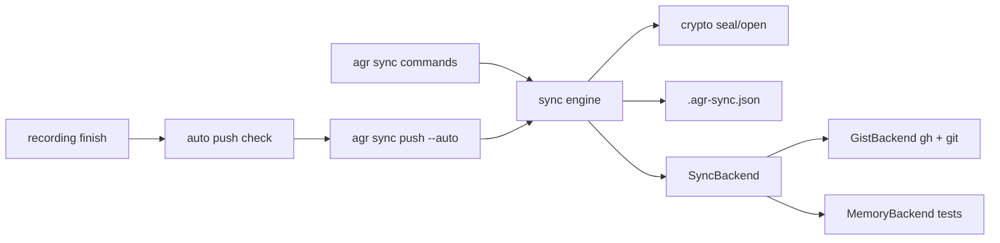
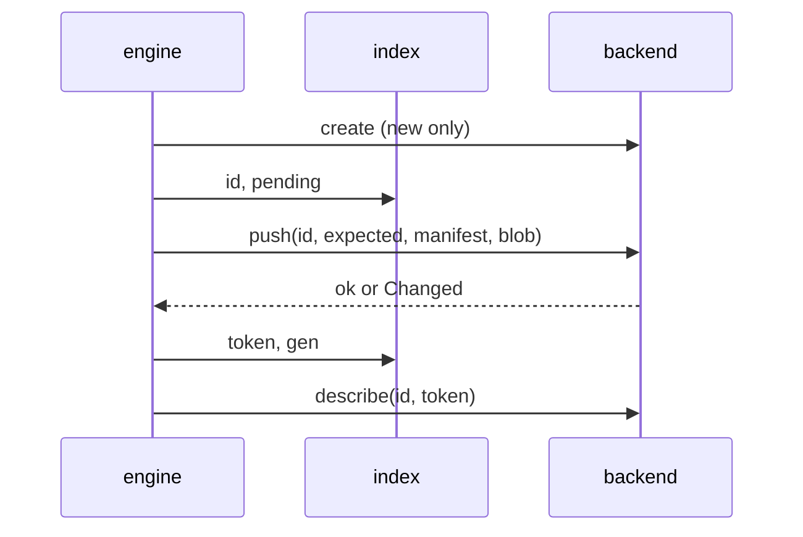
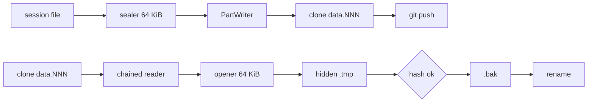
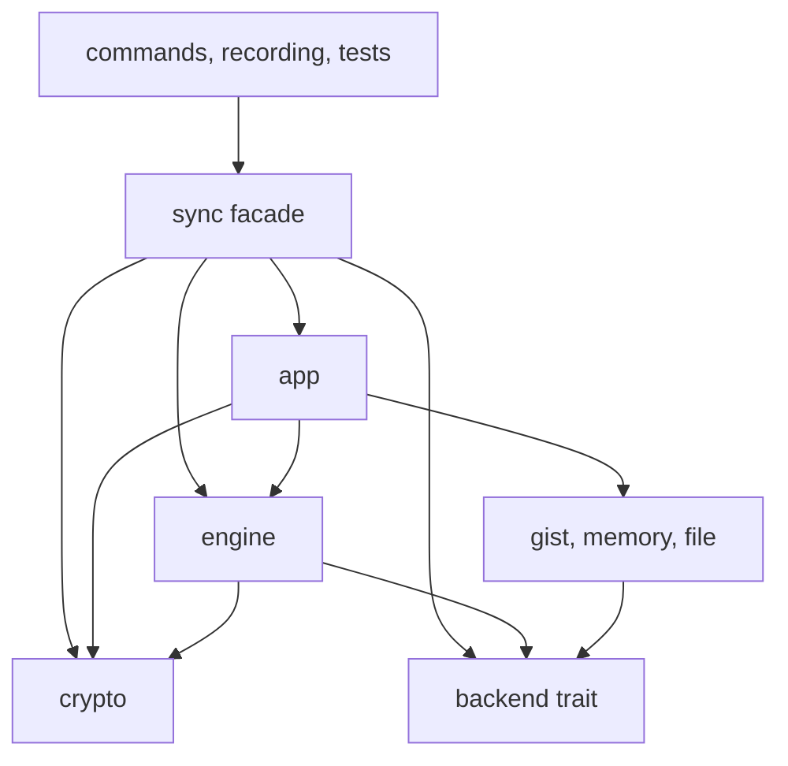
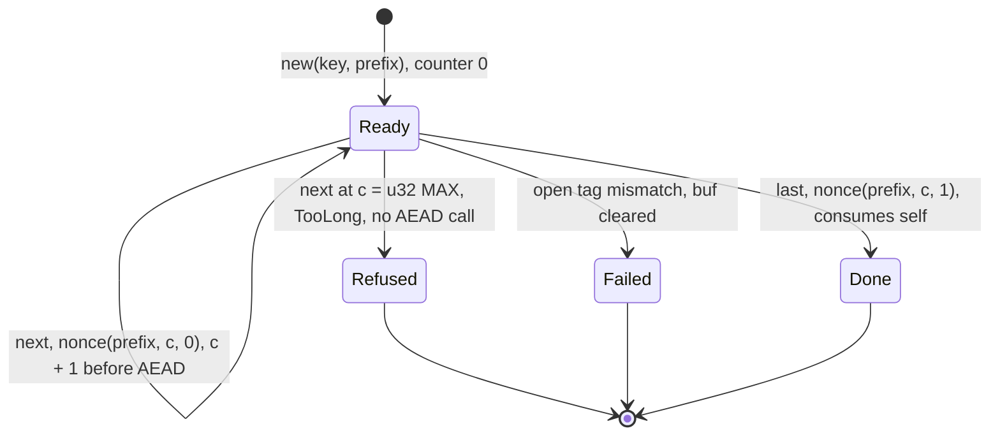
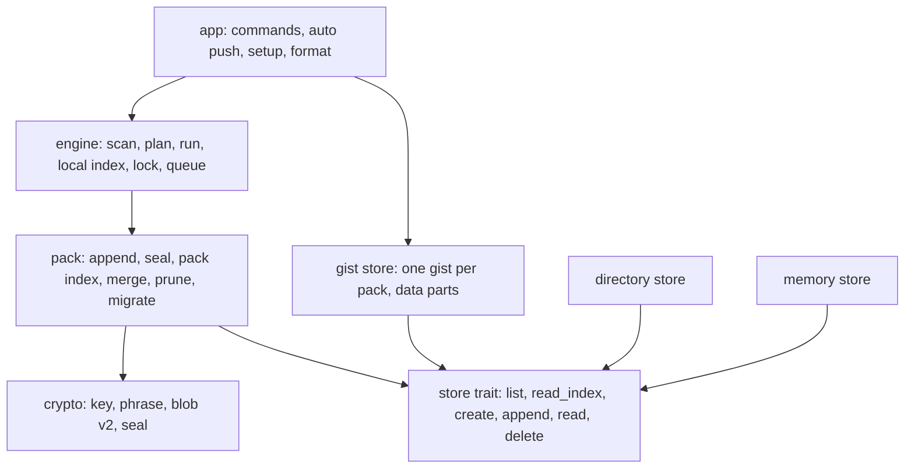
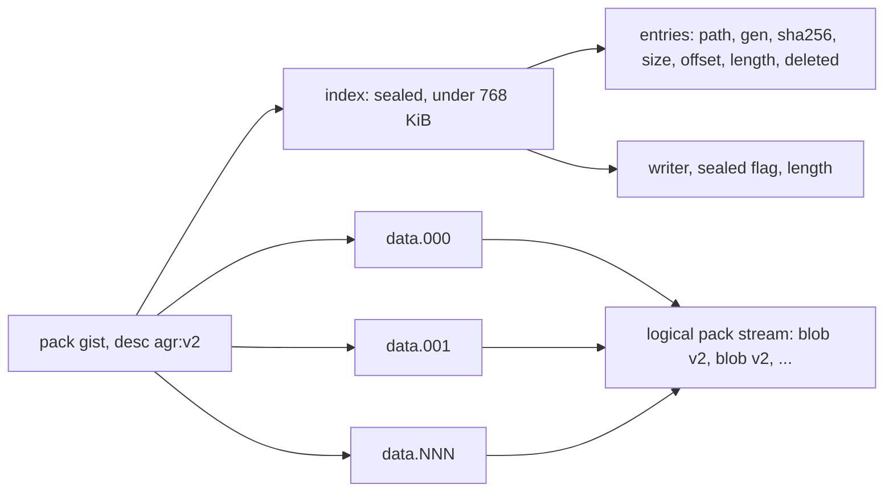
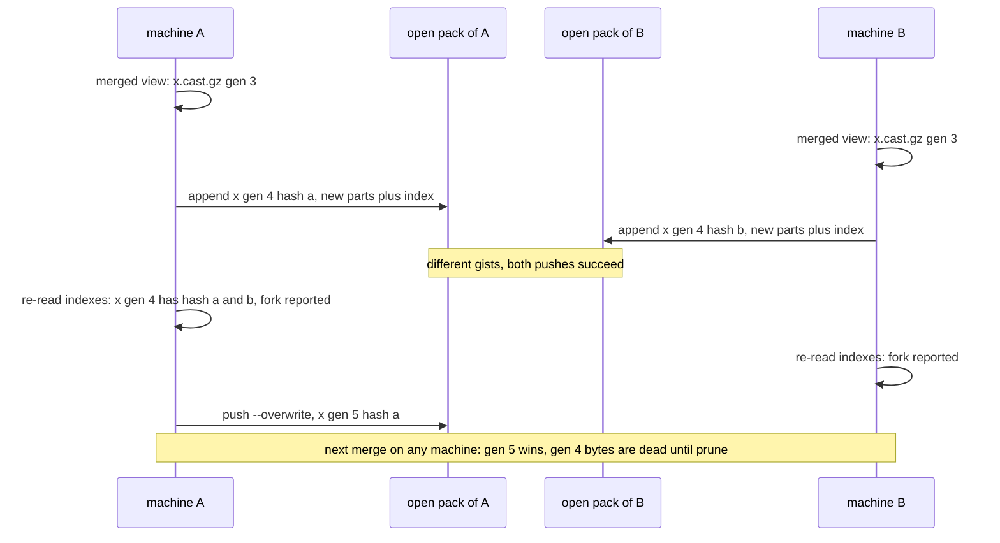
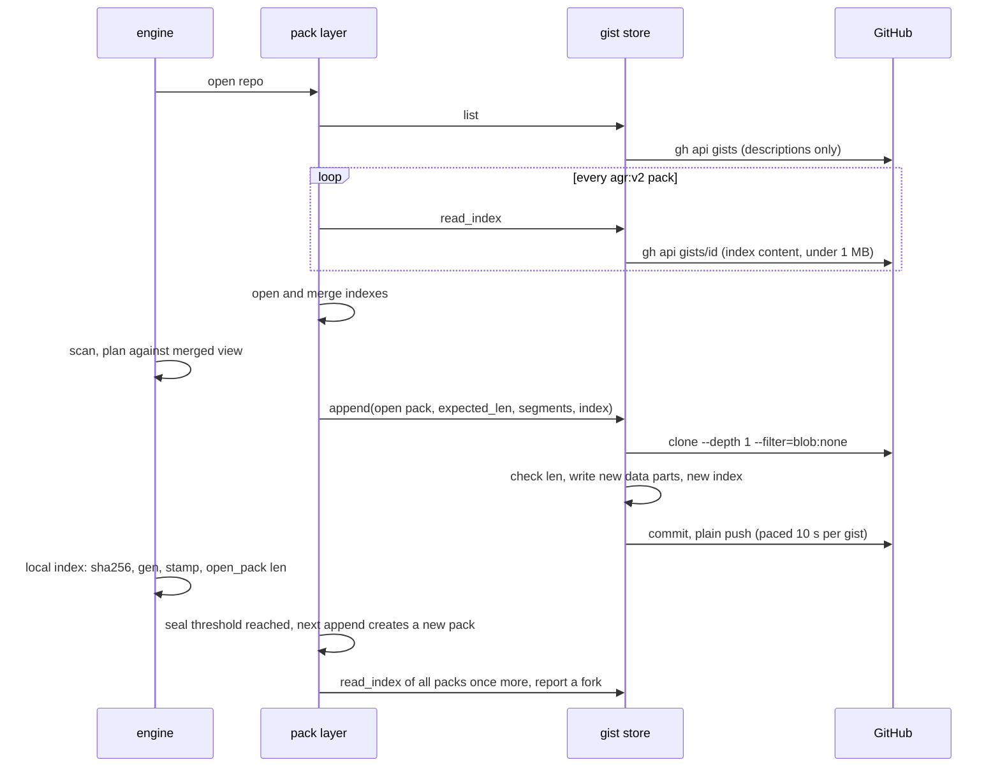
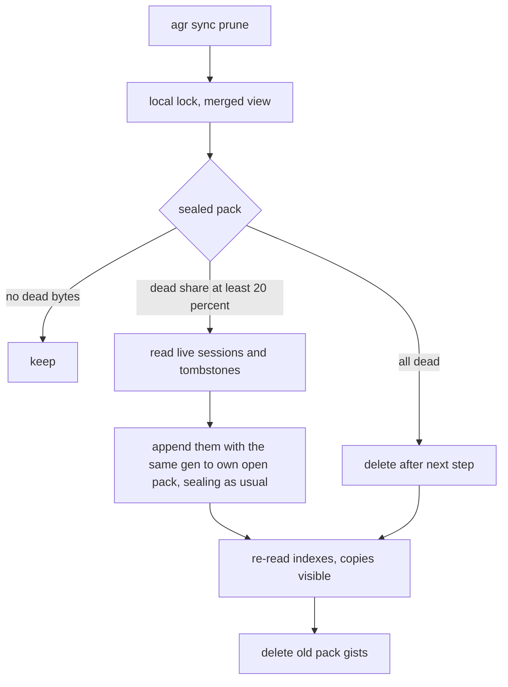

# ADR: Encrypted Session Sync (secret gists first)

## Status
Accepted (auto-approved, the user delegated the SDLC up to an open PR). Variant A and D9 were decided by the user, not autonomously. Everything else was decided autonomously, review in PR.

## Context

Sessions live on one machine. REQUIREMENTS.md (auto-approved, updated 2026-11-06 with auto push,
encryption and key handling) fixes the what: `agr sync status|push|pull|delete`, a backend-neutral
`SyncBackend` trait, a hidden local index, three-way hash conflicts, secret gists via `gh` as the
only backend, every upload encrypted locally, the key in `~/.config/agr/sync.key` with a recovery
phrase for the second machine, and auto push after each recording once a backend is set.

This ADR decides the how: transport, crypto, remote layout, index, module layout, auto push
latency and the stage split.

Base: `main` after #165 (gzip storage). Config is v4, as such v5 is next. MSRV 1.88.

### Verified facts (2026-11-06)

**GitHub gists**
1. The REST API returns at most 1MB of content per file, `truncated: true` marks the rest. `raw_url`
   works up to 10MB, larger files need a clone via `git_pull_url`. A gist response lists at most
   300 files. Source: https://docs.github.com/en/rest/gists/gists (section "Truncation").
2. Gists are git repositories, they can be cloned, committed to and pushed like any repo.
   Source: https://docs.github.com/en/get-started/writing-on-github/editing-and-sharing-content-with-gists/forking-and-cloning-gists
3. Git warns on files over 50 MiB and GitHub blocks files over 100 MiB. Push size is capped at
   2GB, repos ideally stay under 1GB. Sources:
   https://docs.github.com/en/repositories/working-with-files/managing-large-files/about-large-files-on-github
   and https://docs.github.com/en/repositories/creating-and-managing-repositories/repository-limits
4. Secret gists are not listed or searchable, but anyone with the URL can read them. GitHub also
   runs partner secret scanning on secret gists. Source:
   https://docs.github.com/en/get-started/writing-on-github/editing-and-sharing-content-with-gists/creating-gists
5. "List gists for the authenticated user" supports `per_page` and `since`, so `gh api gists
   --paginate` returns all of them with descriptions. Source:
   https://docs.github.com/en/rest/gists/gists#list-gists-for-the-authenticated-user

**gh CLI (local: gh 2.96.0, logged in, scopes `gist`, `read:org`, `repo`, git protocol ssh)**
1. `gh gist` has `create`, `list`, `view`, `clone`, `edit`, `rename`, `delete`. `create` is secret
   by default (`--public` to list), `delete --yes` skips the prompt, `clone` passes extra flags to
   `git clone` after `--`.
2. `gh gist create` and `gh gist edit` refuse binary content ("binary file not supported").
   Source: https://github.com/cli/cli/blob/trunk/pkg/cmd/gist/create/create.go (around line 214)
   and https://github.com/cli/cli/blob/trunk/pkg/cmd/gist/edit/edit.go (around lines 282, 421).
3. `gh auth status` prints the token scopes line but never the token. `gh api` authenticates with
   the stored token, agr never sees it.

**Crates (crates.io, checked 2026-11-06)**
- `chacha20poly1305` 0.10.1 (stable line, no declared MSRV, `getrandom` feature on by default),
  0.11.0 needs Rust 1.85. Both fit MSRV 1.88.
- `sha2` 0.10.9 (no declared MSRV), 0.11.1 needs exactly 1.88.
- `data-encoding` 2.11 (MSRV 1.48, no deps) covers base32 and base64url.
- `getrandom` 0.2 and 0.3 are already in Cargo.lock through other deps.
- Windows target `x86_64-pc-windows-msvc` is installed locally, so `cargo check --target` works.

**Codebase touch points**
- `src/recording.rs` (370 lines) `finish()` calls `finalize_recording` (src/recording/finalize.rs),
  which returns the final `.cast.gz` path. That is the auto push hook.
- `src/files/codec.rs` has `atomic_write`, `temp_path_for`, `is_gzip_path`, `session_stem`.
  `src/files/backup.rs` has `create_backup` / `backup_path_for`. `src/files/lock.rs` has
  `read_lock` and live-lock detection. `src/commands/prompt.rs` has `should_proceed` with the
  no-TTY rule. `src/config/state.rs` loads and atomically saves `state.toml`.
- `StorageManager::list_sessions` only walks directories under the storage root and skips
  hidden files, so a hidden file at the root (the index) is never a session and never in stats.
  `agent_dirs` does not skip hidden directories, as such temp clones must never live in the
  storage dir.
- `src/cli.rs` is 420 lines already, new subcommand enums go to `src/cli/subcommands.rs` (229).

### Still unknown (verify in a stage)
1. A git push of a binary file to a gist is accepted and served back byte-identical. Verify in
   Stage 7 (ignored live test). Fallback: base64url text in the same git file, about 33% larger,
   nothing else changes.
2. Maximum gist description length (the sealed metadata token is about 260 chars). Verify in
   Stage 7. Fallback: put the token into `agr-session.json` and read it per gist (one API call
   per gist on `list`, slower but correct).
3. With `git_protocol = https` and no gh credential helper, `git push` to the gist fails. Verify
   in Stage 7 and map the error to the hint `gh auth setup-git`.

## Options Considered

### 1. Transport for the blob

**Option A: REST API through `gh api` with base64 text files**
- Pros: one tool, no git, no temp clone.
- Cons: API reads truncate at 1MB per file and `raw_url` stops at 10MB, so a 52MB session needs
  chunking into 1MB files (about 70 files of base64, 33% larger), plus one JSON request body of
  70MB for create. Request body limits are undocumented.

**Option B: git clone and push of the gist repo, `gh` for create, list and delete**
- Pros: the blob is a real binary file, no size overhead, the documented path for files over
  10MB, single file per gist. `gh gist clone` reuses the user's git protocol setup.
- Cons: needs `git` on PATH, one temp clone per push or pull, the gist history keeps old
  ciphertexts (encrypted, acceptable).

**Option C: `gh gist create/edit` with files**
- Not possible, `gh` refuses binary, and ciphertext is binary.

**Decision: Option B**, decided autonomously (review in PR). It is the documented way for large
files and keeps one file per gist. Clones are shallow (`-- --depth 1`) into
`std::env::temp_dir()/agr-sync-<pid>-<n>`, removed afterwards, never under the storage dir.

### 2. Cipher

**Option A: XChaCha20-Poly1305 (`chacha20poly1305`)**
- Pros: 24-byte nonce makes random nonces safe for any number of messages, constant-time in
  software on every CPU, pure Rust, RustCrypto.
- Cons: none relevant here.

**Option B: AES-256-GCM (`aes-gcm`)**
- Pros: hardware accelerated on most CPUs.
- Cons: 12-byte nonce, random nonces need care past ~2^32 messages per key, software fallback
  is slower and needs care for side channels.

**Decision: Option A, `chacha20poly1305 = "0.10"`**, decided autonomously (review in PR). Speed
does not matter at sync sizes, nonce safety does. 0.10 over 0.11 because it shares the existing
`getrandom` 0.2 and is the long-standing stable line, bump later in a separate PR.

### 3. Recovery phrase encoding

**Option A: BIP39 word list**
- Pros: familiar words.
- Cons: a 2048-word list (crate or 13KB file), more than we need.

**Option B: base32 with checksum**
- Pros: `data-encoding` is tiny, has no deps and also gives us base64url for the metadata token.
  Case-insensitive, no ambiguous `0/O`, `1/I` with RFC 4648 base32.
- Cons: less pleasant to type than words.

**Decision: Option B**, decided autonomously (review in PR). Phrase = base32 (RFC 4648, no padding)
of `key (32 bytes) || first 2 bytes of SHA-256(key)`, which is 55 chars, printed as 11 groups of
5 joined with `-`, prefixed `agr1-`. Import upper-cases and strips spaces and dashes, rejects a
wrong prefix, wrong length or bad checksum.

### 4. Where the metadata lives and whether names are encrypted

**Option A: plain description `agr:v1 <agent>/<name>`**
- Pros: readable in the gist UI, one list call gives everything.
- Cons: session names come from directory and branch names (customer and ticket names), that is
  exactly what the user wants private.

**Option B: sealed metadata in the description, `agr:v1 <token>`**
- Pros: one paginated list call still gives path, plaintext hash and size for every gist, nothing
  readable leaks. Gists sealed with another key show up as "other key" and are left alone.
- Cons: the gist UI shows only an opaque token, description length to verify (fallback above).

**Decision: Option B**, decided autonomously (review in PR). `token = base64url(sealed JSON)`,
JSON is `{"v":1,"path":"claude/x.cast.gz","sha256":"<hex>","size":123}`. `.keep` in the gist
holds a fixed `agr` line (gists need one text file at create time, and `gh` refuses a blank one, `gh gist create` cannot create
the binary file), the blob lives in `data.000`, `data.001`, ... (see "Large sessions").
File names reveal neither the tool nor the content, only the `agr:v1 ` description prefix does
(second machines find their gists by it).

### 5. Auto push latency

**Option A: synchronous with a short timeout**
- Pros: the warning line is printed in the same terminal.
- Cons: create plus clone plus push is several seconds for small files, a 50MB upload is much
  longer, it blocks the shell after every recording, which the requirement forbids.

**Option B: fast local checks in-process, network part in a detached child**
- Pros: the shell returns right away. Every skip reason that is knowable locally (no backend,
  `auto_push = false`, no privacy ack, no key, plain or locked session, `gh` or `git` not on
  PATH) still prints its one-line hint synchronously.
- Cons: a network failure cannot print in the original terminal.

**Decision: Option B**, decided autonomously (review in PR). After the local checks pass, agr
spawns `agr sync push --auto <agent>/<name>` (hidden flag) with null stdio, its own process group
on unix, no wait. On failure the child stores one line in `state.toml`
(`last_auto_push_error`), and the next recording or `agr sync status` prints it as a warning and
clears it. The child takes the sync lock non-blocking and quietly skips if a push already runs,
the next push picks the session up. Exit status of the recording is never touched.

### 5a. Changed sessions go with the next recording (2026-11-07, user decision)

The auto child pushes the new session plus every session with an index entry whose local file
differs in size or mtime from the stamp stored at its last sync (`size` and `mtime_ns` in the
index entry, `serde(default)` for old indexes). Only those files are hashed, the plan still
decides by hash, so a touched but identical file is a no-op. The first sync of a session stays
manual because of the privacy notice. A rename is a new path without an index entry, so it is
not picked up and a second copy is never uploaded, a manual `agr sync push` handles it.

### 6. Hash

**Decision: `sha2 = "0.10"`**, SHA-256 over the `.cast.gz` bytes (plaintext of the cipher). The
index, conflicts and pull verification use this hash, never the ciphertext.

## Decision

### Data flow


Legend: commands and auto push go through one engine, encryption sits above the trait, backends
only ever see opaque bytes and opaque metadata tokens.

### Trait

```rust
pub struct RemoteEntry { pub id: String, pub meta_token: String }

pub trait SyncBackend {
    fn name(&self) -> &'static str;
    fn check(&self) -> Result<(), BackendError>;            // gh/git present, logged in, scope
    fn list(&self) -> Result<Vec<RemoteEntry>, BackendError>;
    fn push(&self, id: Option<&str>, meta_token: &str, blob: &[u8]) -> Result<String, BackendError>;
    fn pull(&self, id: &str) -> Result<Vec<u8>, BackendError>;
    fn delete(&self, id: &str) -> Result<(), BackendError>;
}
```
`BackendError` (thiserror) has `NotInstalled(&'static str)`, `NotLoggedIn`, `MissingScope`,
`Unreachable(String)`, `Other(String)`, so commands print one clear line per case. Encryption is
in the engine, as such a later S3 or git backend gets it for free.

### Blob and token format

`b"AGR1" || version u8 (1) || nonce [24] || ciphertext+tag`. AAD is `b"agr:blob:" || path` for
the blob and `b"agr:meta"` for the token, so a blob moved to another session's gist fails to
open.
**Superseded for the blob by D9 below** (streamed `AGR1 || 0x02`, no longer whole in memory), the
token keeps this one-shot format.

### Key file

`~/.config/agr/sync.key`, content `agr-sync-key v1 <base32 key>`, created with mode 0600
(`OpenOptions::mode`, unix only, `cfg(unix)` so Windows still compiles). Load refuses a file with
any group or other bits set. First creating push without a key generates one from `OsRng`, but
only if the remote has no agr gists, otherwise it aborts with the import hint (a second key
would split the remote into two unreadable halves). `agr sync key export` prints the phrase,
`agr sync key import [--force]` reads it from stdin (or the argument), refuses to replace a
different existing key without `--force`.

### Index

`<storage>/.agr-sync.json`, written with `codec::atomic_write`.
`{"version":1,"entries":{"claude/x.cast.gz":{"sha256":"..","remote_id":"..","synced_at":"<rfc3339>"}}}`.
Missing or unparseable is treated as empty (rebuild path, same rules as a second machine), with
one warning for unparseable. Never synced, never a session.

### Decision table (pure, `sync::plan`)

Inputs per path: local hash (or skip reason), remote hash and id, last synced hash.
1. local == remote: in sync (index refreshed when missing).
2. local only: push. remote only (also "in index but deleted locally"): pull.
3. local changed, remote == last: push. remote changed, local == last: pull.
4. both differ from last (or no last and local != remote): conflict, skipped unless
   `--overwrite`, which picks push or pull by command.
5. remote entry sealed with another key or unknown version: reported, never touched.
6. local plain `.cast`, live lock, over 1 GiB: skipped with reason.

### Safety rules
- Pull: download, open (auth), SHA-256 equals the sealed metadata hash, then
  `codec::atomic_write_raw` (new, same temp + fsync + rename as `atomic_write` but never
  encodes, because `atomic_write` gzips any `.cast.gz` target and would double-compress).
  An existing file is only replaced when the decision is pull (row 3, remote changed and local
  == last) or `--overwrite` on a conflict, after the current file is copied to the hidden
  `.bak`. An older, different `.bak` is rotated (replaced by the current file, the newer state
  worth keeping), it never blocks a pull.
- Push and pull take `<storage>/.agr-sync.lock` (create_new, pid inside, stale pid reclaimed).
- Index updated after each successful session, so an interrupted run loses nothing.
- Per-session errors go to the report, the run continues.
- No implicit deletes in either direction, `agr sync delete` only removes the gist and the
  index entry.
- `gh` is called with `std::process::Command`, never through a shell, args never contain the
  token, stderr is mapped to `BackendError` and never echoed raw into the index or state.

### Module layout

**Superseded** by "Module structure (refinement 2026-11-06)" below, the table shows the old flat files.

| File | Content |
|------|---------|
| `src/sync/mod.rs` | module list, `SessionPath`, re-exports |
| `src/sync/crypto.rs` | key type, seal/open, token encode, phrase encode/decode, sha256 helper |
| `src/sync/key.rs` | key file load/save, permissions |
| `src/sync/index.rs` | index load/save |
| `src/sync/plan.rs` | pure decision table |
| `src/sync/backend.rs` | trait, `RemoteEntry`, `BackendError` |
| `src/sync/memory.rs` | `MemoryBackend` (pub, used by tests) |
| `src/sync/scan.rs` | local scan (skip reasons) and remote decode into plan inputs |
| `src/sync/run.rs` | execute push, pull, delete, report, sync lock |
| `src/sync/push.rs` | push of one session, compare-and-swap, adopt and description repair |
| `src/sync/pace.rs` | clock and pacer for mutating GitHub calls |
| `src/sync/fail.rs` | why one push or pull did not finish (`Fail`) |
| `src/sync/record.rs` | index entry written after a push, refresh or pull |
| `src/sync/parts.rs` | sealed blob as `data.NNN` parts, rolling writer and chaining reader |
| `src/sync/blob.rs` | streamed blob v2, STREAM over XChaCha20-Poly1305 in 64 KiB frames |
| `src/sync/pull.rs` | pull of one session, verify, backup rotation, atomic write |
| `src/sync/lock.rs` | `.agr-sync.lock`, pid inside, stale pid reclaimed |
| `src/sync/format.rs` | plain text lines for status, preview, summary, delete |
| `src/sync/setup.rs` | backend and key resolution, error explanations, key import and export |
| `src/sync/file.rs` | directory backed fake, only through `AGR_SYNC_TEST_BACKEND_DIR` (prints one stderr line when set) |
| `src/sync/gist.rs` | `GistBackend` (`gh` and `git` calls) |
| `src/sync/gist_parse.rs` | list parsing, stderr mapping, scope check, pure |
| `src/sync/runner.rs` | `Runner` trait, `ProcessRunner` and `spawn_detached`, the only code that spawns processes |
| `src/sync/auto.rs` | auto push checks and error line |
| `src/recording/auto_push.rs` | recording hook, prints the hint and spawns the child |
| `src/commands/sync/` | `mod.rs` (dispatch, output), `key.rs` |

The library never prints, except the existing `State::load_from` warning. Commands format output
with theme helpers. `auto.rs` returns the hint line, `src/recording.rs` prints it.

### Config v5

**Update 2026-11-06**: auto-optimize (#184) took config v5 on main, as such the sync migration is now `migrations/v6.rs` with `CURRENT_VERSION = 6`. References to v5 below mean v6.

```toml
[sync]
# backend = "gist"   # unset means sync is off
auto_push = true
```
`SyncConfig { backend: Option<SyncBackendKind>, auto_push: bool }`, enum `Gist` with
`serde(rename_all = "lowercase")`, so an invalid value fails with the allowed values. v5 adds
the table with `auto_push = true` and the commented backend line, idempotent. `State` gets
`sync_privacy_ack: bool` and `last_auto_push_error: Option<String>`.

### Large sessions and listing limit (2026-11-06, user decision)

1. **Parts in the same gist**: the sealed blob is cut into parts of at most 45 MiB, named
   `data.000`, `data.001`, ..., all in the session's own gist and pushed in one commit with the
   rest. 45 MiB stays under git's 50 MiB warning. A re-push removes stale higher parts in the
   same commit. Pull reads every `data.NNN`, requires them contiguous from 000 (no gap, no
   extra, no reorder) and joins them before anything is opened. Split and join are pure
   (`sync::parts`), the engine and `SyncBackend` still move one blob.
2. **1 GiB cap** per session (was 100MB), from GitHub's repository size guidance
   (https://docs.github.com/en/repositories/creating-and-managing-repositories/repository-limits).
   The cap is checked on the local `.cast.gz` size (D10 follow-up). The memory bound this point
   described is gone with D9, memory is flat now.
3. **Listing abort at 3000**: GitHub documents a 3000 gist pagination cap
   (https://docs.github.com/en/rest/gists/gists). If the listing has 3000 or more gists in
   total (all gists, not only agr ones) the backend errors and the engine aborts before any
   change, so unlisted gists are never treated as missing.

### Variant A: manifest, generation and compare-and-swap (2026-11-06, accepted, built in Stages 14 to 31)

**Status**: Accepted (user decisions D1 to D5 on 2026-11-06), built in Stages 14 to 31 (D9 streaming is Stages 25 to 31). The points
marked **USER DECISION** below are settled by D1 to D5, D6 to D8 came after the batch 12 review.

**Problem**: push today is clone, commit, `git push`, then a separate description PATCH
(`src/sync/gist.rs` `upload`), and the engine never checks that the remote is still the state
it planned against (`src/sync/run.rs` `push_one`). Two machines pushing the same session can
lose an update, an interrupted create leaves an orphan, a rollback through gist history is not
detected, 403/429 are a generic `Other` and the run keeps going, and commit dates carry the
local timezone.

#### Rejected: HMAC and ciphertext hash in the file names

The earlier proposal named the gist files after an HMAC of the path plus the ciphertext hash.
**Rejected**, because:
1. A git commit is already atomic, the parts and their metadata land together or not at all,
   file names add nothing to that.
2. A stable HMAC of the path is the same on every push, as such it links gists and revisions
   to one session for anyone who can read the gist list (linkability leak), and it needs a
   second key derived from the sync key (key separation) that we do not have today.
3. It does not fix the real races (plan against a stale listing, two pushes in the same
   seconds, the separate description PATCH).

#### Decision

1. **Manifest file**: every session gist holds a file `manifest` in the same commit as its
   `data.NNN` parts. Its content is the sealed metadata token, the same string that goes into
   the description, `Meta { v: 2, path, sha256, size, gen }`. The commit is the truth, the
   description is a listing hint, and repairing the description is copying the manifest token
   into it.
2. **Generation**: `gen` starts at 1 and is planned gen + 1 on every push. Because every push
   is a compare-and-swap (point 3) two machines can never both commit the same gen on one gist.
3. **Compare-and-swap push**: the engine passes the token it planned against (`expected`,
   `None` for a new or pending gist). The gist backend clones, reads `manifest` (missing means
   `None`), and when it is not byte-equal to `expected` it returns `BackendError::Changed` with
   the current token and writes nothing. Otherwise it writes the parts and the new manifest,
   commits and runs a plain `git push`. Never `--force`, never a `+` refspec, never a pull or
   rebase retry. A non-fast-forward rejection maps to `Changed(None)`.
4. **Blob AAD**: `b"AGR1" || 0x01 || b"agr:blob:" || path || ":" || gen`, format tag in AAD
   (domain separation, wire header checked separately) and gen bound, the core `seal` and `open` (and the KAT vector) stay untouched.
4a. **Clock and pacer** (Batch 10 review): one `pace::Clock` trait (`mono`, `unix_secs`,
   `sleep`, all `&self`) behind `Arc<dyn Clock>`, `SystemClock` in production and a mutex
   backed fake in tests. `unix_secs` errors on a pre-epoch clock instead of giving 1970.
   `GistBackend` holds the clock for commit dates and a `Mutex<Pacer>` built from the same
   clock, so `&self` trait methods can pace and no generic leaks into the public type. The
   per-call `wait` wiring stays in Stage 18.
5. **Push order**: `create` (pending gist) then the index entry with the id and
   `pending = true`, then the compare-and-swap push, then the index entry with token and gen,
   then the description PATCH. A failing step keeps the gist, nothing is deleted on error any
   more, the next run resumes it through the index id.
6. **Pull**: the backend returns the manifest token and the joined blob from the same clone.
   The engine opens the manifest, requires the row path, and rejects it when its gen is lower
   than the index gen or lower than the planned gen (rollback or stale copy, local file
   untouched). The blob is opened with the manifest gen and checked against the manifest
   SHA-256. A manifest newer than the description is accepted (manifest wins), the pull was
   only planned because the local file equals the last synced state, as such nothing local is
   lost.
7. **Description repair**: the description is only ever rewritten to the newest known token,
   that is the index token when the index gen is higher than the description gen, or a
   `Changed` token whose gen is at least the index gen and the description gen. It never moves
   to a lower gen.
8. **Adopt own commit**: `Changed(Some(t))` where `t` opens and its SHA-256 equals the local
   file is our own earlier push (crash after the commit, before the index save), the engine
   records it and repairs the description instead of reporting a conflict.
9. **Index id fallback**: when the listing misses a path but the index has a remote id, the
   push goes to that id with the index token as `expected`. `BackendError::NotFound` (gist
   deleted on GitHub) is reported as "remote copy gone" and skipped (D6), no automatic
   recreate. Only `push --overwrite` creates a new gist and updates the index. An index id
   that is listed as another key or an unknown version is never pushed into.
10. **Duplicates**: `RemoteEntry` gets the server `created_at`. Several gists for one path
    resolve to the oldest `created_at`, id as tie-break, so every machine picks the same one.
    Same SHA-256 means the others are reported with a hint, a different SHA-256 makes the path
    `Duplicate`, skipped and reported with both ids, also with `--overwrite`.
11. **Rate limits**: 403 or 429 with `rate limit` in the text, or `secondary rate limit`, map
    to `BackendError::RateLimited`. The engine stops the run at the first one, keeps what is
    done (index is saved per session) and the report says "N left, run again later". Every
    mutating call (create, `git push`, PATCH, delete) is paced to at most one per second.
12. **UTC dates**: `git commit` runs with `GIT_AUTHOR_DATE` and `GIT_COMMITTER_DATE` set to
    `@<unix seconds> +0000`. `Runner::run` gets an `env` argument for exactly that, the process
    env of the tests is never touched.
13. **Compatibility**: nothing is released. A gist with a v1 token (no manifest) opens as
    `v != 2` and becomes the existing `UnknownVersion` row, reported and never touched, the
    maintainer deletes the test gists by hand. **USER DECISION** D5, the task allowed "treated
    as needing a push", this is the zero code option.

#### Trait (changes, and why)

```rust
pub struct RemoteEntry { pub id: String, pub meta_token: String, pub created_at: String }

pub trait SyncBackend {
    fn name(&self) -> &'static str;
    fn check(&self) -> Result<(), BackendError>;
    fn list(&self) -> Result<Vec<RemoteEntry>, BackendError>;
    fn create(&self) -> Result<String, BackendError>;                  // pending, unlisted
    fn push(&self, id: &str, expected: Option<&str>, manifest: &str, blob: &[u8])
        -> Result<(), BackendError>;                                    // compare-and-swap
    fn describe(&self, id: &str, token: &str) -> Result<(), BackendError>;
    fn pull(&self, id: &str) -> Result<(Option<String>, Vec<u8>), BackendError>;
    fn delete(&self, id: &str) -> Result<(), BackendError>;
}
```
`BackendError` gains `Changed(Option<String>)`, `NotFound`, `RateLimited`.
Why: `create` is split out so the engine stores the id before any upload (no orphans),
`expected` is the compare-and-swap, `describe` is split out because repair and the crash
window need it on its own, `pull` returns the manifest so it is checked from the same commit
as the blob. The backend still only sees opaque tokens and bytes, the comparison is plain
string equality.


Legend: one push of one session, every arrow after `create` is safe to repeat on the next run.

Index entry: `{sha256, remote_id, synced_at, gen, token, pending}`, the three new fields with
`serde(default)`, index version stays 1 (nothing released).

#### Design review (architect)

1. **Is the compare-and-swap race free?** There are three windows.
   - Plan to clone (listing at t0, clone at t1): closed by the manifest equality check in the
     clone.
   - Clone to push (two pushes within seconds): closed by git itself, the server updates the
     ref only when our parent is still the tip, the second push gets non-fast-forward and maps
     to `Changed`. This holds only while we never force and never auto retry, both get a test
     on the argument list.
   - Commit to description PATCH: **not closed**, the gist API has no conditional PATCH. A
     stalled PATCH can land after a newer push and its PATCH, the description then shows an
     older gen than the manifest. Nothing is lost (every push and pull checks the manifest in
     the clone), it only hides the newer version from listings until it heals. It heals when
     the newest writer runs again (index gen higher than description gen, point 7) or when any
     machine pushes that session (`Changed` with a newer token, point 7). Documented as a
     known limit, the window is the length of one stalled HTTP call.
2. **Is `gen` safe with concurrent writers?** Yes on the gist, two machines planning N+1 from
   N both clone gen N, one push wins, the other is non-fast-forward. It is only safe because of
   point 3, a backend without a ref compare-and-swap would need another mechanism, the memory
   backend models it with one mutex. A lost index on a machine means trust on first use, the
   fresh index accepts whatever gen the remote has, so a rollback done before that machine
   syncs again is not detected there. Documented as a known limit, the other machines still
   detect it.
3. **Does gen in the blob AAD create a recovery problem?** No, manifest and parts are in one
   commit, they cannot get out of step through a partial failure. Honest note: it is
   redundant, the authenticated manifest SHA-256 already rejects an old blob with a new
   manifest. It costs one line, as such we keep it as the requirement asks.
4. **Is "manifest wins, description repaired" safe with a rolled back manifest?** Only with
   the gen rule of point 7, a manifest with a lower gen than the index or the description is
   rejected and never copied into the description. Without an index (fresh machine) a rolled
   back manifest wins, same trust on first use limit as above.
5. **Can dedupe delete the only good copy?** Yes, the duplicate that is not the oldest can hold
   the newer content, and deleting after verifying the kept gist does not change that. Report
   only is simpler and loses nothing, duplicates are rare once the index id fallback and the
   pending resume exist. **USER DECISION** D1: drop the automatic delete, keep the
   deterministic pick by `created_at` and id, report duplicates with both ids. Recommended.
6. **Throttle numbers**: GitHub documents at most 80 content-generating requests per minute
   and 500 per hour (https://docs.github.com/en/rest/using-the-rest-api/rate-limits-for-the-rest-api),
   whether gist git pushes count is not documented. A new session costs up to three mutating
   calls (create, `git push`, PATCH), an existing one two. Pacing every mutating call to one
   per second gives at most 60 per minute even if git pushes count, which leaves 20 for other
   `gh` use, that is at most 20 to 30 sessions per minute. The hourly 500 is reached after about
   eight minutes of a large first push, as such a big first sync will stop with "N left" and
   needs two or three runs. **USER DECISION** D3 (decided 2026-11-06): pace only, no own
   hourly stop. agr spaces mutating calls one second apart and stops the run cleanly as soon as
   GitHub reports a rate limit, it never retries automatically after that (the architect had
   recommended an extra stop after 450 calls, the user chose pace only). Auto push moves one session per recording, it never runs into the hourly
   limit by itself, when it is rate limited the error line is stored and shown after the next
   recording, the next recording tries again with the same one or two calls.
7. **retry-after**: `gh gist create` and `git push` never show response headers, only `gh api`
   with `--include` would, and that output is not verified. **USER DECISION** D4: honour
   retry-after by never retrying automatically, the stop message says "run again later", no
   header parsing. Recommended.
8. **`parts` in the manifest**: the engine seals the manifest before the backend splits the
   blob, it does not know the part size, and a missing or extra part already fails the
   contiguity check and the AEAD tag. **USER DECISION** D2: drop `parts` from the manifest.
   Recommended.
9. **What else is over-engineered for one user with 2 to 3 machines?** Dropped already: file
   name HMAC, automatic dedupe delete (D1), header parsing (D4), `parts` (D2), a separate
   manifest AAD (the token AAD is enough), an index version bump. Kept because they are cheap
   and close a real loss: compare-and-swap, pending resume, index id fallback, gen check,
   description repair, `created_at` pick, rate limit stop, pacing, UTC dates.

#### Known limits (documented, not fixed)

- GitHub lists at most 3000 gists, sync aborts at that size.
- Session count, sizes and push times are visible to anyone who can see the gists.
- A rename leaves the old name on other machines until `agr sync delete`, and
  `agr sync delete` racing a push elsewhere is not a compare-and-swap, the other machine
  re-creates the gist from its local copy on its next push.
- A leaked key exposes every old revision in the gist history.
- The description can lag behind the manifest after a stalled PATCH, until it heals (review 1).
- Rollback detection is trust on first use for a machine without an index (review 2).

### D9: streaming encryption (2026-11-06, accepted, built in Stages 25 to 31, Stage 25 is B1 and B2)

**Status**: Accepted. The user asked for it (D9) and accepted the design on 2026-11-06, see Decision
History.

**Problem**: push reads the whole session and seals it in one AEAD call (`src/sync/push.rs`
`push_one`, `src/sync/crypto.rs` `seal`), the gist backend splits a `&[u8]` and joins every part
into one `Vec<u8>` on pull (`src/sync/gist.rs` `stage_parts`, `pull`), pull opens the whole blob
in memory and scan hashes the whole file in memory (`src/sync/scan.rs` `local_state`). A 1 GiB
session needs about 2 GiB of RAM on push and on pull. Memory has to stay flat up to the cap,
the format has to detect truncation, reordering, dropped and duplicated chunks, and pull must
write nothing unless the whole stream verified.

#### Options

1. **STREAM from the already used RustCrypto `aead` crate** (chosen). `chacha20poly1305 0.10.1`
   and `aead 0.5.2` are in `Cargo.lock`. `aead` has a `stream` module (STREAM, Hoang,
   Reyhanitabar, Rogaway, Vizar 2015, https://eprint.iacr.org/2015/189.pdf) behind the
   `stream` feature, `chacha20poly1305` forwards it as `stream = ["aead/stream"]`, the feature
   has no extra dependencies and `aead` declares `rust-version = "1.56"`, as such MSRV 1.88 is
   fine and no new crate comes in. Checked in the vendored sources
   (`~/.cargo/registry/src/*/aead-0.5.2/src/stream.rs`, `Cargo.toml` of both crates), docs.rs
   page: https://docs.rs/aead/0.5.2/aead/stream/index.html. `StreamBE32` builds the nonce as
   `prefix || counter u32 BE || last flag u8`, with XChaCha20-Poly1305 the prefix is 19 bytes.
   `EncryptorBE32::encrypt_next_in_place` / `encrypt_last_in_place` take the AAD per chunk.
   The same construction is used by age (https://github.com/C2SP/C2SP/blob/main/age.md,
   "payload", 64 KiB chunks, counter and last flag in the nonce) and libsodium secretstream
   is a close relative (https://doc.libsodium.org/secret-key_cryptography/secretstream).
2. **Own chunking with a per-chunk index in the AAD and a final length record**. Same idea,
   more code we own, no proof. Rejected.
3. **libsodium secretstream through a binding**. New C dependency, rekeying and tags we do not
   need. Rejected (constraint: no new heavy dependencies).

#### Blob format v2

```
AGR1 (4) || 0x02 (1) || nonce prefix (19, random) || frame 0 || frame 1 || ... || frame n
frame i < n : ciphertext of exactly 65536 plaintext bytes + tag (16) = 65552 bytes, last flag 0
frame n     : ciphertext of 0..=65536 plaintext bytes + tag (16), last flag 1
AAD (every chunk) = AGR1 || 0x02 || "agr:blob:" || path || ":" || gen
```

- Chunk size 64 KiB is a constant of version 2, not stored in the header, a different size
  is a new version byte. Overhead is 16 bytes per 64 KiB (0.025 %), a 1 GiB session is 16384
  chunks, far below the 2^32 counter.
- An empty session is one empty last frame (16 bytes). A session that is an exact multiple
  of 64 KiB ends with a full frame that carries the last flag, there is never an empty
  trailing frame after a full one.
- Magic and version are authenticated through the AAD, the nonce prefix through the nonce
  itself (a changed prefix gives a different nonce and every tag fails).
- The manifest token stays the one-shot `AGR1 || 0x01` format with `agr:meta` AAD, it is
  small. Only the blob moves to v2. `crypto::open` on a v2 blob and the v2 opener on a v1
  blob both fail with `UnsupportedVersion`.

Reading frames: wrap the input in a `BufReader`, read up to one frame with
`take(FRAME).read_to_end`, then `fill_buf().is_empty()` tells whether more data follows. More
data means `decrypt_next`, none means `decrypt_last`. Sealing uses the same look-ahead on the
plaintext to decide `encrypt_next` or `encrypt_last`.

| Attack on the stored ciphertext | Why it fails |
|---|---|
| Truncation at a frame boundary | the new last frame was sealed with flag 0, it is opened with flag 1 |
| Truncation inside a frame | short frame is opened as last, tag fails, under 16 bytes is `Truncated` |
| Reorder or swap frames | the counter is part of the nonce, frame i only opens at position i |
| Drop a frame | every later frame sits one position off, dropping the last leaves a flag 0 frame at the end |
| Duplicate a frame | same as reorder, the copy sits at the wrong counter |
| Append bytes or a frame after the end | the real last frame is then opened with flag 0 and fails |
| Frame from another blob, another gen or another session | other nonce prefix, other gen or path in the AAD |
| Old v1 blob replayed | version byte check, then AAD carries `0x02` |

#### Parts and chunks stay independent

The 45 MiB gist parts are a plain byte split of the sealed stream, a part boundary can fall
inside a frame. Integrity comes from STREAM over the joined bytes, `check_sequence` keeps
guarding the part names. Aligning parts to frames would couple two layers for no gain (a part
size of 45 MiB is not a multiple of 65552 anyway). `parts::split` and `parts::join` go away,
`part_name`, `check_sequence` and `stale` stay.

#### Trait and data flow

```rust
/// Writes the sealed blob into `out`, may be called again for a retry.
pub type BlobSource<'a> = &'a dyn Fn(&mut dyn std::io::Write) -> std::io::Result<()>;

fn push(&self, id: &str, expected: Option<&str>, manifest: &str, blob: BlobSource<'_>)
    -> Result<(), BackendError>;
/// Manifest and a reader over the stored blob, read from the same clone.
fn pull(&self, id: &str) -> Result<(Option<String>, Box<dyn std::io::Read>), BackendError>;
```

- Push gives a callback, not a reader, as `Push::run` can send twice (`Gone` plus
  `--overwrite`) and each call has to re-read the file. The callback opens the session file
  and runs the sealer straight into `out`, a fresh nonce prefix each time.
- The gist backend runs the callback only after the compare-and-swap check, into a small
  `PartWriter` (Write impl that rolls `data.NNN` files at `part_size`, creates `data.000`
  only on finish for an empty blob), then drops stale parts and writes the manifest as today. A callback error aborts
  before `git add`, nothing is committed, the scratch dir is removed on drop.
- The gist `pull` returns a reader that owns the `Scratch` and chains the part files in
  order (opened after `check_sequence`), the clone is removed when the reader is dropped.
- File backend: `File::create` plus callback on push, `File::open` on pull. Memory backend
  (tests only): callback into a `Vec`, `Cursor` on pull. Byte helpers `put`, `set_blob`,
  `blob` stay as they are for tests.
- `crypto::sha256_reader(impl Read) -> io::Result<(String, u64)>` hashes by `io::copy` into
  `Sha256` (sha2 implements `Write` with its default `std` feature). Scan uses it on the file
  instead of `fs::read`.


Top row is push, bottom row is pull, every arrow carries at most one frame at a time.

**Push**: `push_one` hashes the file again in a streamed pre-pass (hash and size, the manifest
meta is built from these, not from the scan). The sealer returns the plaintext SHA-256 and size
it saw, and `seal_file` compares them with that pre-hash and fails with "session changed while
pushing, run again" when they differ. So a file that changed between scan and push uploads the
new content under a manifest for the new content (the compare-and-swap still holds), and a
file that changed between the pre-pass and the seal is never committed.

**Pull safety**: new `codec::atomic_write_raw_with(path, fill)` (same hidden temp, fsync,
rename and temp removal on error as `atomic_write_raw`, the `commit` helper already does the
removal). The fill closure, in this order: open the stream into the temp writer (every frame
and the last flag verified), compare the returned SHA-256 with the manifest, then
`backup_existing`. Only then does `commit` rename. Any failure (tag, truncation, hash, backup,
disk) returns an error, the temp is removed, the local file and the `.bak` stay untouched.
Unverified plaintext only ever sits in the hidden temp file next to the target (hidden-file
rule from #160, scan skips it). A crash in the middle leaves the hidden temp, the next pull
of that session truncates and reuses it.

#### Memory bound

Data path per direction: one plaintext chunk and one frame buffer (2 x 64 KiB), a `BufReader`
(8 KiB default) and the hasher, under 256 KiB, independent of the session size. Peak RSS of the
process is then the binary, the gist listing and the index, a few MiB to a few tens of MiB.
Not counted: `git` child processes, git loads one blob at a time below `core.bigFileThreshold`
(512 MiB), our parts are 45 MiB.

**Perf test** (`tests/performance/sync_memory_test.rs`, `#[ignore]`, run with
`cargo test --release --test performance -- --ignored sync_memory --nocapture`): same pattern as
`gzip_memory_test.rs`. Builds a gzip of random bytes (`Compression::none()`, fast) at 64 MiB
and at 512 MiB, runs the release binary under `/usr/bin/time` (`-l` macOS, `-v` Linux) with
`AGR_SYNC_TEST_BACKEND_DIR` (file backend, no network, no git) for `agr sync push --yes` on
machine A and `agr sync pull --yes` on machine B after `key import`. Prints all four peak RSS
values and asserts the 512 MiB run is at most 16 MiB above the 64 MiB run for push and for
pull, and every run stays under 64 MiB. Before D9 the same test shows roughly 2x the session.

#### Migration

Blob v1 (`AGR1 || 0x01` one-shot) was never released, nothing to migrate, same reasoning as D5.
A v1 blob on a test gist fails to pull with "unsupported blob version 1", push replaces it on
the next change or with `--overwrite`.

#### Also in this round (same files)

- **B1** (`push.rs` `adopt`): on `Changed(Some(theirs))` that is not our content, when `theirs`
  opens with our path and its gen is at least max(index gen, row gen), describe the gist with
  `theirs` (best effort, only `RateLimited` stops the run), then report CHANGED. So the
  listing heals for the loser of a race and the next run plans against the real remote.
- **B1** (`scan.rs` `row`): a pending index entry (sha256 `""`) is never `last`, it is
  filtered out like its token already is.
- **B2** (`pull.rs` `pull_one`): `engine.backend.pull(id).map_err(Fail::from)?`, a rate limit
  during pull stops the run, `NotFound` stays `Gone`.

#### Challenge

1. **What can go wrong?**
   - Session changes between scan and seal: caught by the hash check in `seal_file`, the
     push fails for that session and nothing is committed.
   - The look-ahead is the one subtle bit: a decoder that calls `decrypt_last` on a full frame
     without checking for more data would accept appended frames. Tests cover truncation at
     every boundary, append, drop, swap and duplicate on a 3 to 4 frame blob.
   - Backup inside the fill closure means the `.bak` is written while the hidden temp exists,
     a failed backup removes the temp, nothing renamed. Ordering is tested.
   - The reader returned by gist `pull` holds the scratch clone, an engine that keeps it
     around keeps 1 GiB on disk longer. `pull_one` (`write_session` and `verify_into`) drops it at the end of the function.
   - Disk use is unchanged in total (clone plus temp), only RAM drops.
2. **What is over-engineered?** Dropped: chunk size or any parameter in the header (version
   byte covers it), aligning parts to frames, own STREAM code, a streaming memory backend,
   rekeying. Kept the plaintext SHA-256 although STREAM already authenticates, it is the sync
   identity for the three-way compare and it catches a file that changed during push.
   `seal_blob` / `open_blob` byte wrappers stay for tests only (thin, over a `Cursor`).
3. **Code size**: the stream code goes into a new `src/sync/blob.rs` (crypto.rs is already
   459 lines), about 150 lines with tests.

## Consequences

- New deps: `chacha20poly1305`, `sha2`, `data-encoding` (all pure Rust, small).
- New runtime requirement for sync only: `gh` and `git` on PATH.
- Gist UI shows only `agr:v1 <token>` and opaque `data.NNN` files, which is the point.
- Losing every copy of the key makes the remote unreadable. Docs and the first key generation
  say so.
- Help and completions snapshots change, docs regenerated with `cargo xtask gen-docs`.
- Expected PR size about 45 files, under the 100 file limit. Variant A adds about 3 files
  (`src/sync/push.rs`, `src/sync/pace.rs`, `tests/integration/sync_multi_machine_test.rs`),
  the branch is at 77 today.

## To verify during implementation
1. Binary git push to a gist round-trips (Stage 7, ignored live test).
2. Description length fits the token (Stage 7).
3. https protocol without credential helper error mapping (Stage 7).
4. `cargo check --target x86_64-pc-windows-msvc` passes with the new deps (Stage 1 and Stage 11).

**Variant A, still unverified live (Stage 18, fake runner only):** the compare-and-swap read of
`manifest` after `gh gist clone`, the plain `git push` rejection texts mapped to `Changed(None)`
(`! [rejected]`, `non-fast-forward`, `fetch first`), the `created_at` field in the list call, the
404 mapping to `NotFound`, and the rate limit texts mapped to `RateLimited`. The ignored live test
in `tests/sync_gist_live.rs` covers them and was not run.

**Still unverified live (Stage 7 was tested against a fake process runner only, no real gist was
created, edited or deleted, the ignored `tests/sync_gist_live.rs` was not run):**
- Exact `gh gist create <file> --desc <text>` output format (the id is parsed from the last path
  segment of the printed `gist.github.com/...` URL).
- `gh gist clone <id> <dir> -- --depth 1` works for a secret gist and with the configured git
  protocol.
- A binary `data.000` pushed with plain `git push` is served back byte-identical (Open
  Question 1), gist description length for the token (Open Question 2), and the real https
  without credential helper error text (Open Question 3, the mapping is built from sample
  strings, not captured output).
- `gh api gists?per_page=100 --paginate` prints concatenated JSON arrays (parser accepts that and
  a single array), and `gh api -X PATCH gists/<id> -f description=...` updates the description.
- The `gh auth status` scope line wording (`Token scopes: ...`) on other gh versions.
- Not verified live: `gh gist create` accepting the empty dotfile `.keep` with a newline body, a
  multi-part push and shrink (`tests/sync_gist_live.rs`, run by hand).
- Push order, not verified live (replaces the old order that deleted a newly created gist on
  error): a new gist is created with the placeholder description `agr:pending` (no `agr:v1 `
  prefix, so `list` ignores it), then clone, compare the manifest with the expected one, one
  commit with manifest and parts, plain `git push`, and only then `describe(token)`. A failed
  push never deletes a gist, an interrupted create stays in the index as pending and the next
  push resumes it. A crash before the description leaves an unlisted pending gist or an old
  description with a new manifest, pull trusts the manifest and the description is repaired
  later.
- Measured peak RSS of the D9 perf test (`tests/performance/sync_memory_test.rs`) is recorded in
  the PLAN progress notes of Stage 30.

## Decision History
1. 2026-11-06: user added auto push after recording (default on once a backend is set).
2. 2026-11-06: user required private storage, gists have no private mode, decided: keep secret
   gists, encrypt every upload locally, key file plus recovery phrase. GitHub secrets rejected
   by the user (write-only for `gh`).
3. 2026-11-06 (fix round): decision 9, a pull replaces an older different `.bak` with the
   current local file (rotate), a stale backup must not fail every later pull.
4. 2026-11-06 (fix round): decision 10, push order is blob first and token last with a
   placeholder description at create, so an orphan gist never advertises a hash without a blob.
5. 2026-11-06 (after adversarial review): user chose Variant A (manifest, gen, compare-and-swap),
   the HMAC file name proposal is rejected, D1 to D5 decided by the user on 2026-11-06: D1 report only, D2 drop
   `parts`, D3 pace only, D4 no retry-after parsing, D5 v1 gists left alone.
6. All other decisions in this ADR: decided autonomously (review in PR).
- 2026-11-06: Variant A decisions by user: D1 duplicates report only, no auto delete; D2 no `parts` in the manifest; D3 pace only (60 mutating calls per minute), no own hourly stop, stop when GitHub reports a rate limit; D4 no retry-after parsing, "run again later"; D5 unreleased v1 gists shown as unknown and left alone.
- 2026-11-06: Batch 12 review decisions by user: D6 a deleted gist (gh API 404) is reported as "remote copy gone" and skipped, only `push --overwrite` recreates it (replaces the automatic recreate in ADR item 9); git "Repository not found" is never NotFound (auth/access failures must not cause duplicates). D7 missing created_at fails closed in the duplicate pick. D8 a duplicate pick may change once after a pending gist gets its description, reported, nothing deleted.
- 2026-11-06: PO acceptance follow-ups by user: D9 stream the encryption in chunks so memory stays flat up to the 1 GiB cap (format change, gets its own design section and review); D10 keep `AGR_SYNC_TEST_BACKEND_DIR` in release builds, documented as test-only.
- 2026-11-06: D9 design by the architect (autonomous, review in PR): STREAM (`aead` `stream` feature, `StreamBE32`, XChaCha20-Poly1305), 64 KiB chunks, blob v2 `AGR1 || 0x02 || prefix19`, parts and chunks independent, push callback and pull reader in the trait, verify into hidden temp then backup then rename, v1 not migrated (unreleased). B1 and B2 from the Variant A review go into the same round.
- 2026-11-06: D9 design accepted by user: STREAM over XChaCha20-Poly1305 via `aead::stream`, 64 KiB chunks, plaintext SHA-256 check kept as sync identity.
- 2026-11-06: D11 by user (D9 batch 1 review): the B1 description repair re-reads the gist manifest right before describing and only describes if it still equals the token it adopts. GitHub has no conditional description update, so a millisecond window remains in which a concurrent newer describe can be overwritten; documented as a known limit, it self-heals when the newer machine runs again.
- 2026-11-06: D9 measured (Stage 30, release build, macOS, file backend): peak RSS push 64 MiB 7.7 MiB, push 512 MiB 7.7 MiB, pull 64 MiB 7.6 MiB, pull 512 MiB 7.5 MiB. Memory does not grow with session size.

## Module structure (refinement 2026-11-06)

**Status**: Accepted (approved by the user on 2026-11-06).

**Problem**: `src/sync/` is 24 flat files (about 6.6k lines), almost every module is `pub mod`, five
files are over 400 lines (`gist.rs` 1028, `blob.rs` 551, `format.rs` 511, `crypto.rs` 434,
`auto.rs` 429) and the layering only exists in our heads. Commands, recording and tests reach
into any module they like, as such every internal rename is a public API change.

**Approach**: four layers as folders, a small facade in `sync/mod.rs`, one hidden `testing`
module for the integration tests, and a unit test that fails when a layer imports what it must
not. Pure moves first, then splits, then visibility.

### Target tree

```
src/sync/
  mod.rs            facade: layer declarations, public re-exports, `testing`, layer check test
  crypto/           depends on nothing in sync
    mod.rs          Key, CryptoError, sha256_hex, sha256_reader
    seal.rs         one-shot `AGR1 || 0x01` seal and open, metadata token (Meta, seal_meta, open_meta)
    phrase.rs       recovery phrase export and import, checksum, PhraseError
    blob/
      mod.rs        streamed blob v2, STREAM over XChaCha20-Poly1305, 64 KiB frames (D9)
      tests.rs      cfg(test): truncation, reorder, bit flip, nonce layout and known-answer tests
  backend/          opaque bytes and tokens only, never crypto
    mod.rs          SyncBackend trait, RemoteEntry, BackendError, BlobSource, push_bytes, pull_bytes
    memory.rs       MemoryBackend, in-memory fake with failure hooks
    file.rs         FileBackend, directory fake behind AGR_SYNC_TEST_BACKEND_DIR (D10)
    gist/
      mod.rs        GistBackend, SyncBackend impl, scratch clone, stage, commit and push
      parse.rs      list parsing, stderr mapping, scope check (was gist_parse.rs)
      parts.rs      data.NNN part writer and chaining reader
      pace.rs       clock and pacer for mutating GitHub calls
      runner.rs     Runner trait and ProcessRunner, spawns gh and git
      fake.rs       cfg(test): fake runner, helpers, gh side tests (check, list, create, describe, delete)
      push_tests.rs cfg(test): push, parts and compare-and-swap tests
      pull_tests.rs cfg(test): pull, missing part and clone lifetime tests
  engine/           uses crypto, the backend trait and its own bookkeeping, never prints
    mod.rs          layer declarations
    plan.rs         pure decision table
    scan.rs         plan inputs from storage, index and remote list
    run.rs          Engine, Options, Report, Item, Outcome, SyncError
    push.rs         push of one session, compare-and-swap, pending resume
    pull.rs         pull of one session, verify, backup rotation, atomic write
    fail.rs         Fail and Stop, why one push or pull did not finish
    record.rs       index entry written after a push, refresh or pull
    index.rs        .agr-sync.json load and save, INDEX_FILE, LOCK_FILE
    lock.rs         .agr-sync.lock, pid inside, stale pid reclaimed
  app/              command-facing glue, the only place that picks a concrete backend
    mod.rs          layer declarations
    setup.rs        backend choice, key resolution, error explanations, key import and export
    key.rs          sync.key file, 0600, load, save_new, import
    auto/
      mod.rs        hook side: decide, after_recording, on_path, spawn_detached
      child.rs      child side: run, error_line, take_error_line
    format/
      mod.rs        label, status lines, shared helpers, test fixtures
      summary.rs    preview, privacy, problem, delete preview, rate limit, summary lines
```

### Dependency rules

1. **crypto** uses no `crate::sync` path, and no file outside `crypto/` names
   `chacha20poly1305`, `aead` or `sha2`. As such the open #167 decision (0.10
   `stream` or 0.11 plus our own STREAM layer) touches `crypto/` and `Cargo.toml` only, and the
   known-answer and nonce layout tests in `crypto/blob/tests.rs` prove the wire format stayed.
   `data_encoding` (base32 in `key.rs`) is plain encoding, not part of #167, and stays allowed.
2. **backend** uses nothing from crypto, engine or app (D-rule from Variant A, backends only ever
   see opaque tokens and sealed bytes). `gist/` uses `backend/mod.rs` and its own files.
3. **engine** uses crypto, `crate::sync::backend` (the trait module root only, never `gist`,
   `memory` or `file`), plus `crate::files` and `crate::storage`. Never app.
4. **app** may use every layer and `crate::config`. `setup.rs` is the only file that builds a
   concrete backend.
5. **Outside sync** (`src/commands`, `src/recording`, `tests/`) uses `agr::sync::<item>` or
   `agr::sync::testing::<item>` only, never a layer path.
6. Cross-layer imports are written `crate::sync::<layer>::...`, inside a layer `super::...`,
   never `super::super` (keeps the check below a plain text match).
7. `Command::new` only in `backend/gist/runner.rs` (gh, git) and `app/auto/mod.rs` (the
   detached `agr sync push --auto` child), as the detached child is the auto push feature and not
   gist transport.

Rust has no visibility between sibling modules of one crate that could enforce rules 1 to 4, as
such `sync/mod.rs` carries one `#[cfg(test)]` test that reads `src/sync/<layer>/**/*.rs` and
fails on a forbidden path (rules 1 to 3, 6 and 7). About 40 lines, runs
in `cargo test --lib`, counted by Codecov.


Legend: an edge means "may import" (facade edges are re-exports only), anything without an edge is forbidden and fails the layer check test.

### Public facade

`agr::sync` (always compiled):
- **engine**: `Engine`, `Options`, `Report`, `Item`, `Outcome`, `SyncError`, `Decision`,
  `SkipReason`, `Duplicate` (the last three are pub fields of `Item` and `Report`).
- **backend**: `SyncBackend`, `BackendError`, `RemoteEntry`, `BlobSource`.
- **crypto**: `Key`, `PhraseError` (inside `setup::ImportError`).
- **app namespaces**, kept as modules because commands call them as `format::status_lines` and so on:
  `auto` (after_recording, spawn_detached, run, error_line, take_error_line),
  `format` (label, status_lines, preview_lines, privacy_lines, problem_lines,
  delete_preview_lines, rate_limit_lines, summary_lines),
  `setup` (default_key_path, resolve_key, explain, open_backend, needs_privacy_ack, import_key,
  export_key, KeyNeed, KeyState, SetupError, ImportError, IMPORT_HINT),
  `key` (save_new, Imported, KeyError).

`agr::sync::testing` (`#[doc(hidden)]`, always compiled, for `tests/` only):
- **backends**: `MemoryBackend`, `GistBackend` (live test), `push_bytes`, `pull_bytes`.
- **crypto**: `seal`, `seal_meta`, `open_meta`, `sha256_hex`, `Meta`, `CryptoError`,
  `seal_stream`, `open_stream`, `BlobError`.
- **engine internals**: `index` (module: load, path_for, Index, IndexEntry, LOCK_FILE),
  `decide`, `resolve`, `Command`, `Remote`, `scan`, `Row`.

Layer modules are private (`mod crypto`) in `sync/mod.rs`. Items are `pub` only when the facade
or `testing` re-exports them, `pub(in crate::sync)` when another layer uses them, `pub(super)`
inside a layer, private otherwise. A `pub` item that names a `pub(in crate::sync)` type fails
`private_interfaces` under `-D warnings`, and with the layers private `dead_code` now reports
items nobody uses (delete them, no deferral).

### Options weighed

1. **Five layers as drafted** (crypto with the key file, backend, `state/` with index, record
   and lock, engine, app). Rejected for three reasons:
   1. `record.rs` uses `engine::fail` and `lock.rs` returns `engine::run::SyncError`, so a state
      layer below the engine needs two code changes only to justify the folder.
   2. The key file does disk IO and permission checks, in crypto it would make the #167 folder
      depend on `crate::files` and the filesystem. Only setup and the commands read the key file,
      the engine gets a `&Key`, as such it belongs to app.
   3. `state` collides with `crate::config::state::State`, which app already imports.
2. **Four layers, engine owns its bookkeeping** (chosen). index, record and lock are only used by
   the engine and its tests, they move with it and every move is a plain rename. The
   crypto folder isolates #167, nothing outside it names a crypto crate.
3. **Stay flat, tighten visibility and split the five big files**. Least churn, but the user
   asked for structure, and with 34 files after the splits flat is worse than today.
4. **Separate `agr-sync` crate in a workspace**. The compiler would enforce the layers, but the
   engine needs `StorageManager`, `files::codec` and config from the main crate, Codecov runs on
   `--lib --test integration`, and CI, MSRV and release setup would all change. Too much for a
   folder problem.
5. **A `cipher.rs` inside crypto that owns every AEAD call** (one file for #167 instead of one
   folder). Weighed and dropped: it needs a new frame sealer type between `blob` and the cipher,
   which is a behavior refactor of the most sensitive code in the PR, only to shrink #167 from
   four files to one. The folder boundary already keeps #167 away from the rest of sync.

For the test access, a cargo feature `testing` with a self dev-dependency was weighed against
the always-on hidden module. The feature hides test helpers from release builds, but
`MemoryBackend` and `FileBackend` ship in release today anyway (D10), tarpaulin and the e2e build
would need the feature too, and a self dev-dependency confuses `cargo +1.88 check --locked`.
Chosen: `#[doc(hidden)] pub mod testing`.

### How the big files split

- **`gist.rs` 1028**: production code (about 336 lines) stays whole in `gist/mod.rs`, the 690
  lines of tests split into `fake.rs` (fake runner, helpers, gh side tests), `push_tests.rs` and
  `pull_tests.rs`. All three are `#[cfg(test)]`.
- **`blob.rs` 551**: production code (about 190 lines) stays in `blob/mod.rs`, the 360 lines of
  tests move unchanged to `blob/tests.rs` (`#[cfg(test)] mod tests;`).
- **`crypto.rs` 434**: `mod.rs` (Key, CryptoError, hashes and their tests), `seal.rs` (v1 header,
  one-shot seal and open, meta token and their tests), `phrase.rs` (phrase and its tests).
- **`format.rs` 511**: status lines in `format/mod.rs`, everything printed around a push, pull
  or delete in `format/summary.rs`.
- **`auto.rs` 429**: hook side (runs in the recording process) in `auto/mod.rs`, child side
  (runs in `agr sync push --auto`) in `auto/child.rs`.

Every file ends up at about 400 lines or less, `run.rs` (369) and `memory.rs` (371) stay as
they are.

### Migration

1. **Moves** (one stage per layer, crypto, backend, engine, app): `git mv`, moved files switch
   their imports, `sync/mod.rs` gets temporary `pub use` shims for the old paths, as such
   commands, recording, tests and unmoved files compile untouched.
2. **Splits** (crypto, gist, app, parallel, disjoint files): layer `mod.rs` re-exports keep
   every path stable.
3. **Facade**: layers private, shims removed, consumers switch to the facade and `testing`.
4. **Visibility and layer check**: item visibility tightened, the layer check test added.
5. **Docs and final verification**.

Every stage compares, against its own parent commit, the sorted test leaf names
(`cargo test --all-targets -- --list`, module path stripped, duplicates kept) and the `shasum`
of every `.snap` file. Both must be identical, the only allowed difference in the whole
refactor is the one new layer check test in Stage 40. Module prefixes of test names do change
with the moves, that is the point of the moves.

### Consequences and open points

- **PR size**: #166 is at 90 changed files vs main, 24 of them in `src/sync/`. None of the sync
  files is on main, as such a move does not add a file, but the target tree has 34 files (the
  layer check and `testing` live in `sync/mod.rs`), so #166 lands at exactly 100, the CodeRabbit
  limit with zero headroom. Options: (a) review Stages 32 to 41 as a stacked PR
  `refactor/sync-modules` against `feature/sync-gist` (about 45 files), so CodeRabbit sees the
  refactor on its own whatever #166 ends at, (b) stay on #166 and drop `gist/fake.rs` by keeping
  the fake runner in `push_tests.rs` (one file of headroom). Architect recommendation: (a).
  **Open for the user.**
- **#167**: whichever way it goes, the change stays in `crypto/` plus `Cargo.toml` and `Cargo.lock`.
- **ADR Module layout table** above is superseded by this refinement, marked in Stage 41.
- **Stage 24 grep rule** (`Command::new` only in `runner.rs`) becomes rule 7 above.

## Own STREAM layer on chacha20poly1305 0.11 (2026-11-07)

**Status**: Accepted (built 2026-11-07). Independent security review found no blocking or major issue. Follow-ups done in the same PR: a three-frame known answer computed outside this code (Python `cryptography` plus a hand-written HChaCha20 checked against draft-irtf-cfrg-xchacha-03 2.2.1) pins counter 2 and the last flag, `poly1305` is built with `zeroize` (the chacha20poly1305 feature does not enable it), and the frame look-ahead retries `Interrupted`.

**Problem**: blob v2 (D9) gets STREAM from `aead::stream` (`aead` 0.5.2 behind the `stream`
feature of `chacha20poly1305` 0.10.1). `chacha20poly1305` 0.11.0 (stable, `rust-version = "1.85"`)
depends on `aead` ^0.6, which has no `stream` module and no `stream` feature (features of 0.11:
`alloc`, `getrandom`, `arrayvec`, `bytes`, `rand_core`, `reduced-round`, `zeroize`, checked with
`cargo info chacha20poly1305@0.11`). STREAM moved to the separate `aead-stream` 0.6.0 crate.
Issue #167, audit facts in the memory note of 2026-11-06.

**User decision (2026-11-07), quoted**: "0.11 with our own stream layer if that can be implemented
101% robust and if possible not overengineered but robust adjustable and growable".

**Approach**: one small module `crypto/blob/stream.rs` (about 80 lines plus tests) that builds the
STREAM BE32 nonce itself and calls the plain AEAD of 0.11 in place. Blob v2 stays byte-identical,
the vectors in `crypto/blob/tests.rs` (`KAT_SMALL`, `KAT_TWO_FRAMES_SHA256`, computed in Python)
are the compatibility proof and do not change. Before the bump, the new layer is tested
differentially against `aead::stream::EncryptorBE32` while 0.10 is still in the tree.

### Options weighed

1. **Own STREAM layer on 0.11** (chosen by the user). About 80 lines we own and can read in one
   sitting, no extra crate, no type parameters we do not use. Cost: the protections that
   `aead::stream` gave for free (counter overflow check, one last frame) are now our code, as
   such every one of them gets its own test and its own mutant below.
2. **`aead-stream` 0.6** (0.6.0, published 2026-08-05). Same wire format, but about 546 lines
   generic over five AEAD and counter variants, one publisher, never audited (the NCC review of
   2019/2020 did not cover the stream module either). It is a packaging move of code we would
   still have to trust without having written it. Rejected by the user ("no aead-stream crate").
3. **Stay on 0.10.1 with `stream`**. Zero work today, but the 0.10 line gets no new features,
   the next RustSec fix lands on 0.11 first, and #167 stays open. Rejected by the user.

### Verified facts about 0.11 (2026-11-07)

- **AEAD in place**: `AeadInPlace` is deprecated in `aead` 0.6.1 ("use `AeadInOut` instead").
  The successor `AeadInOut` (re-exported as `chacha20poly1305::AeadInOut`) has
  `encrypt_in_place(&self, nonce: &Nonce<Self>, associated_data: &[u8], buffer: &mut dyn Buffer)`
  and `decrypt_in_place` with the same signature, `Vec<u8>` implements `Buffer` under `alloc`
  (default on). `decrypt_inout_detached` checks the tag before it applies the keystream
  (`chacha20poly1305-0.11.0/src/cipher.rs` line 75 onwards), on failure the buffer still holds
  ciphertext and tag.
- **One-shot**: `Aead::encrypt(&self, nonce, impl Into<Payload>)` and `Aead::decrypt` still exist
  (blanket impl for every `AeadInOut` under `alloc`), `Payload { msg, aad }` too. `seal.rs`
  keeps its calls.
- **Keys and randomness**: `OsRng` and `AeadCore::generate_nonce` are gone. `KeyInit::generate_key`
  is deprecated. The successor is the `Generate` trait (`crypto-common` 0.2.2, re-exported as
  `chacha20poly1305::aead::Generate`): `Key::generate()`, `XNonce::generate()` and
  `<[u8; 19]>::generate()` draw from `getrandom::SysRng` and panic if the OS RNG fails, the same
  behavior as `OsRng` today. `KeyInit::new(&Key)` is unchanged.
- **Arrays**: `generic-array` is replaced by `hybrid-array` 0.4.15. `From<[u8; N]>` and
  `From<&[u8; N]>` still work, `From<&[u8]>` does not (only `TryFrom`). Test helpers that do
  `nonce.as_slice().into()` switch to `try_into().unwrap()` (or build a `[u8; 24]`).
- **Zeroize**: 0.10 wiped the key copy inside the cipher on drop unconditionally, in 0.11 this
  needs the `zeroize` feature (`chacha20poly1305-0.11.0/src/lib.rs`, `impl Drop`). We enable it,
  it adds no crate (`zeroize` 1.9.1 is already in `Cargo.lock`).
- **Probe**: a scratch crate on 0.11 built the v2 nonce by hand, sealed `b"known answer"` and
  reproduced `KAT_SMALL` byte for byte, on toolchain 1.88 (aarch64-apple-darwin). The same crate
  passes `cargo check --target x86_64-pc-windows-msvc` (local stable, the local 1.88 has no
  Windows std, CI `windows-check` runs 1.88).

### Nonce layout (source)

`aead` 0.5.2, `src/stream.rs`, `impl StreamBE32`, lines 437 to 449, the reference we must match:

```rust
fn aead_nonce(&self, position: u32, last_block: bool) -> crate::Nonce<A> {
    let mut result = GenericArray::default();
    let (prefix, tail) = result.split_at_mut(NonceSize::<A, Self>::to_usize());
    prefix.copy_from_slice(&self.nonce);
    let (counter, flag) = tail.split_at_mut(4);
    counter.copy_from_slice(&position.to_be_bytes());
    flag[0] = last_block as u8;
    result
}
```

With XChaCha20-Poly1305 (24 byte nonce, `NonceOverhead = U5`):

```
byte  0..=18  prefix (19 bytes, random per blob, stored in the header)
byte 19..=22  frame counter, u32 big endian, starts at 0
byte 23       last flag, 0x00 for every frame but the final one, 0x01 for the final one
```

Counter limit, same file, lines 289 to 294 (the in-place `next` methods, generated for both
`encrypt_next_in_place` and `decrypt_next_in_place`):
`if self.position == S::COUNTER_MAX { return Err(Error) }` with `COUNTER_MAX = u32::MAX`, the
counter moves on only after a successful call, and the `*_last_in_place` methods take `self` and
use the current position. As such non-last frames use counters `0..=u32::MAX - 1` and the last
frame may use `u32::MAX`. Our layer keeps exactly this rule.

### Module API (`src/sync/crypto/blob/stream.rs`)

```rust
//! STREAM BE32 (Hoang, Reyhanitabar, Rogaway, Vizar 2015) over XChaCha20-Poly1305.
//! Nonce = prefix[19] || counter u32 BE || last flag u8, as aead 0.5 StreamBE32.

pub(super) const PREFIX_LEN: usize = 19;
pub(super) const TAG_LEN: usize = 16;

/// Shared state. Deliberately not Clone or Copy: two copies would hand out the same nonces.
struct Stream {
    aead: XChaCha20Poly1305,
    prefix: [u8; PREFIX_LEN],
    counter: u32,
}

impl Stream {
    fn new(key: &Key, prefix: [u8; PREFIX_LEN]) -> Self;
    /// prefix || counter BE || flag, the only place a nonce is built.
    fn nonce(&self, last: bool) -> XNonce;
    /// Nonce for a non-last frame. The counter moves on BEFORE the AEAD runs,
    /// `counter.checked_add(1)` refuses at u32::MAX with TooLong, nothing is encrypted then.
    fn take_next(&mut self) -> Result<XNonce, CryptoError>;
    #[cfg(test)]
    fn at(key: &Key, prefix: [u8; PREFIX_LEN], counter: u32) -> Self; // overflow test seam
}

pub(super) struct Sealer(Stream);
impl Sealer {
    pub(super) fn new(key: &Key, prefix: [u8; PREFIX_LEN]) -> Self;
    /// Plaintext in `buf` becomes ciphertext || tag.
    pub(super) fn next(&mut self, aad: &[u8], buf: &mut Vec<u8>) -> Result<(), CryptoError>;
    /// Consumes the sealer, a second last frame or a frame after it does not compile.
    pub(super) fn last(self, aad: &[u8], buf: &mut Vec<u8>) -> Result<(), CryptoError>;
}

pub(super) struct Opener(Stream);
impl Opener {
    pub(super) fn new(key: &Key, prefix: [u8; PREFIX_LEN]) -> Self;
    /// ciphertext || tag in `buf` becomes plaintext, on any error `buf` is cleared.
    pub(super) fn next(&mut self, aad: &[u8], buf: &mut Vec<u8>) -> Result<(), CryptoError>;
    pub(super) fn last(self, aad: &[u8], buf: &mut Vec<u8>) -> Result<(), CryptoError>;
}
```

`blob/mod.rs` keeps its shape: `Option<Sealer>` and `Option<Opener>` with `take()` for the last
frame replace `Option<EncryptorBE32<_>>`, `seal_frame` and `open_frame` stay as the two tiny
dispatchers. Frame size, magic, version, AAD and the look-ahead stay in `blob/mod.rs`, the
stream layer knows nothing about frame size or files. `seal_stream`, `open_stream`, `BlobError`
and every caller outside `crypto/` are untouched.

Generic only where it buys something: nothing is generic today. The only real axis of change is
the cipher, and it changes the nonce length and so the prefix length, as such it is cheaper to
add one type parameter on the day a v3 needs it than to carry `hybrid-array` arithmetic now.

### State machine


Legend: one `Sealer` or `Opener` per blob, `c` is the frame counter, `Done` is reached at most once because `last` takes `self`, `Refused` and `Failed` end the blob with an error.

Frames on the wire are decided by `blob/mod.rs` with the existing look-ahead:

| Input after reading up to one frame | Sealer | Opener |
|---|---|---|
| more bytes follow | `next` | `next` (frame must be exactly 65552 bytes, enforced by `take`) |
| no more bytes | `last` (0 to 65536 plaintext bytes) | `last` (16 to 65552 bytes) |
| fewer than 16 bytes in a frame | n/a | `Truncated` before the AEAD runs |

An empty plaintext gives exactly one `last` call on an empty buffer, the frame is 16 bytes of
tag under nonce `prefix || 00000000 || 01`, the blob is 40 bytes, as today.

### Error mapping

| Cause | Today (0.10) | New |
|---|---|---|
| tag mismatch on open (tamper, wrong key, path, gen, flag, counter) | `Authentication` | `Authentication` |
| frame shorter than the tag | `Truncated` (blob) | `Truncated` (blob, unchanged) |
| counter at `u32::MAX` on `next`, seal or open | `Authentication` (opaque `aead::Error`) | `TooLong` (new variant) |
| AEAD refuses to encrypt (only above 256 GiB per frame, unreachable at 64 KiB) | `Authentication` | `TooLong` |
| header short, bad magic, other version | unchanged | unchanged |

`CryptoError::TooLong` ("blob is too long for one stream") is the only API change and lives in
`crypto/mod.rs`. Outside `crypto/` only `engine/scan.rs` matches on `CryptoError` and it has a
`_` arm, as such no caller changes. A refusal on the sealing side was reported as
"authentication failed" before, which named the wrong cause.

### Invariants and their tests

Every row gets a manual mutant in the stage that adds it (the mutant is applied, the named test
must fail, the mutant is reverted and not committed, as in Stage 40). New tests go into
`stream.rs` (`#[cfg(test)] mod tests`, inline to keep the file count down), blob level ones into
`blob/tests.rs`. Existing tests and both KAT constants stay byte for byte.

| # | Invariant | Test | Mutant that must fail it |
|---|---|---|---|
| I1 | nonce is `prefix \|\| ctr BE32 \|\| flag` | new `nonce_layout_is_prefix_counter_be_and_flag` (counters 0, 1, 0x01020304, `u32::MAX`, both flags, hand-built bytes) plus existing `frame_nonce_is_prefix_counter_and_last_flag`, `KAT_SMALL`, `KAT_TWO_FRAMES_SHA256` | `to_le_bytes`, flag byte at 19, prefix at offset 5 |
| I2 | byte-identical to `aead` 0.5 `StreamBE32` | new `matches_aead_stream_be32` (Stage 42 only, differential over the 8 `SIZES`, then removed with 0.10 in Stage 44, the KATs carry it on) | any I1 mutant |
| I3 | counter overflow refused before wraparound | new `next_is_refused_at_u32_max_and_last_still_works` (`Stream::at(.., u32::MAX - 1)`: one `next` ok, the second gives `TooLong` and leaves `buf` untouched, `last` then seals under `prefix \|\| ffffffff \|\| 01`), same for `Opener` | `wrapping_add` instead of `checked_add` |
| I4 | exactly one last frame | compile time (`last(self)`), plus new blob test `only_the_final_frame_carries_the_last_flag` (opens every frame of a 4 frame blob by hand, flag 1 only on frame 3) | `seal_frame` calls `next` for the last frame, or `last` for every frame |
| I5 | nothing after the last frame | existing `appended_bytes_or_frames_after_the_last_frame_are_rejected`, `valid_last_frame_followed_by_a_valid_frame_is_rejected_by_lookahead_alone`, `a_full_final_frame_without_the_last_flag_plus_appended_data_is_rejected` | look-ahead removed (`last = buf.len() < max`) |
| I6 | truncation at any frame boundary | existing `truncation_at_every_frame_boundary_and_inside_a_frame_is_rejected`, `full_frame_sealed_as_next_cannot_pass_as_last_at_a_boundary` | `Opener::last` builds `nonce(false)` |
| I7 | reorder or duplication detected | existing `dropping_swapping_and_duplicating_frames_is_rejected` | counter not advanced in `take_next` |
| I8 | zero-length final frame as today | new `empty_last_frame_is_just_a_tag` (equals a hand-sealed empty message under `prefix \|\| 0 \|\| 1`), existing `round_trips_and_has_exact_length` (n = 0 gives 40 bytes) | `seal_with_prefix` skips an empty last frame |
| I9 | no plaintext before its frame verified | new `failed_open_clears_the_buffer`, existing `assert_rejected` (writer holds only whole, correct, earlier frames) and `valid_last_frame_followed...` (no output) | `Opener` without `buf.clear()`, or `dst.write_all` before the open |
| I10 | a nonce is never reused within a stream | new `counter_moves_before_the_aead_and_never_repeats` (seals 5 frames, recovers each frame with the hand-built nonce `0..=3` flag 0 and `4` flag 1, asserts the counter after each call), plus `Stream` is not `Clone` (stated in its doc) | `take_next` returns the nonce without advancing, or advances before building it (off by one, also caught by the KATs) |
| I11 | header bound through AAD | existing `frames_sealed_without_the_header_in_the_aad_are_rejected`, rewritten in Stage 44 to seal the bare-AAD frame with a hand-built nonce instead of `EncryptorBE32` (same bytes, the reference type is gone) | AAD without `AGR1 \|\| 0x02` |

Seal side, randomness: the prefix stays 19 fresh bytes per blob from the OS RNG
(`<[u8; 19]>::generate()`), 152 random bits, as such two blobs under one key share a prefix with
negligible chance. Existing `two_seals_differ` covers it.

### How a v3 slots in

`read_header` is the only place that reads the version byte. Today it compares with `VERSION`,
for a v3 it becomes a match that returns the frame size (and later the cipher) next to the
prefix:

```rust
match head[4] {
    2 => Format::V2,      // 64 KiB frames, XChaCha20-Poly1305
    // 3 => Format::V3,   // another frame size or cipher
    v => return Err(CryptoError::UnsupportedVersion(v).into()),
}
```

- **Another frame size**: a new constant and the match arm, `stream.rs` is untouched (it never
  sees frame size). The sealer always writes the newest version.
- **Another cipher**: `Stream` gets one type parameter `A: AeadInOut + KeyInit`, the prefix
  length becomes nonce length minus 5. `seal_stream`, `open_stream` and every caller outside
  `crypto/` stay as they are.
- Not built now, there is no v3 on the table.

### Dependency diff (`cargo update -p chacha20poly1305` after the bump, measured in a scratch worktree)

`Cargo.toml`: `chacha20poly1305 = { version = "0.11", features = ["zeroize"] }` (was
`{ version = "0.10", features = ["stream"] }`). The `zeroize` feature changes nothing in the lock.

| Crate | Change | Owners (crates.io) |
|---|---|---|
| chacha20poly1305 | 0.10.1 to 0.11.0 | newpavlov, rustcrypto team |
| aead | 0.5.2 to 0.6.1 | rustcrypto |
| chacha20 | 0.9.1 to 0.10.2 | rustcrypto |
| poly1305 | 0.8.0 to 0.9.1 | rustcrypto |
| cipher | 0.4.4 to 0.5.2 | rustcrypto |
| universal-hash | 0.5.1 to 0.6.1 | rustcrypto |
| inout | 0.1.4 to 0.2.5 | rustcrypto |
| rand_core | 0.6.4 to 0.10.1 (0.6.4 leaves the lock) | rust-random |
| crypto-common | 0.2.2 added, 0.1.7 stays for `sha2` | rustcrypto |
| block-buffer | 0.12.1 added, 0.10.4 stays for `sha2` | newpavlov, github:rustcrypto:utils |
| cpufeatures | 0.3.1 added, 0.2.17 stays for `sha2` | tarcieri, github:rustcrypto:utils |
| getrandom | 0.4.3 added, 0.2.17 (`dirs`) and 0.3.4 (`tempfile`) stay | dhardy, github:rust-random:maintainers |
| r-efi | 6.0.0 added (only `target_os = "uefi"` with `getrandom_backend = "efi_rng"`, never built for us) | dvdhrm |
| **hybrid-array** | **new** 0.4.15 (replaces `generic-array` for the cipher, `generic-array` 0.14.7 stays for `sha2`) | tarcieri, github:rustcrypto:utils |
| **ctutils** | **new** 0.4.8 (constant-time helpers, `rust-version = "1.87"`) | tarcieri, github:rustcrypto:utils |
| **cmov** | **new** 0.5.4 (constant-time select, used by ctutils) | tarcieri, github:rustcrypto:utils |
| opaque-debug | 0.3.1 removed | |
| subtle | 2.6.1 removed (tag compare now through `ctutils`) | |

Every new crate is RustCrypto or rust-random, every `rust-version` is 1.85 or lower except
`ctutils` (1.87), all fit MSRV 1.88. `cargo tree --target x86_64-pc-windows-msvc` shows no
Windows-only crate for the cipher. `sha2` 0.10 is not touched (a `sha2` 0.11 bump would be its
own decision).

### Consequences and risks

- **Tag compare moves from `subtle` to `ctutils`/`cmov`**: younger code, same maintainers. Our
  tests cannot prove constant time, this is trust in RustCrypto as before. Worth a line in #167.
- **`zeroize` feature is opt-in in 0.11**: without it the cipher's key copy is not wiped on drop,
  a silent regression against 0.10. Stage 44 checks `Cargo.toml` names it.
- **Differential proof only while 0.10 is in the tree**: Stage 42 runs before the bump for that
  reason, after Stage 44 the Python KATs and the nonce layout test carry the proof alone.
- **Overflow test needs a seam** (`Stream::at`, `#[cfg(test)]`), 2^32 frames cannot be run.
- **PR size**: `stream.rs` is one new file, #166 goes from 103 to 104 changed files vs main.
- **Wire format**: unchanged, existing v2 blobs keep opening, no migration.
- **Out of scope**: dropping the SIMD backends (`chacha20` soft backend), `sha2` 0.11, an audit
  of `ctutils`. Re-open only if #167 asks for it.

**2026-11-09:** user decision, backend defaults to gist, `off` disables. Supersedes the autonomous decision to keep it unset.

**2026-11-09:** user decision, auto_push off by default, nobody is forced to upload.

## Superseded by the code (2026-11-09)

The architecture lookup `docs/architecture/sync.md` describes the code as built. Where this ADR differs, the code wins:
- **Not found**: git "Repository not found" maps to `NotFound` (gone) after the credential check, since git authenticates through `gh`. This replaces the "never NotFound" rule in D6 and item 9.
- **Defaults**: backend defaults to `gist`, `off` disables sync, `auto_push` defaults to `false` (user decisions 2026-11-09). This replaces "unset means off" and `auto_push = true`.
- **Known answers**: the vectors live in `crypto/blob/kat_tests.rs`, with a third one for three frames.

## Pack layer (2026-11-09)

### Status
Accepted by the user on 2026-11-09 ("do it"). Reworked on 2026-11-09 with the user decisions "one gist is one pack", "64 MiB default", "one open pack per machine, append only", "index per pack" and "prune only for dead data", they replace the earlier volume design.

### Context
**Problem**: one secret gist per session does not scale for a real user. The first real push created hundreds of gists with only a `.keep` stub (`agr:pending`) and buried the gist page of the user, and every changed session rewrites a whole gist while git history keeps the old bytes anyway.

The user decided on 2026-11-09 to move to buckets, quoted: "the bucket approach I really really like" and "maybe more something like 64/128MB similar to how restic does it? this should be not just bound to gist tought but handled one level above".

As such we need a layer between the engine and the backend that bundles many sessions into a few big encrypted packs, keeps an encrypted index per pack and treats the backend as a dumb pack store. Gist stays the only backend for now, but a private repo, a directory or S3 should later only implement the store.

**Scope**:
- **in**: pack format, pack index, merge rules, the store trait, the gist mapping, append and seal, prune, migrate, auto push on packs, cost of status and pull.
- **sketch only**: `agr share <session>`.
- **out**: dedup or content defined chunking, a local index cache, other backends.

### Options

#### A: restic-style packs, one open pack per machine, index per pack
- **Packs**: a pack is a logical byte stream of sealed sessions, many sessions per pack. Each machine owns exactly one open pack and only appends to it until it reaches the target size, then seals it, and a sealed pack is never written again.
- **Index**: every pack carries its own small sealed index. A reader merges the indexes of all packs, the highest gen per path wins.
- **Buckets**: on gists one pack is one gist, the store cuts the pack into part files under the per-file limit.
- **Concurrency**: two machines never write the same pack, so no lost update on the storage side. A logical conflict (both push gen 4 of one session) shows up as a fork in the merge and is reported, nothing is lost.

#### B: shared buckets with one manifest per bucket and compare-and-swap
- **Buckets**: N gists shared by every machine, a session goes into bucket `hash(path) mod N` as its own file or parts, and every bucket has a `manifest` file mapping path to file, hash and gen.
- **Concurrency**: today's compare-and-swap moves from the session to the bucket. Clone, compare the manifest, commit, plain push, `Changed` on a mismatch.
- **Changes**: a changed session overwrites its file in the bucket, git history keeps the old bytes, the only way to free them is recreating the bucket gist.

#### Weighed
1. **Concurrency**: B makes every machine fight over the same few manifests, an auto push on machine X fails because machine Y pushed an unrelated session into the same bucket, and that needs retry loops we never had. In A every machine writes only its own open pack, there is no shared mutable file.
2. **Backend neutral**: B needs a real compare-and-swap from every backend on every write. A only needs "append to a pack nobody else writes", the one guard it keeps (expected pack length) is a cheap check that only matters when a writer id was copied by accident.
3. **Space**: in B every change rewrites a bucket file and grows its history, invisible bloat on gists. In A existing bytes are never rewritten, a sealed pack is frozen, as such its history is its content (plus small index versions) and deleting the pack gist frees exactly that.
4. **Size**: B keeps the per-session file model and with it the 300 file listing limit per bucket. A has the pack size as its one knob, which is what the user asked for with "64/128MB similar to how restic does it".
5. **Cost of A**: an index merge, a prune and a fork case. That is real code, but restic proves the model and every piece is a small pure function we can test without a network.

**Recommendation**: A. The pack is the "bucket" the user likes, packing and indexing live one level above the store as asked.

### Decision

#### Layers

Legend: an edge means "may import", the store never sees a session name, a gen or plaintext, part files are a store detail.

- **engine** keeps scan, the three-way plan, the run loop, the local index, the lock, the queue and the observer events. It stops calling the backend and talks to a `Repo` from the pack layer instead (merged remote view, `push_batch`, `read_session`, `tombstone`).
- **pack** is new. It owns everything that knows the remote format: sealing sessions into the pack stream, the pack index, append and seal rules, the merge, the prune planner and migrate. It is the only layer above the store that calls crypto for remote data.
- **store** replaces `SyncBackend`. `layer_rules_hold` gets one new rule: `pack/` must not name `app`, `engine` or a concrete store, and `store/` must not name `crypto`, `engine`, `pack` or `app`.

#### Store trait
```rust
pub struct PackInfo {
    pub id: String,      // gist id, directory name, S3 prefix, opaque to the pack layer
    pub len: u64,        // logical pack length, sum of all parts
    pub updated_at: String,
}

/// One sealed session in an append, written as one contiguous range of the pack stream.
pub struct Segment<'a> { pub len: u64, pub write: BlobSource<'a> }

pub trait PackStore {
    fn name(&self) -> &'static str;
    fn check(&self) -> Result<(), StoreError>;
    fn list(&self) -> Result<Vec<PackInfo>, StoreError>;
    /// The sealed index text of the pack, as stored by the last create or append.
    fn read_index(&self, id: &str) -> Result<String, StoreError>;
    /// New pack with no data and `index`, returns its id.
    fn create(&self, index: &str) -> Result<String, StoreError>;
    /// Appends `segments` behind the current end and replaces the index, all or nothing.
    /// Refused with `Moved` when the pack length is not `expected_len`, nothing is written.
    fn append(&self, id: &str, expected_len: u64, segments: &[Segment], index: &str)
        -> Result<(), StoreError>;
    /// Streams the logical range `offset..offset + len` of the pack.
    fn read(&self, id: &str, offset: u64, len: u64) -> Result<Box<dyn Read>, StoreError>;
    fn delete(&self, id: &str) -> Result<(), StoreError>;
}
```
- **Nothing GitHub specific**: the trait only knows a pack id, a logical byte stream, an index string and a length. A gist, a GitLab snippet or repo, a directory or an S3 prefix each map that onto their own files, the per-file limit and the part files stay inside the store.
- **No compare-and-swap on content**: the only guard is `expected_len` on append, which a git store gets for free from a rejected non-fast-forward push. `StoreError` keeps `NotInstalled`, `NotLoggedIn`, `MissingScope`, `Unreachable`, `RateLimited`, `NotFound` and `Other`, `Changed(Option<String>)` becomes `Moved` without a token.
- **Ordering contract**: an append writes the new data and the new index as one unit. On gists that is one commit, on a directory store new part files first and the index renamed into place last, a crash in between leaves unreferenced bytes behind the indexed end that the next append overwrites.

#### Pack format and pack index

Legend: the data parts joined in order are the pack stream, the index maps every session to one range of it, both are written in the same commit.

- **Pack stream**: the concatenation of unchanged blob v2 (STREAM, 64 KiB frames, AAD `AGR1 || 0x02 || "agr:blob:" || path || ":" || gen`). A blob moved to another range or replayed under another gen still fails to open. No pack header, the index carries the layout.
- **Index**: one-shot `seal` (AAD `agr:pack-index`) over JSON `{ v: 3, writer, sealed, len, entries: [{ path, gen, sha256, size, offset, length, deleted, at }] }`, stored as base64url text so the gist API returns it as text. The index is the one file an append replaces, its old versions stay in the git history and stay small.
- **Index cap 768 KiB**: the REST API returns at most 1 MB of content per file, as such the index stays well below that and status reads it without a clone. A pack whose next index would cross 768 KiB is sealed early.
- **Delete is a tombstone**: `agr sync delete` appends an entry with `deleted: true` at gen + 1 to the open pack of the deleting machine. Tombstones are kept forever (a few hundred bytes each), so a machine with an old local index never pushes a deleted session back as "remote absent".
- **Description**: `agr:v2`, nothing else, the writer and the sealed flag live in the encrypted index only.

#### Pack size
Restic defaults to 16 MiB and allows 4 to 128 MiB. **Decision**: `[sync] pack_size_mib`, default **64**, accepted range 16 to 512 so one append stays far below the 2 GiB push limit. The gist file limit never caps it, the store cuts parts.

- **Seal threshold**: a pack is sealed by the append that brings it to at least the target, so a pack holds at most the target plus one session.
- **Big sessions**: a session larger than the target gets its own pack, created, appended and sealed in one go, and the open pack of the machine stays open. With the 1 GiB session cap that is at most 1 GiB in one push.
- **Parts on gists**: every append starts a new part, existing parts are never touched. Parts are cut at session boundaries, a part is closed when the next session would make it cross **8 MiB**, a session over 8 MiB is cut into its own parts of 8 MiB. 8 MiB keeps every part under the 10 MB `raw_url` limit and makes pulling one small session cost at most one part. The `data.NNN` naming and the gap and order check of today's `parts.rs` move into the gist store.
- **File cap**: a pack gist is sealed early when the next append would take it over 250 files, which stays under the 300 file limit of the API listing. A 64 MiB pack needs at least 8 parts plus the index, as such only many tiny auto push appends hit the cap.

#### Append and seal (one machine, its open pack)
1. **Find the open pack**: the gist id sits in the local sync index as `open_pack`. When it is missing, the merged view is searched for an unsealed pack with our writer id, and when there is none `create` makes a new gist with an empty index (the index is non-blank text, as such `gh gist create` takes it, no `.keep` any more). The id is saved locally right after the create.
2. **Clone**: `git clone --depth 1 --filter=blob:none --no-checkout` into a temp dir outside the storage dir, which downloads the commit and the tree only. The index blob is read from that clone, so index and parts belong to the same commit.
3. **Check**: the index opens with our key, its writer is ours, it is not sealed and its `len` equals the sum of the part sizes in the tree and the `expected_len` the engine planned against. Anything else is `Moved`.
4. **Write**: the sessions are sealed straight from their files into new part files behind the last one, never into an existing part.
5. **Index**: the new index is the old entries plus the new ones, the new `len`, and `sealed: true` when a seal threshold is reached.
6. **Commit and push**: one commit with the new parts and the new index, one plain `git push`, never forced.
7. **Local index**: saved after the push returned, with sha256, gen and stamp per session and the new `open_pack` length. After a seal `open_pack` is cleared and the next append creates a new pack.

**Why a crash leaves a consistent pack**: a git push moves the branch from the old commit to the new one in one step, as such a reader sees either the old index with the old parts or the new index with all new parts, never parts without their index or an index without its parts. A crash before the push changes nothing remote. A crash after the push but before the local save leaves remote entries whose hash equals the local file, the next run plans them `InSync` and refreshes the local index, which the plan already does today. Old bytes are never rewritten, as such no crash can damage data that was already pushed.

**Rejected push**: only possible when two machines share a writer id (config dir copied). The append drops its local commit, clones again, re-checks the index (sealed or longer than planned means we start a fresh pack) and redoes the append once on top, then it fails with "changed on the remote, run again". Part numbers are recomputed on the retry, so the two writers never overwrite each other.

#### Merge and what replaces compare-and-swap
**Merge rules** (pure, `pack::merge`), over the indexes of all `agr:v2` packs:
1. An index that does not authenticate makes its pack `OtherKey`, an unknown `v` makes it `UnknownVersion`, both are reported and never touched (same as today).
2. Group all entries by path and keep the highest gen.
3. Several entries at the highest gen with the same sha256 are one session with several places (after a prune or migrate copy), the reader tries the next place on `NotFound`.
4. Several entries at the highest gen with different sha256 are a **fork**, it replaces today's `Duplicate` and is reported per session, push and pull skip it. `push --overwrite` resolves it by appending gen + 1 from the local file.
5. A tombstone at the highest gen means absent, and the next push of that path uses gen + 1 above it.

- **Lost update**: impossible on the storage side, every machine writes only its own open pack and sealed packs are frozen. Where the compare-and-swap refused the second writer before it wrote, now both writes land and the merge reports the fork. Nothing is overwritten, as such nothing is lost, the user picks with `--overwrite`.
- **Plan**: unchanged three-way compare of local hash, remote hash and last hash from the local index, the remote hash now comes from the merged view.
- **Rollback refusal**: the local index keeps `gen` per path as today. A merged gen below it (a pack gist deleted outside agr) is refused as today, "remote older than last sync", the local file stays untouched. The blob AAD still binds path and gen.
- **Fork right after a push**: the run reads the indexes once more after its last append and reports a fork it created, so the user does not wait for the next status.


Legend: each machine only ever writes its own open pack, the fork is reported to both and resolved by one explicit overwrite.

#### Push sequence

Legend: data parts and index land in one commit, the local index is saved only after the push returned, a manual push of many sessions repeats the append per pack.

#### Status and pull cost
- **Status**: one paginated `gh api gists` listing, then one `gh api gists/<id>` per pack, which returns the index content in full because it stays under 1 MB. No git clone at all. With the 721 sessions of 440 MiB from the first push that is about 7 sealed packs plus one open pack per machine, so about 10 API calls against the limit of 5000 per hour. A local cache of sealed indexes is a quick win later, sealed packs never change.
- **Pull of one session**: a `--filter=blob:none --depth 1` clone of its pack gist (commit and tree only), the index read from that clone, then `git cat-file` on only the parts that cover its range. Cost: a small session at most one part of 8 MiB, a big session its own parts. We take partial clone for every pull because it is verified on gists and needs no size rule. `raw_url` would work for single parts too (every part is under 10 MB, the docs require a clone only above that), but serving binary parts of a secret gist through `raw_url` is not verified, as such it is an option for Stage 1, not the plan.
- **Pull of everything**: every live part once, plus the dead bytes that share a part with a live session.
- **Range reads**: not used. `read(id, offset, len)` already takes a range, a store that can do HTTP range requests (S3) uses it later without a trait change.

#### Changes, deletes and `agr sync prune`
A changed session (markers, optimize) is a new blob at gen + 1 in the open pack, the old blob is dead bytes. A delete is a tombstone, its blobs are dead bytes too. Small packs do not need cleanup any more, packs only end small when a big session got its own pack. Prune exists only for dead data.


Legend: only sealed packs are repacked, the copies are pushed and visible before any old pack gist is deleted.

- **When**: manual `agr sync prune [--dry-run]`, restic-like. `status` prints a hint line when dead bytes are over 20 percent of the remote. No automatic prune.
- **Same gen**: copies keep path, gen and sha256, so the merge treats original and copy as one session with two places, and the rollback floors of other machines stay valid.
- **Tombstones** of a repacked pack are copied too, they are never dropped.
- **Pattern delete** (P10, user answers 2 to 4 of 2026-11-09): `agr sync delete` matches `*` and `?` (or `--all`) against `<agent>/<name>` of the merged remote view only, collects first and prints the preview, asks yes/no, and above 10 matches also asks to type the count. `--yes` skips only the yes/no, above 10 without a TTY needs `--force`. All matches become tombstones in one append, prune frees the bytes later. Built in PR C with the engine switch.
- **Backend name** (P17): the string `gist` appears only in `store/gist/`, `store/legacy/` and the config value match in `app/setup.rs`, checked by `layer_rules_hold`.
- **Open packs are never touched**: another machine may be appending to its own. This is also why we need no remote lock: restic needs an exclusive lock because a writer could reference a pack that prune deletes, here nobody writes into a sealed pack and nobody references bytes in another pack.
- **Readers during prune**: a pull that gets `NotFound` on a pack re-reads the indexes once and retries with the copy.
- **Two prunes at once**: both copy the same live data into their own open pack, the merge sees two places for one session and the next prune drops one. Harmless, only bandwidth.
- **Cost**: prune downloads the live bytes of every repacked pack and uploads them again, restic warns the same ("This can be very time-consuming for remote repositories"). `--dry-run` prints how many bytes it would move and free first.

#### Auto push on packs
The queue and the drain that are being built now stay as they are, only what one round uploads changes.

- **One drain round, one append**: the child that holds the lock seals all queued sessions plus the changed synced ones into one append to the open pack, one commit, one push. Ten recordings that finish while a drain runs land in the next round together.
- **No local buffering**: we do not hold recordings back to fill a pack, a recording that sits only on one machine defeats auto push.
- **Pacing**: GitHub recommends at most 6 pushes per minute per repository, as such pushes into the same gist are paced 10 s apart, a burst of recordings waits in the queue. Other mutating calls stay at 1 s.
- **Many tiny rounds**: every round adds at least one part, the 250 file cap seals the pack after about 240 rounds, which is a pack below 64 MiB but not a problem, it is never touched again and prune ignores it unless it holds dead bytes.

#### What a third party with the URL can see
- **Visible**: the `agr:v2` description, how many pack gists we have, the file names (`index`, `data.NNN`), every part size, commit times in UTC and the number of commits. Parts are cut at session boundaries, as such an auto push part shows roughly the size of one recording and its commit time shows when it was pushed, the same leak as today's one gist per session.
- **Not visible**: session names, agents, which machine wrote a pack, how many sessions sit in a part, hashes, gens, the sealed flag and the content.

The commit identity (`agr`, `agr@localhost`, UTC dates), the hook scrub, `GIT_TERMINAL_PROMPT=0` and the stall timeout stay as today.

#### Migration from per-session gists
`agr sync migrate`, dry-run unless `--yes`, run after the first `agr sync push` in the new format.

1. **List** every gist of the user, all pages. Migrate does not abort at 3000 gists like sync, it only acts on what it saw and verified and is re-run until nothing is left.
2. **Recognise** only:
   - **ours, v1**: description `agr:v1 <token>` and the token opens with our key with a valid path.
   - **stub**: description exactly `agr:pending`, exactly one file `.keep` with the body `agr\n`, created more than 1 hour ago (so an old agr still running somewhere is left alone).
   - anything else (other key, unknown version, foreign files) is listed and never touched.
3. **Move**: an ours-v1 session whose path, sha256 and a gen at least as high are already in the merged view is done. Otherwise its blob is read with the old pull path (clone, join `data.NNN`, open blob v2 with the manifest gen), checked against the manifest sha256 and appended to our open pack with the same gen, packs seal as usual.
4. **Delete** an old gist only after the append that holds its session returned and a fresh read of the indexes shows it. Stubs are deleted directly.
5. **Pacing**: deletes 1 s apart, a rate limit stops the run with "N left, run again later", re-running is safe because every step checks the merged view first.

The dry-run prints `N sessions to move (size), M already moved, K empty stubs to delete, L not ours (kept)`. The old gist reader lives in `pack/migrate` only and is deleted one release later.

#### `agr share <session>` (sketch only)
- A fresh random key per share, the session written as a one-session pack (same index and part layout, sealed at once) into a new secret gist with the description `agr:share`, sealed with the share key instead of the sync key.
- The URL is `https://gist.github.com/<user>/<id>#k=<base32 key>`, the fragment is never sent to GitHub.
- The reader is the normal pack reader with another key, the share is never part of the merge (other prefix), revoking is deleting that gist.

#### Kept and dropped
**Kept**:
- crypto as is: key, key file, recovery phrase, blob v2 with our STREAM layer, the AAD with path and gen, the one-shot `seal` (now for the pack index), the KAT vectors.
- the gist runner: `gh` and `git` spawning, the 120 s stall timeout, env scrub, forced identity, UTC dates, the progress parser and sink (the percent now belongs to an append).
- the part logic of `parts.rs` (naming, gap and order check), moved into the gist store with 8 MiB parts cut at session boundaries.
- the engine: scan, the three-way plan, `--overwrite`, the rollback refusal, the local lock, the queue and drain, the observer events, the live line, `state.toml`, the layering test, the `Fake` runner, the 1 GiB session cap, the 3000 gist listing abort for sync.

**Dropped**:
- the `SyncBackend` trait with `create` per session, compare-and-swap `push`, `describe`, `RemoteEntry`, `BackendError::Changed` (becomes `Moved`).
- the per-session gist layout: `.keep`, `manifest`, `agr:pending`, the sealed description token, description repair and heal, adopt own commit, pending resume, the index id fallback, duplicate resolution by `created_at`.
- local index fields `remote_id`, `token`, `pending`, the index goes to `version` 2 with `open_pack` (nothing released, an old index reads as empty plus one warning, like today).
- the `Meta` token as a remote listing format (`seal` itself stays).

### Consequences
- A push of 440 MiB is about 7 pack gists instead of 721, the gist page shows one entry per 64 MiB.
- Concurrent pushes never block each other, conflicts turn into forks that are reported after the write instead of refused before it.
- Status needs no clone, only API calls, and pulling one small session costs at most one 8 MiB part.
- We get a prune command and with it a second place where data is deleted, guarded by "sealed packs only" and "copies visible first".
- A directory or S3 store implements six methods later, the format above it does not change.

### Open risks
1. **Append from a partial clone**: partly verified on 2026-11-09. Commit and push from a `--depth 1 --filter=blob:none --no-checkout` clone work and the full clone is byte-identical, but git lazily fetched the existing `data.000` during the append, so with a 64 MiB pack every append would download it. The second probe `append_fetch_trigger` (which step fetches, which recipe avoids it) is pending. Fallback if no recipe exists: keep a clone of the own open pack in the cache dir, only this machine writes it so it stays current.
2. **Forks after the write**: two machines can both report success and then a fork, which is new for users used to "changed on the remote, run again". Wording in status has to make the next step obvious.
3. **Writer id copied** with the config dir: two machines then append to one open pack. The `expected_len` check plus the rejected push, re-clone and one retry keep it safe, but it is the one place where two writers meet, a test with two writers on one id is mandatory.
4. **Lost writer id or local state**: a machine that loses `state.toml` gets a new writer id and its old open pack stays open forever. Harmless (readable, merged, never written), prune leaves it alone, a `prune --seal-orphans` can come later if it matters.
5. **Index history**: every append rewrites `index` and git keeps the old versions. With about 200 bytes per entry and the 250 file cap this stays in the low MiB per pack, the 768 KiB cap bounds the worst case.
6. **Prune bandwidth**: repacking downloads and uploads live bytes, a user with many changed sessions may move GiBs. Dry-run first, no automatic prune.
7. **Rate limits**: status costs one API call per pack, auto push rounds and migrate deletes count too, pacing exists but bursts of hundreds of stubs to delete will hit the secondary rate limit, migrate has to be resumable (it is by design).
8. **Verified, one left**: `raw_url` and `Range` work on secret gists for binary parts up to 8 MiB (2026-11-09, user live run). Still unverified is the community "about 5 GB per gist" figure (no official source, our packs stay far below it).

### Verified facts
**restic** (all from https://github.com/restic/restic/blob/master/doc/design.rst unless noted, fetched 2026-11-09):
- Immutable files: "All files in a repository are only written once and never modified afterwards. Writing should occur atomically to prevent concurrent operations from reading incomplete files. This allows accessing and even writing to the repository with multiple clients in parallel. Only the ``prune`` operation removes data from the repository." We follow that for the data parts and sealed packs, the per-pack index is the one file an append replaces, inside the same atomic commit.
- Content names: the storage ID "is the SHA-256 hash of the content of a file". We do not name packs by content, a pack grows while open, the gist id names it.
- Pack format: "EncryptedBlob1 || ... || EncryptedBlobN || EncryptedHeader || Header_Length", and "All the blobs ... are authenticated and encrypted independently. This enables repository reorganisation without having to touch the encrypted Blobs." We keep the independent blobs and move the header into the per-pack index.
- Index files: "There may be an arbitrary number of index files, containing information on non-disjoint sets of Packs. The number of packs described in a single file is chosen so that the file size is kept below 8 MiB." and "The field ``supersedes`` lists the storage IDs of index files that have been replaced with the current index file."
- Pack size, https://github.com/restic/restic/blob/master/doc/047_tuning_parameters.rst: "Restic currently defaults to a 16 MiB pack size." Limits in https://github.com/restic/restic/blob/master/internal/repository/repository.go: `MinPackSize = 4 * 1024 * 1024`, `DefaultPackSize = 16 * 1024 * 1024`, `MaxPackSize = 128 * 1024 * 1024`.
- Locks: "Locks come in two types: Exclusive and non-exclusive locks. At most one process can have an exclusive lock on the repository", stale "for locks with timestamps older than 30 minutes", and "restic creates a new lock, waits, and checks if other locks appeared in the repository".
- Write order: "First, pack files, which contain data and tree blobs, must be written. Then the indexes which reference blobs in these already written pack files. And finally the corresponding snapshots."
- Removing data: "A client removing data *must* acquire an exclusive lock first", "A pack *must* be removed from the referencing index before it is deleted.", "Rewriting a pack *must* write the new pack, update the index (add an updated index and delete the old one) and only then delete the old pack."
- Snapshots: "For each backup that is made, a new snapshot is created. A snapshot is a JSON document that is stored in a file below the directory ``snapshots``". We have no snapshots, the index entry with its gen plays that role per session.
- Prune, https://github.com/restic/restic/blob/master/doc/060_forget.rst: "Completely unused files are marked for deletion. Fully used files are kept. A partially used file is either kept or marked for repacking", "for repacking, restic must download the file from the repository storage and re-upload the needed data", "After deciding what to do, ``prune`` will actually perform the repack, modify the index according to the changes and delete the obsolete files." and for `--max-unused` "The default value is 5%."

**Why we skip restic's remote locks**: every writer has its own open pack, sealed packs are frozen and no pack references bytes of another, as such the case restic locks against (deleting a pack another client is about to reference) cannot happen. The local `.agr-sync.lock` stays for two processes on one machine.

**GitHub** (fetched 2026-11-09):
- https://docs.github.com/en/rest/gists/gists, section "Truncation": "The API provides up to one megabyte of content for each file in the gist. Each file returned for a gist through the API has a key called `truncated`." This is why the pack index stays under 768 KiB and status reads it through the API.
- Same page: "If you need the full contents of the file, you can make a `GET` request to the URL specified by `raw_url`. Be aware that for files larger than ten megabytes, you'll need to clone the gist via the URL provided by `git_pull_url`." This is why parts are 8 MiB, every part stays readable through `raw_url` should we take that route.
- Same page: "the entire files list may be truncated if the total number exceeds 300 files" and "With pagination, you can fetch up to 3000 gists."
- https://docs.github.com/en/repositories/creating-and-managing-repositories/repository-limits: "Push size: This limit is enforced at 2GB.", single object "The recommended maximum limit is 1MB. This is enforced at 100 MB.", "Push rate: The recommended maximum limit is 6 pushes per minute per repository.", on-disk size recommendation 10 GB, and "shallow clones will impose less cost and burden on the server than full clones".
- https://docs.github.com/en/get-started/using-git/troubleshooting-the-2-gb-push-limit: "GitHub has a maximum 2 GiB limit for a single push."
- https://docs.github.com/en/repositories/working-with-files/managing-large-files/about-large-files-on-github: "larger than 50 MiB, you will receive a warning from Git" and "GitHub blocks files larger than 100 MiB."
- **No official total size per gist**: none of these pages states one, the "about 5 GB" figure is a community answer we could not find again, as such it is treated as unverified.

**Probed by hand on 2026-11-09** (read only, a public gist, no gist created):
- `git ls-remote` with protocol v2 against `gist.github.com` advertises `fetch=shallow wait-for-done filter`, so gists support partial clone.
- `git clone --filter=blob:none --depth 1 --no-checkout` downloaded 2 objects (commit and tree), `ls-tree` added nothing, one `git cat-file blob` fetched exactly one more object.
- `git clone --filter=blob:limit=2000 --depth 1` fetched the 1155 byte file and left the 25 KB and 55 KB files missing.
- `GET /gists/public` lists every file with `filename`, `type`, `language`, `raw_url` and `size`, no content. `GET /gists/<id>` returns the content plus `history[0].version`, which equals the `HEAD` of a fresh clone.
- `gh api` fetches a `raw_url` (`gist.githubusercontent.com/<user>/<id>/raw/<blob sha>/<file>`) and returns the file, and a `Range: bytes=0-9` request on a `raw_url` answered 206. Not checked for secret gists, binary files or files over 10 MB.

**Stage 46 live probe, run by the user on 2026-11-09** (`tests/pack_probe_live.rs`, real secret gists):
- Pushing new files from a `--depth 1 --filter=blob:none --no-checkout` clone works and the full clone is byte-identical.
- `raw_url` returns binary 8 MiB parts of a secret gist, and a `Range` request returns 206 with the correct bytes.
- A 700 KiB index comes back `truncated:false` through `gh api`, 1.2 MiB comes back truncated at about 900 KiB.
- **Failed**: `append.data000_never_fetched`. After commit and push `data.000` (3 MiB) was in the local object store and the odb grew 6163 KiB, which is `data.000` plus `data.001`. Git lazily fetched the existing blob during the append, so every append of a 64 MiB pack would download it. The second probe `append_fetch_trigger` finds the step that does it.

### Stages (rough, no PLAN yet)
1. **Probe**: ignored live test against a real secret gist, append from a `--depth 1 --filter=blob:none` clone, binary part round trip through clone and through `raw_url`, index read through the API with `truncated: false`, file cap. Decides risk 1 and the `raw_url` option.
2. **Store trait**: `PackStore` with memory and directory stores, layer rules for `pack/` and `store/`.
3. **Pack index and stream**: index format, seal thresholds, sealing sessions into segments, reading a range back into blob v2, pure tests for every boundary.
4. **Merge**: forks, tombstones, multiple places, `OtherKey` and `UnknownVersion` per pack, pure tests.
5. **Engine on the repo**: plan against the merged view, push as appends, pull via range read, delete as tombstone, local index v2 with `open_pack`, fork after push.
6. **Gist store**: one gist per pack, parts moved from `parts.rs` with 8 MiB cut at session boundaries, index via API, append via partial clone, `Moved` and one retry, 10 s pacing per gist, progress per append.
7. **Auto push**: one append per drain round on top of the queue.
8. **Status and output**: forks, `OtherKey` per pack, prune hint, live line per append.
9. **Prune**: planner (pure), copy live sessions and tombstones, visibility check, delete sealed pack gists.
10. **Migrate**: recognise, dry-run, move with the old reader, delete, resume. Then drop the old gist code.
11. **Docs**: `docs/architecture/sync.md`, wiki command pages.
12. **Later**: `agr share`, `raw_url` reads if Stage 1 allows, a local cache of sealed indexes, S3.
    - the backend name should state host and kind, for example `github-gist`.
    - a self-hosted GitLab backend comes later.
