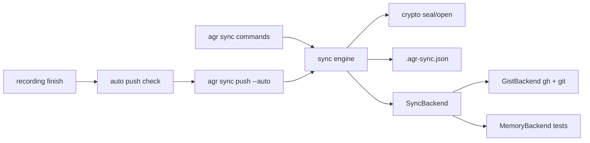

# ADR: Encrypted Session Sync (secret gists first)

## Status
Accepted (auto-approved, the user delegated the SDLC up to an open PR). Decided autonomously, review in PR.

## Context

Sessions live on one machine. REQUIREMENTS.md (auto-approved, updated 2026-11-06 with auto push,
encryption and key handling) fixes the what: `agr sync status|push|pull|delete`, a backend-neutral
`SyncBackend` trait, a hidden local index, three-way hash conflicts, secret gists via `gh` as the
only backend, every upload encrypted locally, the key in `~/.config/agr/sync.key` with a recovery
phrase for the second machine, and auto push after each recording once a backend is set.

This ADR decides the how: transport, crypto, remote layout, index, module layout, auto push
latency and the stage split.

Base: `main` after #165 (gzip storage). Config is v4, as such v5 is next. MSRV 1.88.

### Verified facts (2026-11-06)

**GitHub gists**
1. The REST API returns at most 1MB of content per file, `truncated: true` marks the rest. `raw_url`
   works up to 10MB, larger files need a clone via `git_pull_url`. A gist response lists at most
   300 files. Source: https://docs.github.com/en/rest/gists/gists (section "Truncation").
2. Gists are git repositories, they can be cloned, committed to and pushed like any repo.
   Source: https://docs.github.com/en/get-started/writing-on-github/editing-and-sharing-content-with-gists/forking-and-cloning-gists
3. Git warns on files over 50 MiB and GitHub blocks files over 100 MiB. Push size is capped at
   2GB, repos ideally stay under 1GB. Sources:
   https://docs.github.com/en/repositories/working-with-files/managing-large-files/about-large-files-on-github
   and https://docs.github.com/en/repositories/creating-and-managing-repositories/repository-limits
4. Secret gists are not listed or searchable, but anyone with the URL can read them. GitHub also
   runs partner secret scanning on secret gists. Source:
   https://docs.github.com/en/get-started/writing-on-github/editing-and-sharing-content-with-gists/creating-gists
5. "List gists for the authenticated user" supports `per_page` and `since`, so `gh api gists
   --paginate` returns all of them with descriptions. Source:
   https://docs.github.com/en/rest/gists/gists#list-gists-for-the-authenticated-user

**gh CLI (local: gh 2.96.0, logged in, scopes `gist`, `read:org`, `repo`, git protocol ssh)**
1. `gh gist` has `create`, `list`, `view`, `clone`, `edit`, `rename`, `delete`. `create` is secret
   by default (`--public` to list), `delete --yes` skips the prompt, `clone` passes extra flags to
   `git clone` after `--`.
2. `gh gist create` and `gh gist edit` refuse binary content ("binary file not supported").
   Source: https://github.com/cli/cli/blob/trunk/pkg/cmd/gist/create/create.go (around line 214)
   and https://github.com/cli/cli/blob/trunk/pkg/cmd/gist/edit/edit.go (around lines 282, 421).
3. `gh auth status` prints the token scopes line but never the token. `gh api` authenticates with
   the stored token, agr never sees it.

**Crates (crates.io, checked 2026-11-06)**
- `chacha20poly1305` 0.10.1 (stable line, no declared MSRV, `getrandom` feature on by default),
  0.11.0 needs Rust 1.85. Both fit MSRV 1.88.
- `sha2` 0.10.9 (no declared MSRV), 0.11.1 needs exactly 1.88.
- `data-encoding` 2.11 (MSRV 1.48, no deps) covers base32 and base64url.
- `getrandom` 0.2 and 0.3 are already in Cargo.lock through other deps.
- Windows target `x86_64-pc-windows-msvc` is installed locally, so `cargo check --target` works.

**Codebase touch points**
- `src/recording.rs` (370 lines) `finish()` calls `finalize_recording` (src/recording/finalize.rs),
  which returns the final `.cast.gz` path. That is the auto push hook.
- `src/files/codec.rs` has `atomic_write`, `temp_path_for`, `is_gzip_path`, `session_stem`.
  `src/files/backup.rs` has `create_backup` / `backup_path_for`. `src/files/lock.rs` has
  `read_lock` and live-lock detection. `src/commands/prompt.rs` has `should_proceed` with the
  no-TTY rule. `src/config/state.rs` loads and atomically saves `state.toml`.
- `StorageManager::list_sessions` only walks directories under the storage root and skips
  hidden files, so a hidden file at the root (the index) is never a session and never in stats.
  `agent_dirs` does not skip hidden directories, as such temp clones must never live in the
  storage dir.
- `src/cli.rs` is 420 lines already, new subcommand enums go to `src/cli/subcommands.rs` (229).

### Still unknown (verify in a stage)
1. A git push of a binary file to a gist is accepted and served back byte-identical. Verify in
   Stage 7 (ignored live test). Fallback: base64url text in the same git file, about 33% larger,
   nothing else changes.
2. Maximum gist description length (the sealed metadata token is about 260 chars). Verify in
   Stage 7. Fallback: put the token into `agr-session.json` and read it per gist (one API call
   per gist on `list`, slower but correct).
3. With `git_protocol = https` and no gh credential helper, `git push` to the gist fails. Verify
   in Stage 7 and map the error to the hint `gh auth setup-git`.

## Options Considered

### 1. Transport for the blob

**Option A: REST API through `gh api` with base64 text files**
- Pros: one tool, no git, no temp clone.
- Cons: API reads truncate at 1MB per file and `raw_url` stops at 10MB, so a 52MB session needs
  chunking into 1MB files (about 70 files of base64, 33% larger), plus one JSON request body of
  70MB for create. Request body limits are undocumented.

**Option B: git clone and push of the gist repo, `gh` for create, list and delete**
- Pros: the blob is a real binary file, no size overhead, the documented path for files over
  10MB, single file per gist. `gh gist clone` reuses the user's git protocol setup.
- Cons: needs `git` on PATH, one temp clone per push or pull, the gist history keeps old
  ciphertexts (encrypted, acceptable).

**Option C: `gh gist create/edit` with files**
- Not possible, `gh` refuses binary, and ciphertext is binary.

**Decision: Option B**, decided autonomously (review in PR). It is the documented way for large
files and keeps one file per gist. Clones are shallow (`-- --depth 1`) into
`std::env::temp_dir()/agr-sync-<pid>-<n>`, removed afterwards, never under the storage dir.

### 2. Cipher

**Option A: XChaCha20-Poly1305 (`chacha20poly1305`)**
- Pros: 24-byte nonce makes random nonces safe for any number of messages, constant-time in
  software on every CPU, pure Rust, RustCrypto.
- Cons: none relevant here.

**Option B: AES-256-GCM (`aes-gcm`)**
- Pros: hardware accelerated on most CPUs.
- Cons: 12-byte nonce, random nonces need care past ~2^32 messages per key, software fallback
  is slower and needs care for side channels.

**Decision: Option A, `chacha20poly1305 = "0.10"`**, decided autonomously (review in PR). Speed
does not matter at sync sizes, nonce safety does. 0.10 over 0.11 because it shares the existing
`getrandom` 0.2 and is the long-standing stable line, bump later in a separate PR.

### 3. Recovery phrase encoding

**Option A: BIP39 word list**
- Pros: familiar words.
- Cons: a 2048-word list (crate or 13KB file), more than we need.

**Option B: base32 with checksum**
- Pros: `data-encoding` is tiny, has no deps and also gives us base64url for the metadata token.
  Case-insensitive, no ambiguous `0/O`, `1/I` with RFC 4648 base32.
- Cons: less pleasant to type than words.

**Decision: Option B**, decided autonomously (review in PR). Phrase = base32 (RFC 4648, no padding)
of `key (32 bytes) || first 2 bytes of SHA-256(key)`, which is 55 chars, printed as 11 groups of
5 joined with `-`, prefixed `agr1-`. Import upper-cases and strips spaces and dashes, rejects a
wrong prefix, wrong length or bad checksum.

### 4. Where the metadata lives and whether names are encrypted

**Option A: plain description `agr:v1 <agent>/<name>`**
- Pros: readable in the gist UI, one list call gives everything.
- Cons: session names come from directory and branch names (customer and ticket names), that is
  exactly what the user wants private.

**Option B: sealed metadata in the description, `agr:v1 <token>`**
- Pros: one paginated list call still gives path, plaintext hash and size for every gist, nothing
  readable leaks. Gists sealed with another key show up as "other key" and are left alone.
- Cons: the gist UI shows only an opaque token, description length to verify (fallback above).

**Decision: Option B**, decided autonomously (review in PR). `token = base64url(sealed JSON)`,
JSON is `{"v":1,"path":"claude/x.cast.gz","sha256":"<hex>","size":123}`. `.keep` in the gist
holds only a newline (gists need one text file at create time, `gh gist create` cannot create
the binary file), the blob lives in `data.000`, `data.001`, ... (see "Large sessions").
File names reveal neither the tool nor the content, only the `agr:v1 ` description prefix does
(second machines find their gists by it).

### 5. Auto push latency

**Option A: synchronous with a short timeout**
- Pros: the warning line is printed in the same terminal.
- Cons: create plus clone plus push is several seconds for small files, a 50MB upload is much
  longer, it blocks the shell after every recording, which the requirement forbids.

**Option B: fast local checks in-process, network part in a detached child**
- Pros: the shell returns right away. Every skip reason that is knowable locally (no backend,
  `auto_push = false`, no privacy ack, no key, plain or locked session, `gh` or `git` not on
  PATH) still prints its one-line hint synchronously.
- Cons: a network failure cannot print in the original terminal.

**Decision: Option B**, decided autonomously (review in PR). After the local checks pass, agr
spawns `agr sync push --auto <agent>/<name>` (hidden flag) with null stdio, its own process group
on unix, no wait. On failure the child stores one line in `state.toml`
(`last_auto_push_error`), and the next recording or `agr sync status` prints it as a warning and
clears it. The child takes the sync lock non-blocking and quietly skips if a push already runs,
the next push picks the session up. Exit status of the recording is never touched.

### 6. Hash

**Decision: `sha2 = "0.10"`**, SHA-256 over the `.cast.gz` bytes (plaintext of the cipher). The
index, conflicts and pull verification use this hash, never the ciphertext.

## Decision

### Data flow


Legend: commands and auto push go through one engine, encryption sits above the trait, backends
only ever see opaque bytes and opaque metadata tokens.

### Trait

```rust
pub struct RemoteEntry { pub id: String, pub meta_token: String }

pub trait SyncBackend {
    fn name(&self) -> &'static str;
    fn check(&self) -> Result<(), BackendError>;            // gh/git present, logged in, scope
    fn list(&self) -> Result<Vec<RemoteEntry>, BackendError>;
    fn push(&self, id: Option<&str>, meta_token: &str, blob: &[u8]) -> Result<String, BackendError>;
    fn pull(&self, id: &str) -> Result<Vec<u8>, BackendError>;
    fn delete(&self, id: &str) -> Result<(), BackendError>;
}
```
`BackendError` (thiserror) has `NotInstalled(&'static str)`, `NotLoggedIn`, `MissingScope`,
`Unreachable(String)`, `Other(String)`, so commands print one clear line per case. Encryption is
in the engine, as such a later S3 or git backend gets it for free.

### Blob and token format

`b"AGR1" || version u8 (1) || nonce [24] || ciphertext+tag`. AAD is `b"agr:blob:" || path` for
the blob and `b"agr:meta"` for the token, so a blob moved to another session's gist fails to
open. Whole session in memory, bounded by the 1 GiB cap.
`// ponytail:` in-memory seal, a streaming STREAM construction if the cap ever goes up.

### Key file

`~/.config/agr/sync.key`, content `agr-sync-key v1 <base32 key>`, created with mode 0600
(`OpenOptions::mode`, unix only, `cfg(unix)` so Windows still compiles). Load refuses a file with
any group or other bits set. First creating push without a key generates one from `OsRng`, but
only if the remote has no agr gists, otherwise it aborts with the import hint (a second key
would split the remote into two unreadable halves). `agr sync key export` prints the phrase,
`agr sync key import [--force]` reads it from stdin (or the argument), refuses to replace a
different existing key without `--force`.

### Index

`<storage>/.agr-sync.json`, written with `codec::atomic_write`.
`{"version":1,"entries":{"claude/x.cast.gz":{"sha256":"..","remote_id":"..","synced_at":"<rfc3339>"}}}`.
Missing or unparseable is treated as empty (rebuild path, same rules as a second machine), with
one warning for unparseable. Never synced, never a session.

### Decision table (pure, `sync::plan`)

Inputs per path: local hash (or skip reason), remote hash and id, last synced hash.
1. local == remote: in sync (index refreshed when missing).
2. local only: push. remote only (also "in index but deleted locally"): pull.
3. local changed, remote == last: push. remote changed, local == last: pull.
4. both differ from last (or no last and local != remote): conflict, skipped unless
   `--overwrite`, which picks push or pull by command.
5. remote entry sealed with another key or unknown version: reported, never touched.
6. local plain `.cast`, live lock, over 1 GiB: skipped with reason.

### Safety rules
- Pull: download, open (auth), SHA-256 equals the sealed metadata hash, then
  `codec::atomic_write_raw` (new, same temp + fsync + rename as `atomic_write` but never
  encodes, because `atomic_write` gzips any `.cast.gz` target and would double-compress).
  An existing file is only replaced when the decision is pull (row 3, remote changed and local
  == last) or `--overwrite` on a conflict, after the current file is copied to the hidden
  `.bak`. An older, different `.bak` is rotated (replaced by the current file, the newer state
  worth keeping), it never blocks a pull.
- Push and pull take `<storage>/.agr-sync.lock` (create_new, pid inside, stale pid reclaimed).
- Index updated after each successful session, so an interrupted run loses nothing.
- Per-session errors go to the report, the run continues.
- No implicit deletes in either direction, `agr sync delete` only removes the gist and the
  index entry.
- `gh` is called with `std::process::Command`, never through a shell, args never contain the
  token, stderr is mapped to `BackendError` and never echoed raw into the index or state.

### Module layout

| File | Content |
|------|---------|
| `src/sync/mod.rs` | module list, `SessionPath`, re-exports |
| `src/sync/crypto.rs` | key type, seal/open, token encode, phrase encode/decode, sha256 helper |
| `src/sync/key.rs` | key file load/save, permissions |
| `src/sync/index.rs` | index load/save |
| `src/sync/plan.rs` | pure decision table |
| `src/sync/backend.rs` | trait, `RemoteEntry`, `BackendError` |
| `src/sync/memory.rs` | `MemoryBackend` (pub, used by tests) |
| `src/sync/scan.rs` | local scan (skip reasons) and remote decode into plan inputs |
| `src/sync/run.rs` | execute push, pull, delete, report, sync lock |
| `src/sync/pull.rs` | pull of one session, verify, backup rotation, atomic write |
| `src/sync/lock.rs` | `.agr-sync.lock`, pid inside, stale pid reclaimed |
| `src/sync/format.rs` | plain text lines for status, preview, summary, delete |
| `src/sync/setup.rs` | backend and key resolution, error explanations, key import and export |
| `src/sync/file.rs` | directory backed fake, only through `AGR_SYNC_TEST_BACKEND_DIR` (prints one stderr line when set) |
| `src/sync/gist.rs` | `GistBackend` (`gh` and `git` calls) |
| `src/sync/gist_parse.rs` | list parsing, stderr mapping, scope check, pure |
| `src/sync/runner.rs` | `Runner` trait, `ProcessRunner` and `spawn_detached`, the only code that spawns processes |
| `src/sync/auto.rs` | auto push checks and error line |
| `src/recording/auto_push.rs` | recording hook, prints the hint and spawns the child |
| `src/commands/sync/` | `mod.rs` (dispatch, output), `key.rs` |

The library never prints, except the existing `State::load_from` warning. Commands format output
with theme helpers. `auto.rs` returns the hint line, `src/recording.rs` prints it.

### Config v5

```toml
[sync]
# backend = "gist"   # unset means sync is off
auto_push = true
```
`SyncConfig { backend: Option<SyncBackendKind>, auto_push: bool }`, enum `Gist` with
`serde(rename_all = "lowercase")`, so an invalid value fails with the allowed values. v5 adds
the table with `auto_push = true` and the commented backend line, idempotent. `State` gets
`sync_privacy_ack: bool` and `last_auto_push_error: Option<String>`.

### Large sessions and listing limit (2026-11-06, user decision)

1. **Parts in the same gist**: the sealed blob is cut into parts of at most 45 MiB, named
   `data.000`, `data.001`, ..., all in the session's own gist and pushed in one commit with the
   rest. 45 MiB stays under git's 50 MiB warning. A re-push removes stale higher parts in the
   same commit. Pull reads every `data.NNN`, requires them contiguous from 000 (no gap, no
   extra, no reorder) and joins them before anything is opened. Split and join are pure
   (`sync::parts`), the engine and `SyncBackend` still move one blob.
2. **1 GiB cap** per session (was 100MB), from GitHub's repository size guidance
   (https://docs.github.com/en/repositories/creating-and-managing-repositories/repository-limits).
   Whole session still sits in memory, as such the cap is also a memory bound.
3. **Listing abort at 3000**: GitHub documents a 3000 gist pagination cap
   (https://docs.github.com/en/rest/gists/gists). If the listing has 3000 or more gists in
   total (all gists, not only agr ones) the backend errors and the engine aborts before any
   change, so unlisted gists are never treated as missing.

## Consequences

- New deps: `chacha20poly1305`, `sha2`, `data-encoding` (all pure Rust, small).
- New runtime requirement for sync only: `gh` and `git` on PATH.
- Gist UI shows only `agr:v1 <token>` and opaque `data.NNN` files, which is the point.
- Losing every copy of the key makes the remote unreadable. Docs and the first key generation
  say so.
- Help and completions snapshots change, docs regenerated with `cargo xtask gen-docs`.
- Expected PR size about 45 files, under the 100 file limit.

## To verify during implementation
1. Binary git push to a gist round-trips (Stage 7, ignored live test).
2. Description length fits the token (Stage 7).
3. https protocol without credential helper error mapping (Stage 7).
4. `cargo check --target x86_64-pc-windows-msvc` passes with the new deps (Stage 1 and Stage 11).

**Still unverified live (Stage 7 was tested against a fake process runner only, no real gist was
created, edited or deleted, the ignored `tests/sync_gist_live.rs` was not run):**
- Exact `gh gist create <file> --desc <text>` output format (the id is parsed from the last path
  segment of the printed `gist.github.com/...` URL).
- `gh gist clone <id> <dir> -- --depth 1` works for a secret gist and with the configured git
  protocol.
- A binary `data.000` pushed with plain `git push` is served back byte-identical (Open
  Question 1), gist description length for the token (Open Question 2), and the real https
  without credential helper error text (Open Question 3, the mapping is built from sample
  strings, not captured output).
- `gh api gists?per_page=100 --paginate` prints concatenated JSON arrays (parser accepts that and
  a single array), and `gh api -X PATCH gists/<id> -f description=...` updates the description.
- The `gh auth status` scope line wording (`Token scopes: ...`) on other gh versions.
- Not verified live: `gh gist create` accepting the empty dotfile `.keep` with a newline body, a
  multi-part push and shrink (`tests/sync_gist_live.rs`, run by hand).
- Push order, not verified live: a new gist is created with the placeholder description
  `agr:pending` (no `agr:v1 ` prefix, so `list` ignores it), then clone, blob commit, push, and
  only then `set_description(token)`, for new and existing gists. A crash in between leaves
  either an unlisted pending gist or an old token with a new blob (hash mismatch, pull rejects).
  On error a newly created gist is deleted, when that delete fails too the orphan stays unlisted
  and the next push creates a fresh gist.

## Decision History
1. 2026-11-06: user added auto push after recording (default on once a backend is set).
2. 2026-11-06: user required private storage, gists have no private mode, decided: keep secret
   gists, encrypt every upload locally, key file plus recovery phrase. GitHub secrets rejected
   by the user (write-only for `gh`).
3. 2026-11-06 (fix round): decision 9, a pull replaces an older different `.bak` with the
   current local file (rotate), a stale backup must not fail every later pull.
4. 2026-11-06 (fix round): decision 10, push order is blob first and token last with a
   placeholder description at create, so an orphan gist never advertises a hash without a blob.
5. All other decisions in this ADR: decided autonomously (review in PR).
