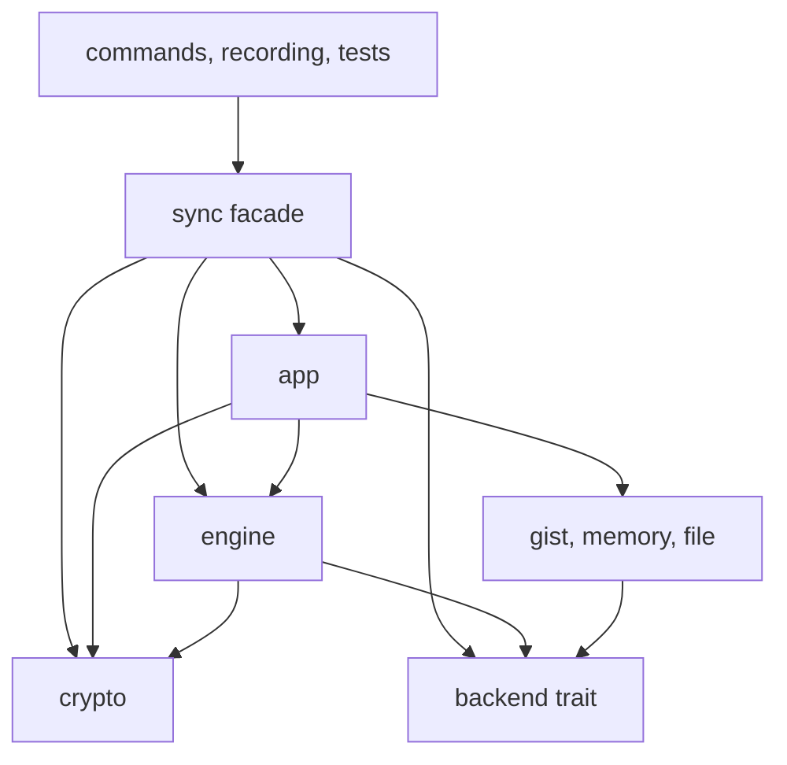
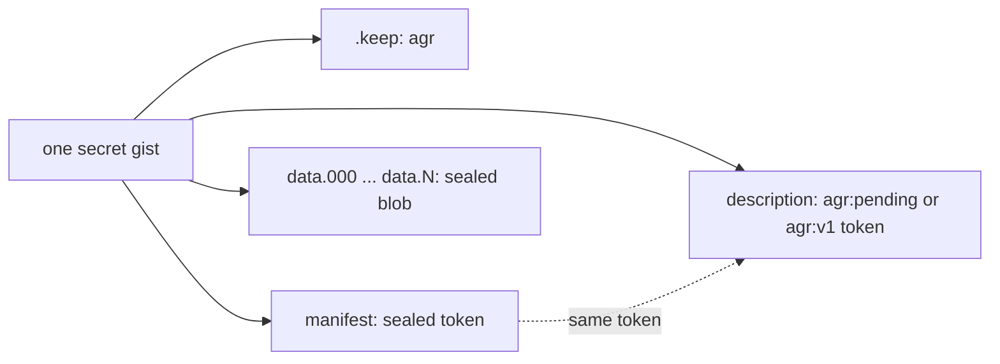
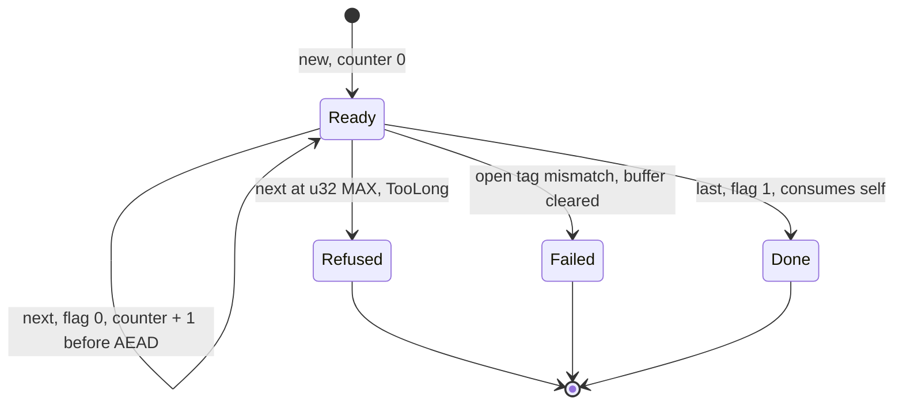
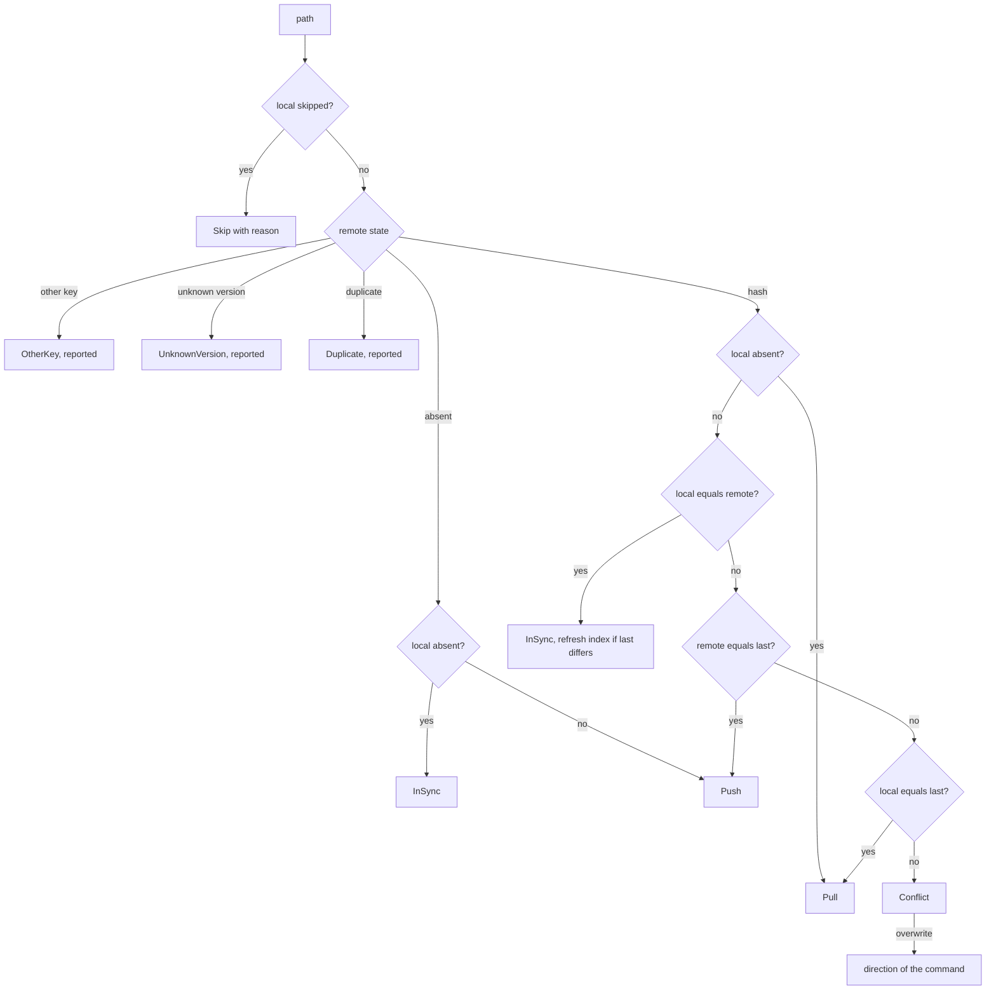
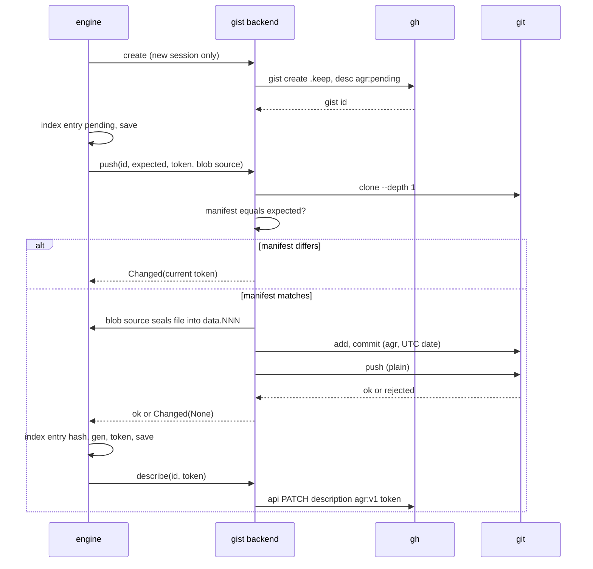
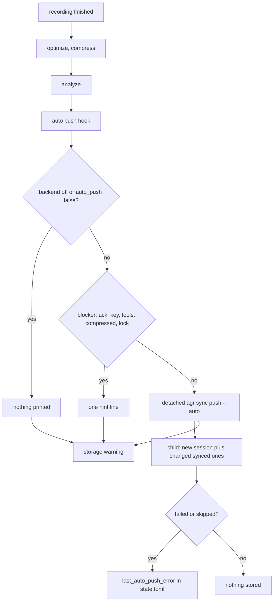
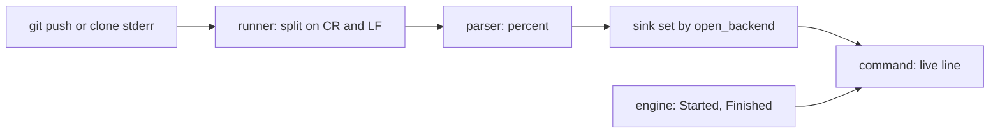
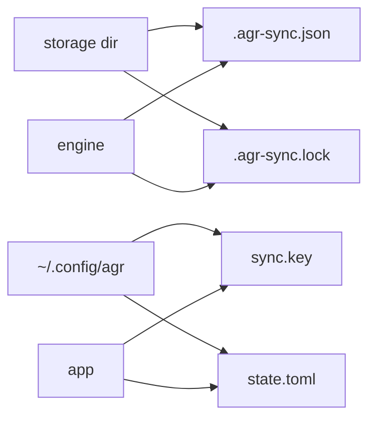
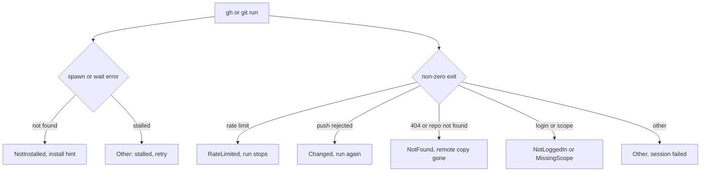

# Sync architecture

`agr sync` copies compressed sessions to a remote so another machine can pull them, and this page explains how the code does it, layer by layer, as a lookup for anyone changing it.

## Purpose and scope

We encrypt every session on the machine before it leaves, and the remote only ever holds ciphertext and opaque tokens.

- **Push and pull:** `agr sync push` uploads new and changed sessions, `agr sync pull` downloads them, `agr sync status` shows the plan and `agr sync delete` removes a remote copy ([commands/sync/mod.rs](../../src/commands/sync/mod.rs#L12)).
- **Secret gists:** the only backend is GitHub gists through `gh` and `git`, one secret gist per session ([gist/mod.rs](../../src/sync/backend/gist/mod.rs#L46)).
- **Local encryption:** XChaCha20-Poly1305 with a key that never leaves the machine except as a recovery phrase on explicit export ([crypto/mod.rs](../../src/sync/crypto/mod.rs#L43)).
- **Auto push off by default:** `auto_push` defaults to `false` ([config/types.rs](../../src/config/types.rs#L70)), as decided on 2026-11-09 ([REQUIREMENTS.md](../../.state/feature-sync-gist/REQUIREMENTS.md#L323)).
- **Backend gist by default:** `backend` defaults to `gist` ([config/types.rs](../../src/config/types.rs#L66)) and `off` disables sync completely ([setup.rs](../../src/sync/app/setup.rs#L108)), as decided on 2026-11-09 ([REQUIREMENTS.md](../../.state/feature-sync-gist/REQUIREMENTS.md#L321)).
- **Not in scope:** auto pull, auto delete, a watch mode and other backends. Deleting a file locally never deletes it remotely and the other way round.
- **Compressed only:** sync moves `<agent>/<name>.cast.gz` files, a plain `.cast` is skipped with a hint to run `agr compress` ([engine/item.rs](../../src/sync/engine/item.rs#L62)).

## Layers

**Problem**: Rust has no visibility rule between sibling modules of one crate, as such our layering would only exist in our heads without a check.

**Approach:** `src/sync/` is split into four private layers below a small facade ([sync/mod.rs](../../src/sync/mod.rs#L3)), the layout follows the ADR section [Module structure (refinement 2026-11-06)](../../.state/feature-sync-gist/ADR.md#module-structure-refinement-2026-11-06).

- **crypto:** key, one-shot seal and the metadata token ([seal.rs](../../src/sync/crypto/seal.rs)), the recovery phrase ([phrase.rs](../../src/sync/crypto/phrase.rs)), the streamed blob v2 ([blob/mod.rs](../../src/sync/crypto/blob/mod.rs)) and our own STREAM layer ([blob/stream.rs](../../src/sync/crypto/blob/stream.rs)). It depends on nothing else in sync.
- **backend:** the `SyncBackend` trait with `RemoteEntry`, `BackendError` and `BlobSource` ([backend/mod.rs](../../src/sync/backend/mod.rs#L48)), plus the gist, memory and file implementations. Backends only see opaque tokens and sealed bytes.
- **engine:** scan, plan, push, pull, delete, the index and the lock ([engine/mod.rs](../../src/sync/engine/mod.rs)). It never prints and only knows the backend trait, never a concrete backend. It reports `Started` and `Finished` events to an observer ([engine/observe.rs](../../src/sync/engine/observe.rs#L1)).
- **app:** command facing glue, backend choice and key resolution ([setup.rs](../../src/sync/app/setup.rs)), the key file ([app/key.rs](../../src/sync/app/key.rs)), auto push ([app/auto/mod.rs](../../src/sync/app/auto/mod.rs)) and the output lines ([app/format/mod.rs](../../src/sync/app/format/mod.rs)), including the compact status ([format/status.rs](../../src/sync/app/format/status.rs)) and the live progress line ([format/live.rs](../../src/sync/app/format/live.rs)).
- **facade:** `agr::sync` re-exports what commands and recording need, and a hidden `testing` module carries internals for the integration tests only ([sync/mod.rs](../../src/sync/mod.rs#L8)).

Legend: an edge means "may import", facade edges are re-exports only, anything without an edge fails `layer_rules_hold`.

**How `layer_rules_hold` enforces it:** the test walks every `.rs` file below `src/sync/` except `mod.rs` itself, strips comments, expands grouped `use` paths like `a::{b, c::{d}}` and checks them against a rule table ([sync/mod.rs](../../src/sync/mod.rs#L144)). The rules ([sync/mod.rs](../../src/sync/mod.rs#L33)) are:

1. `backend/` must not name `crate::sync::crypto`, `crate::sync::engine` or `crate::sync::app`.
2. `engine/` must not name `crate::sync::app` or a concrete backend (`backend::gist`, `backend::memory`, `backend::file`).
3. `app/`, `engine/` and `backend/` must not name `chacha20poly1305`, `sha2::` or `aead::`, so a cipher crate change only touches `crypto/` and `Cargo.toml`.
4. `crypto/` must not use any `crate::sync::` path outside `crate::sync::crypto` ([sync/mod.rs](../../src/sync/mod.rs#L135)).
5. No file may contain `super::super`, so cross-layer imports are always written as `crate::sync::<layer>` and the check stays a plain text match.
6. `Command::new` is only allowed in `backend/gist/runner.rs` (spawns `gh` and `git`) and `app/auto/mod.rs` (spawns the detached push child) ([sync/mod.rs](../../src/sync/mod.rs#L52)).

The check does not cover code outside `src/sync/` and does not check that only `setup.rs` builds a concrete backend, both are kept by review. Small unit tests next to it pin the parser for plain, grouped and nested imports and for comments ([sync/mod.rs](../../src/sync/mod.rs#L161)).

## Remote layout

**Problem**: a secret gist is readable by anyone with its URL, as such everything we put there has to be either ciphertext or harmless.

Every session gets its own gist with these files:

- **`.keep`:** a neutral stub with the fixed body `agr\n` ([gist/mod.rs](../../src/sync/backend/gist/mod.rs#L20)), it only exists because `gh gist create` refuses an empty gist and a blank file ([gist/mod.rs](../../src/sync/backend/gist/mod.rs#L22)).
- **`manifest`:** the sealed metadata token of the current commit, the compare-and-swap checks it ([gist/mod.rs](../../src/sync/backend/gist/mod.rs#L24)).
- **`data.000`, `data.001`, ...:** the sealed blob cut into parts of at most 45 MiB, which stays under git's 50 MiB warning ([parts.rs](../../src/sync/backend/gist/parts.rs#L9)). An empty blob still writes `data.000`, an exact multiple leaves no empty trailing part and a smaller re-push removes the stale higher parts in the same commit ([parts.rs](../../src/sync/backend/gist/parts.rs#L87)). Pull requires the names to be exactly `data.000` up to `data.N` with no gap, extra or reorder ([parts.rs](../../src/sync/backend/gist/parts.rs#L18)).
- **Description:** `agr:pending` while a freshly created gist has no blob yet ([gist/mod.rs](../../src/sync/backend/gist/mod.rs#L26)), then `agr:v1 <sealed token>` ([parse.rs](../../src/sync/backend/gist/parse.rs#L6)). The listing only picks up descriptions with the `agr:v1 ` prefix, so a pending gist stays invisible to other machines ([parse.rs](../../src/sync/backend/gist/parse.rs#L43)).

Legend: the commit (manifest plus parts) is the truth, the description is only a listing hint and is repaired by copying the manifest token into it.

**What a third party can see:**

- **Visible:** the `agr:pending` and `agr:v1` prefixes, the file names and their sizes (so roughly how big a session is), the commit times (always UTC, author and committer `agr` with `agr@localhost`, [gist/mod.rs](../../src/sync/backend/gist/mod.rs#L28)), the git history of a gist and how many gists we have.
- **Not visible:** the session content, the session name, the agent, the content hash and the generation, all of them sit inside the sealed token or the sealed blob.

The commit identity is forced through `-c user.*` and through `GIT_AUTHOR_*` and `GIT_COMMITTER_*` env vars, because exported env vars of the user would beat `-c` and leak a real name ([gist/mod.rs](../../src/sync/backend/gist/mod.rs#L36)). The user's global git hooks are pointed at an empty path ([gist/mod.rs](../../src/sync/backend/gist/mod.rs#L244)).

GitHub lists at most 3000 gists, and a listing of 3000 or more (agr gists and foreign ones counted together) aborts the run, so unlisted gists are never mistaken for missing ones ([parse.rs](../../src/sync/backend/gist/parse.rs#L33)).

## Encryption

**Problem**: sessions can hold secrets typed in a terminal and reach up to 1 GiB, as such the encryption has to authenticate everything and stay flat in memory.

### Key file and recovery phrase

- **Key:** 256 bits from the OS RNG, `Debug` prints `Key(..)` and the bytes are zeroized on drop ([crypto/mod.rs](../../src/sync/crypto/mod.rs#L43)).
- **Key file:** `~/.config/agr/sync.key` ([setup.rs](../../src/sync/app/setup.rs#L55)), content `agr-sync-key v1 <base32>` ([app/key.rs](../../src/sync/app/key.rs#L34)), created with mode 0600 ([app/key.rs](../../src/sync/app/key.rs#L77)). On unix a file with any group or other bit set is refused ([app/key.rs](../../src/sync/app/key.rs#L59)).
- **First key:** push and status may create a key, but only when the remote lists no agr gists, otherwise a second key would split the remote into two unreadable halves and we stop with the import hint ([setup.rs](../../src/sync/app/setup.rs#L60)). The fresh key lives in memory until the user confirmed the push ([commands/sync/run.rs](../../src/commands/sync/run.rs#L217)).
- **Recovery phrase:** `agr1-` plus base32 of `key || sha256(key)[..2]` in groups of five ([phrase.rs](../../src/sync/crypto/phrase.rs#L31)). Import ignores case, spaces and dashes and checks prefix, length and the checksum ([phrase.rs](../../src/sync/crypto/phrase.rs#L43)). `key import` refuses to replace a different key without `--force` ([app/key.rs](../../src/sync/app/key.rs#L123)).

### Blob v2

The blob is `AGR1 || 0x02 || prefix[19] || frames` ([blob/mod.rs](../../src/sync/crypto/blob/mod.rs#L15)). The plaintext is cut into 64 KiB frames, every frame but the last is exactly 65536 plaintext bytes plus a 16 byte tag, and the last frame holds 0 to 65536 bytes plus its tag. An empty session is one empty last frame, a blob of 40 bytes. The 19 byte prefix is fresh from the OS RNG for every blob ([blob/mod.rs](../../src/sync/crypto/blob/mod.rs#L66)).

Legend: the header is 24 bytes, every frame is ciphertext plus a 16 byte tag, only the final frame carries the last flag.

**STREAM nonce:** the 24 byte XChaCha20 nonce is `prefix || counter u32 BE || last flag`, built in one place ([blob/stream.rs](../../src/sync/crypto/blob/stream.rs#L28)). This is the `StreamBE32` layout of `aead` 0.5, which we rebuilt on the plain AEAD of `chacha20poly1305` 0.11 because 0.11 no longer ships a `stream` feature, see the ADR section [Own STREAM layer on chacha20poly1305 0.11 (2026-11-07)](../../.state/feature-sync-gist/ADR.md#own-stream-layer-on-chacha20poly1305-011-2026-11-07).

**Frame state machine:** one `Sealer` or `Opener` per blob. `next` takes the nonce and moves the counter on before the AEAD runs, and `checked_add` refuses at `u32::MAX` with `TooLong` before anything is encrypted ([blob/stream.rs](../../src/sync/crypto/blob/stream.rs#L38)). `last` takes `self`, as such a second last frame does not compile ([blob/stream.rs](../../src/sync/crypto/blob/stream.rs#L79)). A failed open clears the buffer, so no plaintext of an unverified frame leaves the layer ([blob/stream.rs](../../src/sync/crypto/blob/stream.rs#L51)).

Legend: Ready is a live Sealer or Opener, Done is reached at most once, Refused and Failed end the blob with an error.

Which call a frame gets is decided by a look-ahead in `blob/mod.rs`: read up to one frame, then `fill_buf` tells whether more bytes follow. More bytes means `next`, none means `last` ([blob/mod.rs](../../src/sync/crypto/blob/mod.rs#L46)). On open a frame shorter than the tag is `Truncated` before the AEAD runs ([blob/mod.rs](../../src/sync/crypto/blob/mod.rs#L155)), and a frame is written to the output only after it verified ([blob/mod.rs](../../src/sync/crypto/blob/mod.rs#L140)).

**AAD:** every frame carries `AGR1 || 0x02 || "agr:blob:" || path || ":" || gen` ([blob/mod.rs](../../src/sync/crypto/blob/mod.rs#L33)). The header is bound through it, a blob moved into another session's gist fails on the path and an older blob replayed under a newer manifest fails on the gen.

### Sealed metadata token

The token is the one-shot format `AGR1 || 0x01 || nonce[24] || ciphertext+tag` over the JSON of `Meta { v, path, sha256, size, gen }` with the AAD `agr:meta`, then base64url without padding ([seal.rs](../../src/sync/crypto/seal.rs#L61)). The same string sits in the `manifest` file and in the description. A token that does not authenticate is reported as `OtherKey` ([seal.rs](../../src/sync/crypto/seal.rs#L66)). Scan only accepts `v == 2`, `gen > 0` and a path of the form `agent/name.cast.gz` without hidden parts, backslashes or colons, anything else is `UnknownVersion` and never touched ([engine/scan.rs](../../src/sync/engine/scan.rs#L143)).

### Invariants and where they are tested

1. **Nonce layout** `prefix || counter BE || flag`: `nonce_layout_is_prefix_counter_be_and_flag` ([stream/tests.rs](../../src/sync/crypto/blob/stream/tests.rs#L42)) and `frame_nonce_is_prefix_counter_and_last_flag` ([blob/tests.rs](../../src/sync/crypto/blob/tests.rs#L259)).
2. **Counter overflow refused:** `next_is_refused_at_u32_max_and_last_still_works` ([stream/tests.rs](../../src/sync/crypto/blob/stream/tests.rs#L56)).
3. **Nonce never reused:** `counter_moves_before_the_aead_and_never_repeats` ([stream/tests.rs](../../src/sync/crypto/blob/stream/tests.rs#L82)).
4. **No plaintext before its frame verified:** `failed_open_clears_the_buffer` ([stream/tests.rs](../../src/sync/crypto/blob/stream/tests.rs#L105)).
5. **Exactly one last frame:** compile time through `last(self)`, plus `only_the_final_frame_carries_the_last_flag` ([blob/tests.rs](../../src/sync/crypto/blob/tests.rs#L335)).
6. **Nothing after the last frame:** `appended_bytes_or_frames_after_the_last_frame_are_rejected` ([blob/tests.rs](../../src/sync/crypto/blob/tests.rs#L139)) and `valid_last_frame_followed_by_a_valid_frame_is_rejected_by_lookahead_alone` ([blob/tests.rs](../../src/sync/crypto/blob/tests.rs#L302)).
7. **Truncation at any boundary:** `truncation_at_every_frame_boundary_and_inside_a_frame_is_rejected` ([blob/tests.rs](../../src/sync/crypto/blob/tests.rs#L106)) and `full_frame_sealed_as_next_cannot_pass_as_last_at_a_boundary` ([blob/tests.rs](../../src/sync/crypto/blob/tests.rs#L184)).
8. **Reorder, drop and duplicate:** `dropping_swapping_and_duplicating_frames_is_rejected` ([blob/tests.rs](../../src/sync/crypto/blob/tests.rs#L121)).
9. **Header bound through the AAD:** `frames_sealed_without_the_header_in_the_aad_are_rejected` ([blob/tests.rs](../../src/sync/crypto/blob/tests.rs#L322)) and `every_header_and_frame_bit_flip_is_rejected` ([blob/tests.rs](../../src/sync/crypto/blob/tests.rs#L233)).
10. **Wrong key, path or gen give no output:** `wrong_key_path_and_gen_are_rejected_without_output` ([blob/tests.rs](../../src/sync/crypto/blob/tests.rs#L194)).
11. **Empty last frame is just a tag:** `empty_last_frame_is_just_a_tag` ([blob/tests.rs](../../src/sync/crypto/blob/tests.rs#L364)).

**Known-answer vectors:** `KAT_SMALL` pins the full bytes of a one-frame blob, `KAT_TWO_FRAMES_SHA256` and `KAT_THREE_FRAMES_SHA256` pin the hash of a two and a three frame blob, the last one covers counter 2 and the last flag ([kat_tests.rs](../../src/sync/crypto/blob/kat_tests.rs#L15)). The one-shot seal has its own XChaCha20-Poly1305 vector ([seal.rs](../../src/sync/crypto/seal.rs#L99)).

**Independent Python check:** the blob vectors were computed outside our code with Python `cryptography` plus a hand-written HChaCha20 checked against draft-irtf-cfrg-xchacha-03 section 2.2.1 ([kat_tests.rs](../../src/sync/crypto/blob/kat_tests.rs#L1)). The script itself is not in the repo, only its results are, as such re-running it means rebuilding it from that description.

## Push and pull flow

**Problem**: two machines can push the same session at the same time and GitHub has no transactions, as such every write has to be a compare-and-swap and every read has to check it is not older than what we saw last.

### Plan

The engine first loads the index, lists the remote and scans the storage dir into one row per path ([engine/run.rs](../../src/sync/engine/run.rs#L256)). Scan hashes only the local files the run needs, skips plain `.cast`, a live recording lock, files over 1 GiB on disk and unreadable files ([engine/scan.rs](../../src/sync/engine/scan.rs#L97)). When several gists claim one path, the oldest `created_at` wins with the id as tie-break, so every machine picks the same one, and a gist without `created_at` sorts last ([engine/scan.rs](../../src/sync/engine/scan.rs#L135)). Duplicates with another hash make the path `Duplicate`, never acted on, also not with `--overwrite`. When the listing misses a path but the index knows its gist id, the row falls back to that id, unless the id is listed as another key or an unknown version ([engine/scan.rs](../../src/sync/engine/scan.rs#L178)).

The decision is a pure three-way compare of the local hash, the remote hash and the hash of the last sync from the index, file mtime is never an input ([engine/plan.rs](../../src/sync/engine/plan.rs#L65)). `--overwrite` only turns a conflict into the direction of the command ([engine/plan.rs](../../src/sync/engine/plan.rs#L95)).

Legend: "last" is the hash recorded in the index at the last sync, only Push and Pull act, everything else is reported.

### Push with compare-and-swap

`gen` is the planned gen plus one ([engine/push.rs](../../src/sync/engine/push.rs#L46)). A new session first gets a gist with `agr:pending`, and its id goes into the index as `pending` before anything else ([engine/push.rs](../../src/sync/engine/push.rs#L123)). Then the backend clones the gist, compares the stored `manifest` with the token the engine planned against (`None` for a new gist) and writes nothing when they differ ([gist/mod.rs](../../src/sync/backend/gist/mod.rs#L328)). Only after that check the blob is sealed straight from the file into the part files, one commit and one plain `git push` follow, never forced and never retried ([gist/mod.rs](../../src/sync/backend/gist/mod.rs#L234)). After a successful push the index gets the hash, gen and token, and the description PATCH comes last ([engine/push.rs](../../src/sync/engine/push.rs#L196)).

Legend: the clone and compare run before any write, a rejected git push maps to Changed(None) and nothing is retried.

**File moved while pushing:** the seal pass opens the file again and compares hash and size with the pre-pass, a difference fails the blob source, the backend commits nothing and the session reports "session changed while pushing, run again" ([engine/push.rs](../../src/sync/engine/push.rs#L148)).

**Changed on the remote:** `Changed(Some(token))` with our own path and our own hash at a higher gen is our earlier push whose index save got lost, so we adopt it instead of reporting a conflict ([engine/push.rs](../../src/sync/engine/push.rs#L163)). Anything else is "changed on the remote, run again", and when that token is at least as new as what we know, the description is set to it, but only after a fresh read shows the manifest still equals it ([engine/push.rs](../../src/sync/engine/push.rs#L185)). GitHub has no conditional description update, as such a window of a few milliseconds stays open (decision D11 in the ADR [Decision History](../../.state/feature-sync-gist/ADR.md#decision-history)).

**Pending gist resume:** a run that died after the create leaves the id in the index with `pending = true`. Scan picks that id up again with no token ([engine/scan.rs](../../src/sync/engine/scan.rs#L191)), and the next push resumes it with `expected = None` instead of creating a second gist.

**Stale-description heal:** before deciding a push, `heal` checks whether the listed description is older than the index (`repair_description`, set when the listed gen is below the index gen, [engine/scan.rs](../../src/sync/engine/scan.rs#L169)) or missing. Then it copies the index token into the description and plans against the index, it never moves the description to a lower gen ([engine/push.rs](../../src/sync/engine/push.rs#L69)).

### Pull and rollback refusal

Manifest and parts come from one clone, so they belong together ([gist/mod.rs](../../src/sync/backend/gist/mod.rs#L350)). The engine refuses a pull when the manifest is missing, belongs to another path or has a gen below the index gen or the planned gen, which is the rollback refusal ([engine/pull.rs](../../src/sync/engine/pull.rs#L45)). The blob is opened frame by frame into a hidden temp file with the manifest gen, then hash and size have to equal the manifest ([engine/pull.rs](../../src/sync/engine/pull.rs#L91)). Only then an existing file is copied to its hidden `.bak` and the temp is renamed into place ([engine/pull.rs](../../src/sync/engine/pull.rs#L67)). A manifest newer than the description wins, and the description is repaired afterwards on a best effort basis, only a rate limit stops the run there ([engine/pull.rs](../../src/sync/engine/pull.rs#L58)).

### Conflicts and `--overwrite`

A conflict is skipped with "conflict, use --overwrite" ([engine/item.rs](../../src/sync/engine/item.rs#L9)). With `--overwrite` push makes the local side win and pull makes the remote side win, the replaced local file stays as `.bak`. `--overwrite` also lets a push create a new gist when the old one is gone ([engine/push.rs](../../src/sync/engine/push.rs#L118)). It never resolves `OtherKey`, `UnknownVersion` or `Duplicate`.

## Auto push

**Problem**: a finished recording should reach the remote without the user waiting on the network, but nobody should be forced to upload.

**Order after a recording:** silence optimize and compress run inside `finish` ([recording.rs](../../src/recording.rs#L192)), then `after_stop` runs analyze, auto push and the storage warning in that order, so the pushed file is the final one ([recording/post.rs](../../src/recording/post.rs#L4)), wired in [recording.rs](../../src/recording.rs#L129).

**Hook side:** `after_finalize` runs the cheap local checks in-process, prints at most one line and spawns a detached `agr sync push --auto <agent/name.cast.gz>`, it never fails the recording ([recording/auto_push.rs](../../src/recording/auto_push.rs#L9)). The child gets null stdio and its own process group on unix, `DETACHED_PROCESS` on Windows ([app/auto/mod.rs](../../src/sync/app/auto/mod.rs#L133)). The `--auto` flag is hidden from help ([cli/subcommands.rs](../../src/cli/subcommands.rs#L269)).

**Silent:** `backend = "off"` or `auto_push = false` prints nothing ([app/auto/mod.rs](../../src/sync/app/auto/mod.rs#L35)).

**Blockers**, checked in this order, each gives one hint line ([app/auto/mod.rs](../../src/sync/app/auto/mod.rs#L53)):

1. **Ack:** the privacy notice was never confirmed with a manual `agr sync push`.
2. **Key:** no `sync.key` on this machine.
3. **Tools:** `gh` or `git` not on `PATH` (also `gh.exe` on Windows).
4. **Compressed:** the session is a plain `.cast`.
5. **Lock:** the session still has a recording lock.

Legend: the hook runs in the recording process, the child runs detached and only talks back through `state.toml`.

**Child side:** `push_auto` returns silently without the ack and needs an existing key, it never creates one ([commands/sync/run.rs](../../src/commands/sync/run.rs#L297)). It pushes without a prompt, never pulls, never deletes and never uses `--overwrite`, so a conflict is skipped and reported ([app/auto/child.rs](../../src/sync/app/auto/child.rs#L42)).

**Changed synced sessions go with the next recording:** besides the new session the child pushes every index entry whose file no longer matches the stored size and mtime stamp, pending entries excluded ([engine/index.rs](../../src/sync/engine/index.rs#L51)). Only those files get hashed and the plan still decides by hash, as decided on 2026-11-07 ([ADR 5a](../../.state/feature-sync-gist/ADR.md#5a-changed-sessions-go-with-the-next-recording-2026-11-07-user-decision)). A session that was never synced stays out until a manual push.

**Renames excluded:** a renamed file is a new path without an index entry and its old path is gone, so the child leaves it to a manual `agr sync push` and never uploads a second copy ([app/auto/child.rs](../../src/sync/app/auto/child.rs#L38)).

**Busy lock reported:** when another sync holds the lock, the stored line says the session was skipped and asks for `agr sync push` ([app/auto/child.rs](../../src/sync/app/auto/child.rs#L11)). The stored error is shown once on the next recording and by `agr sync status`, then cleared ([app/auto/child.rs](../../src/sync/app/auto/child.rs#L29)).

## Output and progress

**Problem**: with hundreds of sessions one line per session buries the answer, and a 45 MiB upload looks frozen without feedback.

**Status:** `agr sync status` prints the backend line, one line per category with count and size (`721 to push (128.4 MiB)`, one `skipped: <reason>` line per reason) and a hint to use `-v` ([format/status.rs](../../src/sync/app/format/status.rs#L12)). Conflicts, failures, other-key entries and duplicates are always listed per session, because they need action. `-v` keeps the full per-session list and the totals line.

**Progress events:** the engine calls the observer with `Started { path, size, i, n }` before a push or pull and `Finished { item, i, n }` after it, `Started` always comes first and nothing is sent for in-sync items or dry runs ([engine/observe.rs](../../src/sync/engine/observe.rs#L7)). The engine never prints, the command decides what to show.

**Live line:** only when stderr is a terminal, and never for `--auto`, `--dry-run` or a pipe. The command ([commands/sync/live.rs](../../src/commands/sync/live.rs#L12)) owns one line per running session, redrawn with `\r` and padded with spaces, no escape codes:

- **While running:** `[12/721] claude/x.cast.gz 47.40 MiB, uploading 45%` (`downloading` on pull), redrawn only when the percent changes ([format/live.rs](../../src/sync/app/format/live.rs#L10)).
- **When done:** the old line is overwritten by `[12/721] pushed claude/x.cast.gz (47.40 MiB)`.

**Where the percent comes from:** the gist backend reads the `Writing objects: NN%` lines of `git push --progress` and the `Receiving objects: NN%` lines of `git clone --progress` while the process runs. The runner splits stderr on `\r` and `\n` and hands every line to the backend through `run_watched`, whose default ignores them so `Fake` keeps working ([runner.rs](../../src/sync/backend/gist/runner.rs#L28)). A pure parser turns a line into a percent ([progress.rs](../../src/sync/backend/gist/progress.rs#L4)). The backend only passes that number to a sink the app layer set in `open_backend` ([gist/mod.rs](../../src/sync/backend/gist/mod.rs#L47)), so a backend still never sees a plaintext path. The sink is only set on a terminal, and the pre-push clone stays silent.

Legend: the engine knows which session runs, the backend only knows a percent, the command joins both into one line.

**File backend:** the directory fake has no git and never reports a percent, the line then shows `0%` until the session is done.

## Local state

**Problem**: the engine needs to remember what it synced last without trusting file times, and two runs on one machine must not interleave.

Legend: index and lock sit next to the sessions and are never synced or listed as sessions, key and state are machine local in the config dir.

### Index `.agr-sync.json`

Lives at the storage root ([engine/index.rs](../../src/sync/engine/index.rs#L9)), keyed by `agent/name.cast.gz`, `version` 1, saved atomically after every session so an interrupted run loses nothing ([engine/index.rs](../../src/sync/engine/index.rs#L97)). Missing means empty, unparseable means empty plus one warning, the same rules as a fresh machine ([engine/index.rs](../../src/sync/engine/index.rs#L82)).

Fields per entry ([engine/index.rs](../../src/sync/engine/index.rs#L14)):

- **`sha256`:** plaintext hash of the last sync, the "last" input of the plan.
- **`remote_id`:** gist id.
- **`synced_at`:** RFC 3339 time.
- **`gen`:** generation of the last synced manifest, the floor for the rollback refusal.
- **`token`:** sealed manifest token, the `expected` of the next push.
- **`pending`:** the gist was created but its first push is not recorded yet ([engine/record.rs](../../src/sync/engine/record.rs#L33)).
- **`size` and `mtime_ns`:** on-disk stamp of the local file at the last sync ([engine/index.rs](../../src/sync/engine/index.rs#L36)). It is only a cheap "might have changed" check for auto push, never a plan input.

**Restamping:** when a run finds the hashes equal but the stamp stale (an old index or the same bytes rewritten), it rewrites the entry with a fresh stamp, so the next auto run does not hash that file again ([engine/run.rs](../../src/sync/engine/run.rs#L336)).

### Lock `.agr-sync.lock`

Push, pull and delete take it, dry runs and status do not ([engine/run.rs](../../src/sync/engine/run.rs#L217)). The lock JSON (pid and start time) is written to a temp file and hard linked into place, so a second process never sees it empty ([engine/lock.rs](../../src/sync/engine/lock.rs#L47)). On a filesystem without hard links it falls back to `create_new` and a write in place, an empty lock file then counts as held ([engine/lock.rs](../../src/sync/engine/lock.rs#L70)). A lock whose pid is dead is reclaimed, a live one gives `Busy` ([engine/lock.rs](../../src/sync/engine/lock.rs#L16)). The lock is removed on drop.

### `state.toml`

`~/.config/agr/state.toml` is machine local and never synced ([config/state.rs](../../src/config/state.rs#L15)):

- **`sync_privacy_ack`:** set once the user confirmed the privacy notice before the first push that creates gists ([commands/sync/run.rs](../../src/commands/sync/run.rs#L190)).
- **`last_auto_push_error`:** the one line left by a failed auto push child.
- **`compress_offer_version`:** not sync related, it shares the file.

## Failure handling

**Problem**: `gh` and `git` fail in many ways and print a lot, as such every failure maps to one clear case and the run keeps going where it safely can.

Per-session failures go into the report and the run continues, a rate limit ends the whole run ([engine/fail.rs](../../src/sync/engine/fail.rs#L47)). Raw stderr is never echoed, `map_failure` turns it into one `BackendError` ([parse.rs](../../src/sync/backend/gist/parse.rs#L84)).

Legend: only RateLimited stops the run, the other cases end one session or abort before any change.

- **Stall timeout:** a `gh` or `git` process that prints nothing on stdout and stderr for 120 s is killed, any output resets the timer ([runner.rs](../../src/sync/backend/gist/runner.rs#L41)). Clone and push run with `--progress` so a slow upload keeps talking and feeds the live line ([gist/mod.rs](../../src/sync/backend/gist/mod.rs#L258)). Processes get no stdin with `GIT_TERMINAL_PROMPT=0` and `GH_PROMPT_DISABLED=1`, so a missing credential fails instead of hanging ([runner.rs](../../src/sync/backend/gist/runner.rs#L67)).
- **Rate limit stop:** mutating calls (create, `git push`, PATCH, delete) are paced at least 1 s apart ([pace.rs](../../src/sync/backend/gist/pace.rs#L10)). The first rate limit GitHub reports stops the run with "N left, please run again later" and keeps what is done ([engine/run.rs](../../src/sync/engine/run.rs#L28)).
- **Not found means gone:** a gh 404, and a git "repository not found" after the credential check, map to `NotFound` ([parse.rs](../../src/sync/backend/gist/parse.rs#L103)). The engine reports "remote copy gone" and skips the session, only `push --overwrite` uploads it again ([engine/fail.rs](../../src/sync/engine/fail.rs#L31)).
- **Missing gh or git:** `check` runs `git --version`, `gh --version` and `gh auth status` before anything else ([gist/mod.rs](../../src/sync/backend/gist/mod.rs#L307)), a missing binary is `NotInstalled` with an install hint ([setup.rs](../../src/sync/app/setup.rs#L78)). A token without the `gist` scope is `MissingScope` ([parse.rs](../../src/sync/backend/gist/parse.rs#L115)).
- **Interrupted reads:** an `Interrupted` error is retried in the frame look-ahead ([blob/mod.rs](../../src/sync/crypto/blob/mod.rs#L52)), in the part reader ([parts.rs](../../src/sync/backend/gist/parts.rs#L156)) and in the pipe drain of the runner ([runner.rs](../../src/sync/backend/gist/runner.rs#L135)).
- **Blank stub rule:** `gh` refuses a file that is blank after trimming, as such `.keep` carries the fixed word `agr` and no metadata ([gist/mod.rs](../../src/sync/backend/gist/mod.rs#L21)).

## Configuration and commands

| Item | Default | Effect |
|---|---|---|
| `[sync] backend` | `"gist"` | `"off"` disables every sync command and auto push |
| `[sync] auto_push` | `false` | `true` pushes after each recording once the privacy notice is confirmed |
| `agr sync status [-v]` | | summary per category, conflicts, failures and other-key entries listed, `-v` lists every session, read only |
| `agr sync push [sessions]` | all | upload, `--dry-run`, `--yes`, `--overwrite` |
| `agr sync pull [sessions]` | all | download, `--dry-run`, `--yes`, `--overwrite` |
| `agr sync delete <sessions>` | | removes the gist and the index entry, the local file stays |
| `agr sync key export` and `import` | | recovery phrase, `import --force` replaces a different key |
| `AGR_SYNC_TEST_BACKEND_DIR` | unset | swaps the gist backend for a directory fake, tests only ([commands/sync/run.rs](../../src/commands/sync/run.rs#L102)) |

Full flag reference in [Command-sync.md](../wiki/Command-sync.md) and the config keys in [Configuration.md](../wiki/Configuration.md).

## Testing

**Problem**: the real backend needs a GitHub account and the network, as such the default test run has to cover the logic without either.

- **Fake runner:** `Fake` replays scripted `gh` and `git` outputs and records every call, env and pushed file, so the gist backend is tested without spawning anything ([gist/fake.rs](../../src/sync/backend/gist/fake.rs#L27)). Push, parts and compare-and-swap cases are in [push_tests.rs](../../src/sync/backend/gist/push_tests.rs), pull and clone lifetime in [pull_tests.rs](../../src/sync/backend/gist/pull_tests.rs).
- **Memory backend:** one mutex around the compare and the write models git's ref check, `fail_on` injects failures per id ([memory.rs](../../src/sync/backend/memory.rs#L26)). The engine tests ([sync_engine_test.rs](../../tests/integration/sync_engine_test.rs)) and the three-machine interleavings ([sync_multi_machine_test.rs](../../tests/integration/sync_multi_machine_test.rs)) run on it.
- **File backend:** a directory fake behind `AGR_SYNC_TEST_BACKEND_DIR` ([file.rs](../../src/sync/backend/file.rs#L12)), used by the CLI tests ([cli_sync_test.rs](../../tests/integration/cli_sync_test.rs)), the end to end script ([e2e/sync.sh](../../tests/e2e/sync.sh)) and the memory test ([sync_memory_test.rs](../../tests/performance/sync_memory_test.rs)).
- **Live tests:** `cargo test --test sync_gist_live -- --ignored` creates and deletes real secret gists with the logged in `gh` and covers parts, the stub, a binary round trip, compare-and-swap and the description repair ([sync_gist_live.rs](../../tests/sync_gist_live.rs#L1)). They are ignored by default and run by hand only.
- **Only compile-checked:** Windows. CI runs `cargo check --all-targets` on `windows-latest` and nothing else ([ci.yml](../../.github/workflows/ci.yml#L348)), as such the Windows paths (no key file mode check, `gh.exe` lookup, `DETACHED_PROCESS`) are never executed in a test. The runner tests are unix only ([runner.rs](../../src/sync/backend/gist/runner.rs#L147)).
