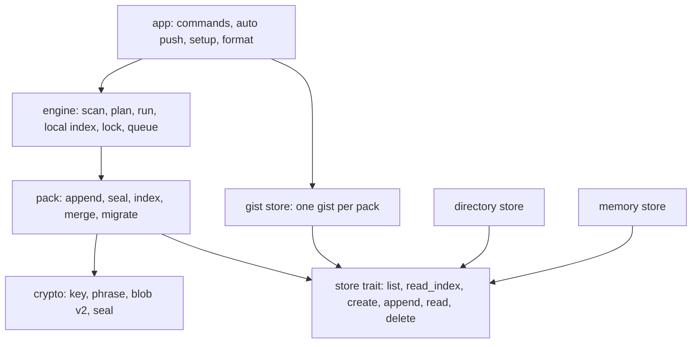
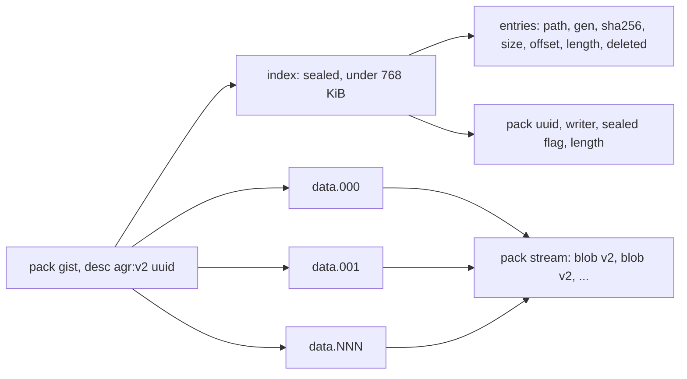
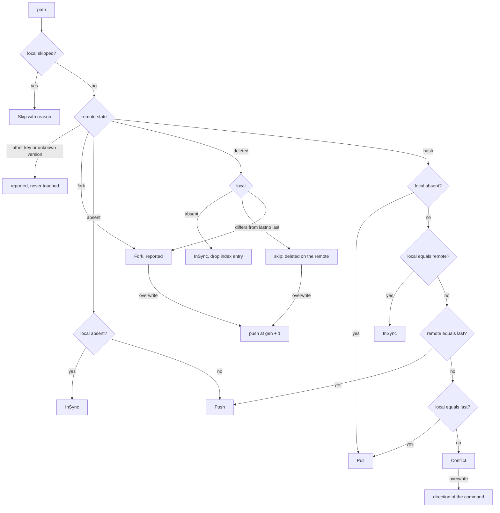
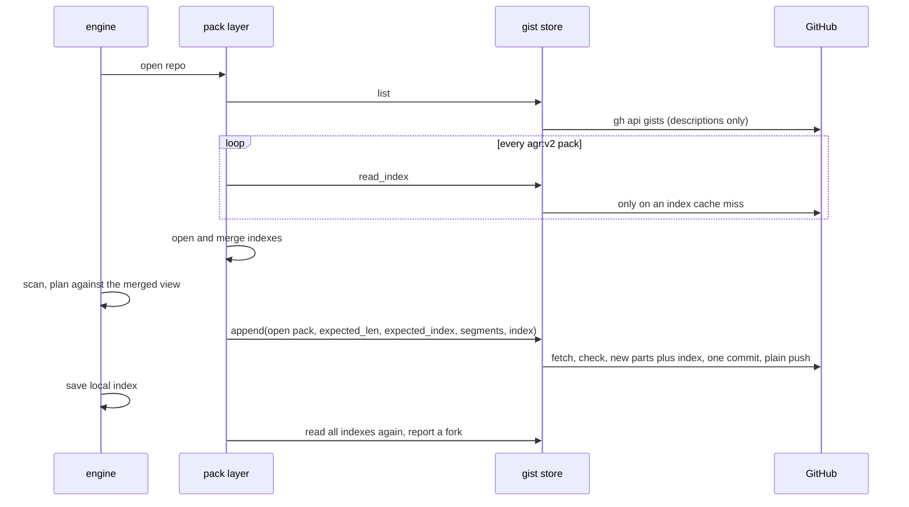
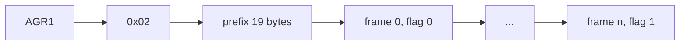
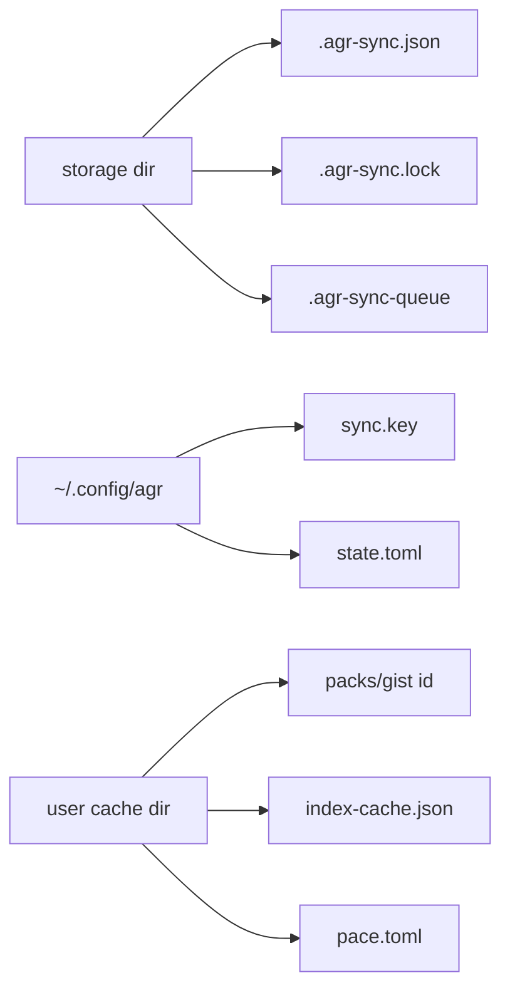
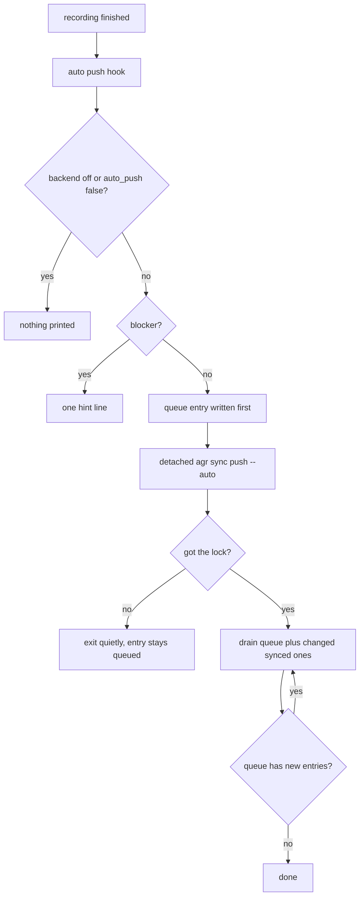

# Sync architecture

`agr sync` copies compressed sessions to a remote so another machine can pull them, and this page explains how the code does it, as a lookup for anyone changing it. The command reference is in [Command-sync.md](../wiki/Command-sync.md).

## 1. Purpose and scope

We encrypt every session on the machine before it leaves, and the remote only ever holds ciphertext, a random pack uuid and file sizes.

- **1.1 In scope:** `push`, `pull`, `status`, `delete` with patterns, `migrate` and `key export` or `import`. The only store is GitHub gists through `gh` and `git`, one secret gist per pack.
- **1.2 Not in scope:** auto pull, auto delete, a watch mode, other stores. Deleting a file locally never deletes it remotely and the other way round.
- **1.3 Compressed only:** sync moves `<agent>/<name>.cast.gz`, a plain `.cast` is skipped with a hint to run `agr compress`. Sessions over 1 GiB on disk are skipped.
- **1.4 Defaults:** `backend = "gist"`, `auto_push = false`, `pack_size_mib = 64`.

## 2. Layers

**Problem**: Rust has no visibility rule between sibling modules of one crate, as such our layering would only exist in our heads without a check.

**Approach:** `src/sync/` is split into five private layers below a small facade, and the test `layer_rules_hold` reads the source text and fails when a layer names something it must not.

- **2.1 crypto:** key, one-shot seal, recovery phrase and the streamed blob v2 with our own STREAM layer. It depends on nothing else in sync.
- **2.2 store:** the `PackStore` trait (`list`, `read_index`, `create`, `append`, `read`, `delete`) and its gist, directory and memory implementations. A store only sees a pack id, a tag, a byte stream and an index text, never a session name, a gen or plaintext. Part files are a store detail.
- **2.3 pack:** everything that knows the remote format. It seals sessions into the pack stream, owns the pack index, the append and seal rules, the merge, and migrate. It is the only layer above the store that calls crypto for remote data.
- **2.4 engine:** scan, plan, the run loop, the local index, the lock and the queue. It never prints and it reaches crypto and the store only through `pack`.
- **2.5 app:** command facing glue, store choice and key resolution, auto push and the output lines.
- **2.6 facade:** `agr::sync` re-exports what commands and recording need, and a hidden `testing` module carries internals for the integration tests only.

Legend: an edge means "may import", the store never sees a session name, a gen or plaintext.

**2.7 What the check enforces:**

1. `engine/` does not name `crate::sync::crypto` or `crate::sync::store` at all.
2. `pack/` does not name `app`, `engine` or a concrete store.
3. `store/` does not name `crypto`, `engine`, `pack` or `app`.
4. `app/`, `engine/` and `pack/` do not name `chacha20poly1305`, `sha2::` or `aead::`, so a cipher change only touches `crypto/`.
5. The old per-session reader `store::legacy` only appears under `pack/migrate/` and inside `store/`.
6. The string `gist` only appears under `store/gist/`, `store/legacy/` and in the one match arm of `app/setup.rs` that maps the config value.
7. `Command::new` is only allowed where `gh` and `git` are spawned and where the detached auto push child starts.

Tests live in `tests/integration` and reach internals through the `sync::testing` facade. A unit test stays inline only for a private unit the facade cannot reach, with a one-line `// inline: <reason>` above it.

## 3. Pack format

**Problem**: one secret gist per session buried the gist page of the user in hundreds of entries and rewrote a whole gist for every change.

**Approach:** many sessions go into one pack, and one pack is one gist. Each machine owns one open pack and only appends to it until it reaches the target size, then seals it, and a sealed pack is never written again.

- **3.1 Pack stream:** the data parts joined in order are the pack stream, the concatenation of blob v2 segments. The segment AAD binds the pack uuid, the path and the gen, so a segment copied into another pack or replayed under another gen does not open.
- **3.2 Index:** one sealed text per pack, JSON `{ v: 3, pack, writer, sealed, len, entries }`, with one entry per session range: `path`, `gen`, `sha256`, `size`, `offset`, `length`, `deleted`, `at`. The AAD carries the pack uuid, so an index copied into another pack does not open.
- **3.3 Description:** `agr:v2 <pack uuid>` and nothing else. The uuid is random and carries no meaning, the writer and the sealed flag live in the encrypted index only.
- **3.4 Parts on gists:** every append starts a new `data.NNN` part, existing parts are never touched. Parts are cut at session boundaries and stay under 8 MiB, a bigger session gets parts of its own. A pack is sealed early at 250 files or when its index text would pass 768 KiB.
- **3.5 Pack size:** `[sync] pack_size_mib`, default 64, range 16 to 512. A pack is sealed by the append that brings it to the target, a session bigger than the target gets a pack of its own.

Legend: the index maps every session to one range of the stream, data parts and index land in the same commit.

**3.6 Why a crash leaves a consistent pack:** one git push moves the branch from the old commit to the new one in one step, as such a reader sees either the old index with the old parts or the new index with all new parts. Old bytes are never rewritten.

**3.7 Concurrency:** two machines never write the same pack, so there is no lost update on the store side. Both writes land and the merge reports a fork, nothing is overwritten. The one guard an append keeps is the expected pack length plus the expected index text, which only matters when a writer id was copied to a second machine. A mismatch is `Moved`, the pack layer re-reads and retries once.

## 4. Merge and plan

**4.1 Merge:** the indexes of all `agr:v2` packs are merged per path and the highest gen wins.

1. An index that does not authenticate makes its pack `OtherKey`, an unknown `v` makes it `UnknownVersion`, both are reported and never touched.
2. Several entries at the top gen with the same hash are one session with several places (after a prune or migrate copy), a reader tries the next place when one fails.
3. Several entries at the top gen with different hashes are a **fork**. Push and pull skip it and `push --overwrite` resolves it at gen + 1 from the local file.
4. A tombstone at the top gen is `Deleted`, not absent.
5. A view built from part of the packs is never used, when one index read fails the run stops before it plans.

**4.2 Plan:** a pure three-way compare of the local hash, the remote hash and the hash of the last sync from the local index. File mtime is never an input. `--overwrite` only turns a conflict, a fork or a deleted session into the direction of the command.

Legend: only Push and Pull act, everything else is reported, `last` is the hash recorded in the local index at the last sync.

**4.3 Rollback refusal:** the local index keeps the gen per path. A merged gen below it, for example after a pack gist was deleted outside agr, is refused and the local file stays untouched.

## 5. Push, pull, delete and migrate

- **5.1 Push:** the engine plans against the merged view and hands the sessions to the pack layer. They are sealed straight from the files into new parts behind the last one, with a new index, in one commit and one plain `git push`, never forced. The local index is saved only after the push returned. After the last append the run reads the indexes once more and reports a fork it created.
- **5.2 Cached clone:** the gist store keeps one clone of the own open pack in the user cache dir, deleted when the pack is sealed. Reads never need a clone, they use the `raw_url` of a part with a `Range` header, so pulling one small session costs at most one part.
- **5.3 Index cache:** every index read is kept in `index-cache.json` in the cache dir, keyed by gist id and the `updated_at` of the listing. Sealed packs never change, as such only open packs that moved and new ids cost a call.
- **5.4 Pull:** the session range is read and opened frame by frame into a hidden temp file, then hash and size have to equal the index entry. Only then an existing file is copied to its hidden `.bak` and the temp is renamed into place.
- **5.5 Delete:** `agr sync delete` matches the patterns against `<agent>/<name>` of the merged remote view, previews, asks, and appends tombstones (`deleted: true` at gen + 1) to the open pack, all matches in as few appends as the index cap allows. Tombstones are kept forever, so a machine with an old local index never pushes a deleted session back. The bytes of a deleted session are dead data, nothing frees it.
- **5.6 Migrate:** `agr sync migrate` moves the old per-session gists into packs with their gens kept, and deletes an old gist only after a fresh read of the indexes shows its session. Empty `agr:pending` stubs older than one hour are deleted directly. Gists of another key or with foreign files are listed and never touched. Every other sync command refuses with "run `agr sync migrate` first" while a gist of the old layout that opens with our key exists.

Legend: data parts and index land in one commit, the local index is saved after the push returned.

## 6. Encryption

**Problem**: sessions can hold secrets typed in a terminal and reach up to 1 GiB, as such the encryption has to authenticate everything and stay flat in memory.

- **6.1 Key:** 256 bits from the OS RNG, never printed, zeroized on drop. The key file is `~/.config/agr/sync.key` with mode 0600, on unix a file with a group or other bit set is refused.
- **6.2 First key:** push and status may create a key, but only when the remote lists no agr packs, otherwise a second key would split the remote into two unreadable halves.
- **6.3 Recovery phrase:** `agr1-` plus base32 of `key || sha256(key)[..2]` in groups of five. Import ignores case, spaces and dashes and checks prefix, length and checksum. `key import` refuses to replace a different key without `--force`.
- **6.4 Blob v2:** `AGR1 || 0x02 || prefix[19] || frames`. The plaintext is cut into 64 KiB frames, every frame carries a 16 byte tag and the last frame carries a last flag. The nonce is `prefix || counter u32 BE || last flag`. A frame is written to the output only after it verified, truncation, reorder, duplication and appended frames are rejected.
- **6.5 Index seal:** the one-shot format `AGR1 || 0x01 || nonce[24] || ciphertext+tag` over the index JSON, base64url without padding.

Legend: the header is 24 bytes, every frame is ciphertext plus a 16 byte tag, only the final frame carries the last flag.

## 7. What a third party with the gist URL can see

**Problem**: a secret gist is readable by anyone with its URL, as such everything we put there has to be either ciphertext or harmless.

- **7.1 Visible:**
  - the description `agr:v2 <pack uuid>`, the uuid is random and has no meaning
  - how many pack gists we have
  - the file names (`index`, `data.NNN`) and every part size
  - the commit times in UTC and the number of commits
  - the size of the `index` file in every revision of the gist history, which roughly shows how many sessions each append added (about 200 bytes per entry)
  - an auto push part shows roughly the size of one recording and its commit time shows when it was pushed
- **7.2 Not visible:** session names, agents, which machine wrote a pack, how many sessions sit in a part, hashes, gens, the sealed flag and the content.
- **7.3 Commit identity:** author and committer are forced to `agr` with `agr@localhost` and UTC dates, through `-c user.*` and the `GIT_AUTHOR_*` and `GIT_COMMITTER_*` env vars, and the user's global git hooks are pointed at an empty path.
- **7.4 History stays:** a gist keeps its git history, as such old index versions and every part stay readable as ciphertext to anyone with the link. If the key is compromised, deleting the gists does not protect ciphertext that someone already copied with the compromised key. The remedy is to pull every session locally, drop local files of earlier deleted sessions (the tombstones go with the gists), delete the old gists, move `sync.key` and `.agr-sync.json` away on every machine (an old key is loaded by the next push, an old index with higher gens makes the rebuilt remote a rollback), and push so a new key is created and the sessions are encrypted anew. Copies made earlier stay readable with the old key.

## 8. Local state

**Problem**: the engine needs to remember what it synced last without trusting file times, and two runs on one machine must not interleave.

Legend: index, lock and queue sit next to the sessions and are never synced or listed as sessions, key and state are machine local, the cache dir can be deleted at any time.

- **8.1 Index `.agr-sync.json`:** `version` 2, keyed by `agent/name.cast.gz` with the plaintext hash and gen of the last sync, the on-disk size and mtime stamp (only a cheap "might have changed" check for auto push), and the `open_pack` id and length. Saved atomically, missing means empty. A v1 index is converted by `agr sync migrate`.
- **8.2 Lock `.agr-sync.lock`:** push, pull, delete and migrate take it, dry runs and status do not. A lock whose pid is dead is reclaimed, a live one gives `Busy`.
- **8.3 Queue `.agr-sync-queue/`:** one empty file per session waiting for an auto push.
- **8.4 `state.toml`:** `sync_privacy_ack`, the writer id of this machine and the last auto push error.

## 9. Auto push

**Problem**: a finished recording should reach the remote without the user waiting on the network, but nobody should be forced to upload.

- **9.1 Hook:** after a recording is finalised the hook runs the cheap local checks, writes the queue entry and spawns a detached `agr sync push --auto <session>`. It never fails the recording.
- **9.2 Silent:** `backend = "off"` or `auto_push = false` prints nothing.
- **9.3 Blockers**, checked in this order, each gives one hint line: the privacy notice was never confirmed with a manual push, no key, `gh` or `git` missing, the session is a plain `.cast`, the session still has a recording lock. A local index that is still v1 makes the child do nothing and keep its queue entry.
- **9.4 Child:** the child that gets the lock seals the whole queue plus the changed synced sessions into one append to the open pack, one commit and one push. Pushes into one gist are paced 10 s apart across processes. It never pulls, never deletes and never uses `--overwrite`.

Legend: the hook queues the session before it spawns, the lock holder drains the queue and the child that loses the race has nothing left to do.

## 10. Failure handling

- **10.1 Per session:** failures go into the report and the run continues, a rate limit ends the whole run with "N left, please run again later".
- **10.2 Pacing:** mutating calls are paced at least 1 s apart, pushes into one gist 10 s.
- **10.3 Stall:** a `gh` or `git` process that prints nothing for 120 s is killed. Processes get no stdin with `GIT_TERMINAL_PROMPT=0`, so a missing credential fails instead of hanging.
- **10.4 Missing tools:** a missing `gh` or `git` or a token without the `gist` scope stops before anything is changed, with a hint.
- **10.5 Listing limit:** GitHub lists at most 3000 gists, a sync with that many aborts instead of guessing which packs exist. Migrate does not abort there.

## 11. Testing

- **11.1 Memory and directory stores:** the pack layer and the engine run on `MemoryStore` and `DirStore`, including the multi machine interleavings, with failure injection per pack.
- **11.2 Fake runner:** the gist store is tested against a `Fake` that replays scripted `gh` and `git` output and records every call.
- **11.3 Live tests:** `cargo test --test pack_gist_live -- --ignored` creates and deletes real secret gists with the logged in `gh`. They are ignored by default and run by hand only.
- **11.4 Windows:** only compile-checked in CI.
